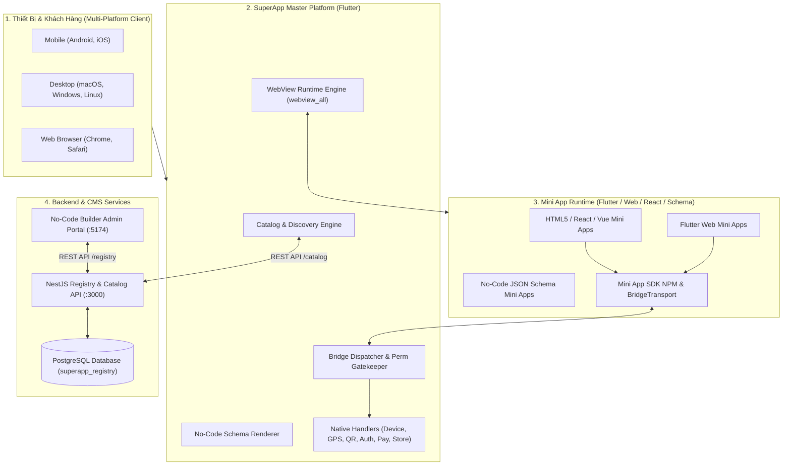

# SuperApp Platform

Hệ sinh thái nền tảng **SuperApp Multi-Platform** xây dựng trên **Flutter**, hỗ trợ nạp, khởi chạy và quản lý các **Mini Apps** (Web/HTML/React/TypeScript và Dynamic No-Code Schema) thông qua cơ chế **JavaScript Bridge 2 chiều**, kiểm soát quyền phân tầng (Capabilities Gatekeeper), xác thực SSO, cổng thanh toán và hệ thống máy chủ Registry tập trung.

---

## 📚 Bộ 3 Tài Liệu Chuyên Sâu (Core Subsystems Documentation)

Tài liệu dự án được phân tách thành 3 phần chuyên biệt phục vụ từng vai trò trong hệ thống:

```
┌─────────────────────────────────────────────────────────────────────────────┐
│                          SUPERAPP PLATFORM ECOSYSTEM                         │
├──────────────────────────────┬──────────────────────────────┬───────────────┤
│ 📱 1. FLUTTER SUPERAPP SHELL │ 🧰 2. DEVELOPER SDK & WEB    │ ⚙️ 3. BACKEND │
│    [ docs/superapp.md ]      │    [ docs/sdk.md ]           │ [docs/backend]│
│                              │                              │               │
│ • Bảng hỗ trợ đa nền tảng    │ • Tính năng SDK (Auth, Pay,  │ • NestJS 10   │
│   (Android, iOS, macOS,      │   Device, Storage, Nav)      │ • TypeORM     │
│   Linux, Windows, Web)       │ • Hướng dẫn & Code mẫu       │ • PostgreSQL  │
│ • Kiến trúc code Flutter     │ • Kiến trúc BridgeTransport  │ • Đặc tả APIs │
│ • Tính năng & Capsule Bar    │ • Cơ chế Auto-Fallback web   │ • Hướng dẫn   │
│ • Bridge Dispatcher & Quyền  │ • Đóng gói Single-file HTML  │   Deploy Full │
└──────────────────────────────┴──────────────────────────────┴───────────────┘
```

👉 **Bấm vào từng tài liệu chi tiết bên dưới:**

1. 📱 **[Tài liệu SuperApp Flutter Shell (docs/superapp.md)](docs/superapp.md)**:
   - **Bảng ma trận hỗ trợ nền tảng**: Chi tiết tính tương thích trên **Android, iOS, macOS, Windows, Linux, Web**.
   - **Kiến trúc mã nguồn**: Clean Architecture, Riverpod 2.x, GoRouter, Bridge Channel, Action Handlers.
   - **Tính năng nổi bật**: Thanh điều hướng WeChat-style Capsule Bar `[ ••• | ⊙ ]`, Watchdog phát hiện màn hình trắng, Kho lưu trữ bảo mật phần cứng cách ly (Keychain/Keystore).

2. 🧰 **[Tài liệu Mini App Developer SDK (docs/sdk.md)](docs/sdk.md)** (Tham khảo thêm [`mini_app_sdk/`](mini_app_sdk/README.md)):
   - **Danh mục tính năng SDK**: SSO Auth Code (60s TTL), Hồ sơ người dùng, Camera QR Scanner, GPS Geolocation, Thư viện ảnh, Tạo đơn & Checkout BottomSheet, Quản lý quyền, Lưu trữ mã hóa.
   - **Hướng dẫn sử dụng & Code mẫu**: Gọi hàm Async/Await, xử lý mã lỗi `BridgeError`, lắng nghe sự kiện vòng đời (`onReady`, `onShow`, `session.changed`).
   - **Kiến trúc SDK**: Cấu trúc `BridgeTransport`, đối tượng `window.SuperAppBridge`, tự động fallback dữ liệu thật khi chạy trên Trình duyệt web.
   - **Quy trình đóng gói**: Cấu hình Vite xuất bản Single-file inlined bundle (`index.html`).

3. ⚙️ **[Tài liệu Backend Registry & Hướng dẫn Deploy (docs/backend.md)](docs/backend.md)** (Xem nhanh [`backend/README.md`](backend/README.md)):
   - **Endpoint Production Live**: `https://superappplatfrom.alwaysdata.net/api/v1`
   - **Đặc tả hệ thống**: NestJS 10, TypeORM, PostgreSQL 17, Dynamic Registry & No-Code Schema.
   - **Đầy đủ thông số REST APIs**: Nhóm API `/auth`, `/catalog`, `/users/me/apps`, `/miniapp`, `/orders`, `/registry`.
   - **Hướng dẫn triển khai chi tiết (Deployment Guide)**:
     - Chạy phát triển cục bộ (Local Development).
     - Triển khai tự động Cloud Alwaysdata ([docs/alwaysdata-deployment.md](docs/alwaysdata-deployment.md)) với lệnh `npm run deploy:alwaysdata`.
     - CI/CD tự động qua GitHub Actions (`.github/workflows/deploy-backend-alwaysdata.yml`).

---

## 🏛️ Sơ đồ Kiến trúc Tổng thể Toàn Hệ sinh thái



---

## 📊 Bảng Tóm tắt Hỗ trợ Đa Nền tảng (Platform Support Summary)

| Nền tảng | WebView Runtime | Bridge Protocol | Phần cứng & Device APIs | No-Code Schema | Mức độ hỗ trợ |
| :--- | :---: | :---: | :---: | :---: | :---: |
| 🤖 **Android** (API 21+) | Android System WebView | ✅ 2 chiều | GPS, Camera QR, File, Keystore, Pin | ✅ Đầy đủ | **Sẵn sàng Sản xuất (Tier 1)** |
| 🍏 **iOS** (iOS 15.0+) | WebKit WKWebView | ✅ 2 chiều | GPS, Camera QR, File, Keychain, Pin | ✅ Đầy đủ | **Sẵn sàng Sản xuất (Tier 1)** |
| 💻 **macOS** (10.15+) | WKWebView Desktop | ✅ 2 chiều | File Picker, Keychain, Network, Logs | ✅ Đầy đủ | **Hỗ trợ Đầy đủ (Tier 1)** |
| 🪟 **Windows** (10/11) | Microsoft Edge WebView2 | ✅ 2 chiều | File Picker, DPAPI Storage, Network | ✅ Đầy đủ | **Hỗ trợ Đầy đủ (Tier 2)** |
| 🐧 **Linux** (Ubuntu/Debian) | WebKitGTK | ✅ 2 chiều | File Picker, libsecret, Network | ✅ Đầy đủ | **Hỗ trợ Đầy đủ (Tier 2)** |
| 🌐 **Web** (Chrome, Safari) | HTML5 Iframe Wrapper | ✅ 2 chiều | HTML5 GPS, Camera Detector, File | ✅ Đầy đủ | **Hỗ trợ Đầy đủ (Tier 1)** |

*(Xem phân tích chi tiết từng API tại [Tài liệu SuperApp Flutter Shell](docs/superapp.md#1-bảng-hỗ-trợ-nền-tảng-platform-support-matrix))*

---

## ⚡ Hướng dẫn Khởi chạy Nhanh (Quickstart in 3 Steps)

### Bước 1: Khởi động Backend & Cơ sở dữ liệu
Cần Node.js (18/20) và PostgreSQL đang chạy:
```bash
# Tạo cơ sở dữ liệu
createdb superapp_registry

# Chạy Backend NestJS
cd backend
npm install
npm run start:dev
```
*Backend sẽ lắng nghe tại `http://localhost:3000/api/v1` và tự động nạp dữ liệu mẫu ban đầu.*

### Bước 2: Tự động Biên dịch & Đẩy Mini Apps lên Backend
Tại thư mục gốc dự án:
```bash
# Tự động build SDK monorepo, build toàn bộ Mini Apps (sdk_playground, schema_runtime, sample_store) và đẩy lên Backend Storage
node scripts/build-and-deploy-miniapps.cjs
# Hoặc sử dụng npm:
npm run build
```
*(Bản dựng inlined được đóng gói theo chuẩn SuperApp v1 và triển khai trực tiếp lên Backend Storage/Registry API. Ứng dụng Flutter SuperApp nạp Mini App qua Backend HTTP URL, không còn lưu trữ trong local assets)*.

### Bước 3: Khởi chạy SuperApp Platform (Flutter)
```bash
# Cài đặt Flutter dependencies
flutter pub get

# Kiểm tra chất lượng code
flutter analyze

# Chạy ứng dụng trên nền tảng mong muốn:
flutter run -d macos     # Chạy trên macOS Desktop
flutter run -d chrome    # Chạy trên Web Browser
flutter run -d android   # Chạy trên Android Device / Emulator
flutter run -d ios       # Chạy trên iOS Device / Simulator
```

---

## 📂 Cấu trúc Thư mục Monorepo

```text
superapp_platform/
├── docs/                        # 📚 THƯ MỤC TÀI LIỆU TOÀN DIỆN
│   ├── superapp.md              # 1. Chi tiết SuperApp Flutter (Platform Matrix, Kiến trúc, Tính năng)
│   ├── sdk.md                   # 2. Chi tiết Mini App SDK (APIs, Code mẫu, Kiến trúc, Fallback)
│   ├── backend.md               # 3. Chi tiết Backend NestJS & Hướng dẫn Deploy Production
│   └── platform-guide.md        # Hướng dẫn quy trình quản trị Mini App
├── lib/                         # 📱 MÃ NGUỒN FLUTTER SUPERAPP MASTER SHELL
│   ├── app/                     # Bootstrap, App Routing (GoRouter)
│   ├── core/                    # Bridge Protocol Envelopes, Error codes, AppConfig, AppTheme
│   └── features/
│       ├── authentication/      # Quản lý phiên, cấp mã authCode, token
│       ├── debug_center/        # Màn hình Native Debug Center & RPC Inspector
│       ├── device/              # Adapter phần cứng thiết bị (GPS, Camera QR, File Picker)
│       ├── mini_app_bridge/     # BridgeChannel, BridgeDispatcher, BridgeEventEmitter
│       ├── mini_app_catalog/    # Hiển thị Catalog, tải Remote Registry, Cache offline
│       ├── mini_app_runtime/    # WebView container, WeChat Capsule Bar [ ••• | ⊙ ]
│       ├── native_actions/      # Action Dispatcher & các Action Handlers
│       ├── payment/             # Đơn hàng, BottomSheet Checkout đa phương thức
│       ├── permissions/         # Capabilities Gatekeeper, Dialog xin quyền
│       ├── storage/             # Isolated Secure Storage (Keychain / Keystore)
│       └── user_profile/        # Màn hình hồ sơ Native & đồng bộ dữ liệu
├── backend/                     # ⚙️ MÃ NGUỒN BACKEND REGISTRY & CATALOG (NestJS + TypeORM)
│   ├── src/                     # CatalogModule, RegistryModule, SeedModule
│   ├── Dockerfile               # File đóng gói container Docker cho Backend
│   ├── package.json
│   └── README.md                # Tóm tắt nhanh & hướng dẫn Backend
├── mini_apps/                   # 🧰 MÃ NGUỒN CÁC MINI APP WEB MẪU
│   ├── sdk_playground/          # Ứng dụng React 18 + TS + Vite kiểm thử toàn bộ tính năng SDK
│   ├── sample_store/            # Mini App bán hàng mẫu
│   └── schema_runtime/          # Runtime HTML5 thực thi No-Code Schema động
├── mini_app_sdk/                # 📦 OFFICIAL NPM PACKAGE CHO DEVELOPER ([@vqh2602/mini-app-sdk](https://www.npmjs.com/package/@vqh2602/mini-app-sdk))
│   ├── src/                     # Core SDK, Bridge Transport, Mock Engine, CLI
│   ├── bin/                     # CLI executables (miniapp, simulator)
│   ├── simulator/               # Mã nguồn Phone Simulator (React 18 + Vite)
│   ├── simulator-dist/          # Web Phone Simulator bundle tĩnh tích hợp sẵn
│   └── README.md                # Tài liệu chi tiết SDK & CLI All-in-One
├── assets/                      # 📦 CÁC ASSETS TĨNH FLUTTER (Hình ảnh, Icons)
│   └── images/                  # Ảnh minh họa và biểu tượng ứng dụng
├── builder/                     # 🛠️ NO-CODE SCHEMA BUILDER CMS (React + Vite :5174)
├── pubspec.yaml                 # Cấu hình dependencies & assets của Flutter
└── docker-compose.yml           # Khởi chạy toàn bộ hệ thống bằng Docker Compose
```

---

## 🤝 Đóng góp & Phát triển

Mọi đóng góp, báo cáo lỗi hoặc đề xuất cải tiến vui lòng mở Issue hoặc tạo Pull Request tuân thủ theo các quy chuẩn kiến trúc đã được đặc tả trong bộ tài liệu tại thư mục `docs/`.
