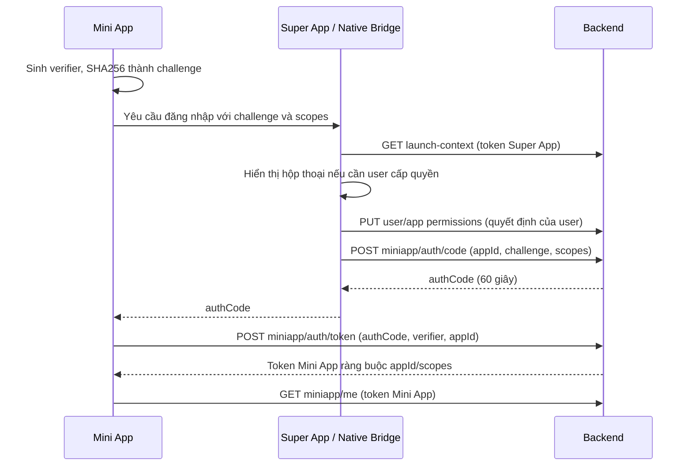

# User, token và quyền truy cập Mini App

Backend đã có tài khoản thật trong PostgreSQL, đăng ký/đăng nhập bằng email và password, token theo phiên, mã đăng nhập Mini App và quyết định cấp quyền theo từng user/app.

Ứng dụng **Flutter SuperApp đã kết nối hoàn chỉnh với các API Backend này**:
- Xác thực người dùng (đăng nhập, đăng ký, hồ sơ, refresh token, đăng xuất) qua HTTP API thật với endpoint tùy biến linh hoạt.
- Mini App Bridge tích hợp luồng xin Auth Code (`/miniapp/auth/code`) và đổi Token PKCE S256 (`/miniapp/auth/token`).
- Đồng bộ quyền và quyết định của người dùng với Backend User Permission API (`/users/me/apps/:appId/permissions`).
- Quản lý và lưu trữ đơn hàng thanh toán trên PostgreSQL qua Order API (`/orders`).

Base URL: `http://localhost:3000/api/v1`. Body JSON, trừ API upload gói. Các endpoint có xác thực nhận `Authorization: Bearer <accessToken>`; không nhận userId từ client để xác định chủ tài khoản.

## Dữ liệu lưu trữ

| Bảng | Nội dung |
| --- | --- |
| `users` | UUID, email duy nhất đã trim/lowercase, passwordHash, displayName, avatarUrl, createdAt/updatedAt |
| `auth_sessions` | userId, audience `superapp`/`miniapp`, appId, phiên Super App cha, scopes, hash token, thời hạn và revokedAt |
| `miniapp_auth_codes` | Hash auth code, userId/appId, phiên Super App phát hành, PKCE challenge, scopes, thời hạn, consumedAt |
| `user_miniapp_permissions` | Một dòng duy nhất cho `(userId, appId, capability)`, `granted: true/false`, thời gian tạo/cập nhật |

Password dùng scrypt với salt ngẫu nhiên riêng từng tài khoản (`N=32768, r=8, p=1`). Access token, refresh token và auth code là chuỗi ngẫu nhiên 256 bit; database chỉ lưu SHA256 của chúng. Password/hash/token không xuất hiện trong hồ sơ user. Token là opaque token, không phải JWT; backend kiểm tra trạng thái trong database nên vẫn dùng được sau khi restart và có thể thu hồi.

## Đăng ký và đăng nhập Super App

### POST /auth/register

```json
{
  "email": "alice@example.com",
  "password": "demo-password-123",
  "displayName": "Alice"
}
```

Email tối đa 254 ký tự. Password 8–128 ký tự và không tự trim. Tên được trim, không rỗng, tối đa 128 ký tự. Các trường như `role`, `userId` không được chấp nhận. Email trùng trả 409.

Trả 201 và tự đăng nhập:

```json
{
  "user": {
    "id": "user-uuid",
    "email": "alice@example.com",
    "displayName": "Alice",
    "avatarUrl": "",
    "createdAt": "2026-10-27T00:00:00.000Z"
  },
  "accessToken": "access_<random>",
  "refreshToken": "refresh_<random>",
  "tokenType": "Bearer",
  "expiresIn": 3599,
  "refreshExpiresIn": 2591999,
  "audience": "superapp",
  "appId": null,
  "scopes": []
}
```

### POST /auth/login

Nhận `email`, `password`, trả 200 với định dạng như đăng ký. Email không phân biệt hoa/thường. Sai email/password cùng trả 401 `Invalid email or password`.

### Các API phiên và hồ sơ

| Method | Path | Token/Body | Kết quả |
| --- | --- | --- | --- |
| GET | `/auth/me` | Access token Super App | Hồ sơ tài khoản hiện tại |
| PATCH | `/auth/me` | Access token Super App; `displayName` và/hoặc `avatarUrl` | Cập nhật hồ sơ; `avatarUrl: ""` để xóa ảnh |
| POST | `/auth/refresh` | `{ "refreshToken": "refresh_..." }`, không cần access token | Xoay cả access/refresh token trong cùng phiên |
| POST | `/auth/logout` | Access token của phiên muốn thoát | Thu hồi phiên hiện tại |
| POST | `/auth/logout-all` | Access token Super App | Thu hồi mọi phiên của user |

Access token Super App có TTL 1 giờ, Mini App 15 phút. Refresh token hết hạn tuyệt đối sau 30 ngày từ lúc tạo phiên, không gia hạn mỗi lần refresh; phiên Mini App không vượt quá hạn refresh của phiên Super App cha. `expiresIn` và `refreshExpiresIn` là số giây còn lại, có thể thấp hơn TTL do thời gian xử lý.

Refresh token được dùng một lần: sau refresh, cả access/refresh token cũ mất hiệu lực. Hai request refresh cùng token chạy đồng thời chỉ một request thành công. Refresh giữ nguyên audience/appId, không thể biến token Mini App thành token Super App.

Logout phiên Super App cũng làm code chưa đổi và mọi token Mini App sinh từ phiên đó mất hiệu lực. Logout một phiên Mini App chỉ thoát phiên Mini App đó. Logout-all không tác động user khác.

## Quyền theo user/app

Có ba lớp quyền riêng:

1. `permissions` trong `app.json`: app yêu cầu dùng quyền nào.
2. `capabilities` quản lý tại Registry: nền tảng cho app dùng quyền nào.
3. `user_miniapp_permissions`: user đồng ý/từ chối quyền nào của app.

**Quyền hiệu lực = manifest ∩ nền tảng ∩ user.** Với token Mini App, còn phải nằm trong `scopes` của token. App đang ẩn thì không có quyền hiệu lực. App mẫu cũ chưa có manifest gói dùng `capabilities` làm danh sách yêu cầu để tương thích dữ liệu demo.

Các API dưới đây chỉ nhận token Super App, vì miniapp không được tự bấm đồng ý thay user:

| Method | Path | Công dụng |
| --- | --- | --- |
| GET | `/users/me/apps` | Các app user từng có quyết định cấp/từ chối quyền |
| GET | `/users/me/apps/:appId/permissions` | Xem yêu cầu, quyền nền tảng, đồng ý của user và quyền hiệu lực |
| PUT | `/users/me/apps/:appId/permissions` | Cấp hoặc từ chối/thu hồi một nhóm quyền |
| DELETE | `/users/me/apps/:appId/permissions` | Thu hồi tất cả quyền của user cho app |

Body PUT:

```json
{
  "permissions": ["user.getBasicInfo", "navigation.close"],
  "granted": true
}
```

Đổi `granted` thành `false` để từ chối/thu hồi. Tối đa 50 quyền mỗi request; gửi quyền ngoài manifest/nền tảng khi cấp trả 400. Không cấp mới cho app đang ẩn; vẫn xem/thu hồi được quyền của app ẩn. Quyền không có quyết định mặc định là chưa cấp. Gửi lại cùng quyết định cập nhật bản ghi cũ, không tạo dòng trùng.

Response điển hình:

```json
{
  "appId": "auth_demo",
  "name": "Auth Demo",
  "icon": "/api/v1/miniapps/auth_demo/1.0.0/icon.png",
  "version": "1.0.0",
  "isAvailable": true,
  "requestedPermissions": ["user.getBasicInfo", "navigation.close"],
  "platformPermissions": ["user.getBasicInfo", "navigation.close"],
  "userPermissions": ["user.getBasicInfo"],
  "effectivePermissions": ["user.getBasicInfo"],
  "hasUserConsent": true,
  "isAuthorized": true,
  "decisions": [
    { "capability": "user.getBasicInfo", "granted": true, "updatedAt": "..." }
  ]
}
```

`GET /users/me/apps` trả cả app đã thu hồi/từ chối để Super App hiển thị lịch sử quyết định; dùng `isAuthorized` hoặc `effectivePermissions` để lọc app đang có quyền hiệu lực. `userPermissions` là quyết định đã lưu, không có nghĩa quyền vẫn được nền tảng cho phép. Các quyết định được giữ sau restart và qua các phiên đăng nhập.

## Đăng nhập Mini App

Mini App không nhận access/refresh token Super App. Luồng là: Mini App tạo PKCE verifier/challenge → native host nhận yêu cầu → Super App gọi API phát code bằng token của mình → trả code qua bridge → Mini App đổi code bằng verifier để lấy token riêng.



### GET /miniapp/apps/:appId/launch-context

Token Super App. Trả trạng thái quyền như trên và `openId`. Host vẫn tải entry/schema qua `GET /catalog/apps/:id`. App ẩn trả 403. Host dùng App ID từ manifest đang chạy, không lấy tùy ý từ payload do Mini App tự gửi.

### POST /miniapp/auth/code

Token Super App, body:

```json
{
  "appId": "auth_demo",
  "codeChallenge": "<base64url SHA256(codeVerifier), 43 ký tự>",
  "codeChallengeMethod": "S256",
  "scopes": ["user.getBasicInfo"]
}
```

`scopes` tùy chọn; mặc định là quyền hiệu lực hiện tại. Có thể `[]` để đăng nhập mà chưa đọc hồ sơ. Mọi scope được yêu cầu phải được cả nền tảng và user cho phép; tối đa 50 scope. Trả 201:

```json
{
  "authCode": "code_<random>",
  "appId": "auth_demo",
  "expiresIn": 60,
  "scopes": ["user.getBasicInfo"]
}
```

PKCE S256 thực hiện theo [RFC 7636](https://www.rfc-editor.org/rfc/rfc7636.html): verifier 43–128 ký tự trong tập chữ/số/`-._~`, giữ trong Mini App; chỉ challenge đi qua native host khi xin code.

### POST /miniapp/auth/token

Không cần Bearer token, body:

```json
{
  "appId": "auth_demo",
  "authCode": "code_<random>",
  "codeVerifier": "<verifier gốc>"
}
```

Trả 200 với access/refresh token, `audience: "miniapp"`, `appId`, `scopes`, `openId`, TTL. Code khớp user/app, PKCE, chưa hết hạn, chưa dùng, phiên Super App vẫn hoạt động và quyền vẫn được cho phép. Code dùng một lần, được khóa và tiêu thụ trong cùng transaction với tạo phiên Mini App. Hai request đổi cùng code chỉ một request thành công.

### GET /miniapp/permissions

Token Mini App. Trả `appId`, `requestedPermissions` và `effectivePermissions` đã giới hạn bởi scope token. Không cho dùng token app A để chọn app B.

### GET /miniapp/me

Token Mini App. Cần scope `user.getBasicInfo` hoặc `user.getProfile` còn hiệu lực:

```json
{
  "appId": "auth_demo",
  "openId": "open_<stable app-specific hash>",
  "name": "Alice",
  "avatarUrl": "https://example.com/avatar.png"
}
```

Chỉ thêm `email` khi token có `user.getProfile` và quyền này vẫn hiệu lực. Không trả UUID user nội bộ hay token Super App. `openId` ổn định theo cặp user/app và khác nhau giữa các app.

Quyền được kiểm tra lại ở mỗi request profile/permissions và mỗi lần refresh. Cấp thêm quyền cho user không tự mở rộng scope token cũ: xin code/token mới để có scope mới. Thu hồi quyền có hiệu lực ngay với API backend; phiên Flutter mock đang chạy không tự nhận thay đổi.

## Nối vào bridge và SDK

Flutter SuperApp đã tích hợp trực tiếp các API Backend theo hợp đồng sau:

| Tính năng trong Client | API Backend được kết nối | Trạng thái tích hợp |
| --- | --- | --- |
| Super App login/register | `/auth/register`, `/auth/login`, `/auth/me`, `/auth/refresh` | ✅ Đã kết nối (`MockAuthRepository`) |
| `auth.requestCode` hoặc SDK `auth.login` | Mini App gửi challenge/scopes; native host gọi `/miniapp/auth/code` bằng token Super App | ✅ Đã kết nối (`AuthActionHandler`) |
| `auth.exchangeCode` | `/miniapp/auth/token` bằng code/verifier | ✅ Đã kết nối (`AuthActionHandler`) |
| `auth.refreshToken` | `/auth/refresh` bằng refresh token Mini App | ✅ Đã kết nối (`AuthActionHandler`) |
| `user.getBasicInfo` / `user.getProfile` | `/miniapp/me` bằng token Mini App với scope tương ứng | ✅ Đã kết nối (`MockUserRepository`) |
| `permission.request` | Host hỏi user; host lưu kết quả bằng PUT `/users/me/apps/:appId/permissions` | ✅ Đã kết nối (`MockPermissionRepository`) |
| `permission.getPermissions` | Host dùng GET user/app permissions; Mini App dùng GET `/miniapp/permissions` | ✅ Đã kết nối (`MockPermissionRepository`) |
| Host logout | `/auth/logout` hoặc `/auth/logout-all` | ✅ Đã kết nối (`MockAuthRepository`) |
| Mini App logout | `/auth/logout` bằng token Mini App | ✅ Đã kết nối (`AuthActionHandler`) |
| Quản lý đơn hàng (Payment) | `/orders`, `/orders/:orderId/status` | ✅ Đã kết nối (`MockOrderRepository`) |

API không thay thế native camera/GPS hay tự hiển thị dialog. Flutter vẫn chịu trách nhiệm hộp thoại consent và thực thi native action. Không đưa token Super App vào JavaScript WebView, URL, manifest hoặc localStorage của Mini App; token Mini App chỉ dùng gọi endpoint cho Mini App.

API không thay thế native camera/GPS hay tự hiển thị dialog. Flutter vẫn chịu trách nhiệm hộp thoại consent và thực thi native action. Không đưa token Super App vào JavaScript WebView, URL, manifest hoặc localStorage của Mini App; token Mini App chỉ dùng gọi endpoint cho Mini App.

## Lỗi và giới hạn

| Status | Ý nghĩa |
| --- | --- |
| 400 | Body sai hợp đồng, password ngắn, URL sai, scope/quyền không được nền tảng/manifest cho phép |
| 401 | Thiếu/sai/hết hạn/thu hồi token, sai mật khẩu, code sai/hết hạn/đã dùng, sai PKCE |
| 403 | Sai audience, thiếu scope/consent hoặc app đang ẩn |
| 404 | App không tồn tại |
| 409 | Email đã đăng ký |
| 429 | Quá nhiều request xác thực; xem `Retry-After` |

Limiter theo IP/endpoint cho một tiến trình: register/login 10 request/phút, refresh 60, xin code/đổi code 30. Limiter reset khi restart; phiên và consent vẫn nằm trong PostgreSQL. API user/token/profile trả `Cache-Control: no-store`.

Registry/Manager vẫn là công cụ quản lý demo như trước, chưa có đăng nhập admin/phân vai; tài khoản đăng ký mới không có vai trò quản trị. Các API user/consent/miniapp nêu trên được bảo vệ riêng bằng token. Không có API liệt kê toàn bộ user hoặc sửa quyền của user khác.

## Kiểm thử

Tại `backend`:

```sh
npm test -- --runInBand
npm run build
npm run test:auth:db
```

Smoke test dùng database PostgreSQL/thư mục tạm riêng và tự dọn. Kiểm tra đăng ký/đăng nhập, hash mật khẩu/token, PKCE, code một lần/hết hạn, refresh rotation và race, cách ly user/app, scope/profile, thu hồi quyền, phiên cha, persistence sau restart, logout và rate limit. Cấu hình PostgreSQL theo `DB_*` như backend; tài khoản chạy test cần quyền tạo database.
