# SuperApp Backend Registry & Catalog Service

Tài liệu kỹ thuật chi tiết về kiến trúc máy chủ Backend, thông số kỹ thuật REST APIs, mô hình cơ sở dữ liệu và **Hướng dẫn Triển khai (Deployment Guide)** từ môi trường Phát triển cục bộ tới Môi trường Sản xuất (Production).

---

## 📑 Mục lục
1. [Tổng quan công nghệ (Technology Stack)](#1-tổng-quan-công-nghệ-technology-stack)
2. [Kiến trúc hệ thống & Các mô-đun (Architecture)](#2-kiến-trúc-hệ-thống--các-mô-đun-architecture)
3. [Mô hình dữ liệu cơ sở dữ liệu (Database Schema)](#3-mô-hình-dữ-liệu-cơ-sở-dữ-liệu-database-schema)
4. [Đặc tả chi tiết REST API (API Specifications)](#4-đặc-tả-chi-tiết-rest-api-api-specifications)
5. [Quy trình Quản lý Phiên bản & Quyền (Lifecycle)](#5-quy-trình-quản-lý-phiên-bản--quyền-lifecycle)
6. [Hướng dẫn triển khai cục bộ (Local Development)](#6-hướng-dẫn-triển-khai-cục-bộ-local-development)
7. [Hướng dẫn triển khai Docker & Docker Compose](#7-hướng-dẫn-triển-khai-docker--docker-compose)
8. [Hướng dẫn triển khai Production (Nginx, SSL, PM2)](#8-hướng-dẫn-triển-khai-production-nginx-ssl-pm2)
9. [Sao lưu & Phục hồi cơ sở dữ liệu (Backup & Restore)](#9-sao-lưu--phục-hồi-cơ-sở-dữ-liệu-backup--restore)

---

## 1. Tổng quan công nghệ (Technology Stack)

Hệ thống Backend được xây dựng theo chuẩn kiến trúc doanh nghiệp:
- **Framework**: [NestJS 10.x](https://nestjs.com/) (Node.js runtime, TypeScript).
- **Database ORM**: TypeORM 0.3.x.
- **Cơ sở dữ liệu**: PostgreSQL 14+ (hỗ trợ lưu trữ JSONB tối ưu cho Schema No-Code).
- **Quản lý tiến trình (Production)**: PM2 hoặc Docker Container.
- **Web Server / Reverse Proxy**: Nginx (hỗ trợ SSL/TLS và HTTP/2).

---

## 2. Kiến trúc hệ thống & Các mô-đun (Architecture)

```mermaid
graph TD
    subgraph Clients["Tầng Khách Hàng (Consumers)"]
        FlutterApp["SuperApp Flutter Client (Catalog & Runtime)"]
        BuilderCMS["No-Code Builder CMS (Admin Portal :5174)"]
        CLI["Mini App Developer CLI"]
    end

    subgraph NestApp["NestJS Application (:3000)"]
        subgraph Controllers["API Controllers"]
            CatalogCtrl["CatalogController (/api/v1/catalog)"]
            RegistryCtrl["RegistryController (/api/v1/registry)"]
        end

        subgraph Services["Business Logic Services"]
            CatalogService["CatalogService"]
            RegistryService["RegistryService"]
            SeedService["SeedService (Tự nạp data mẫu)"]
        end

        subgraph DataLayer["TypeORM & Entities"]
            MiniAppEntity["MiniApp (Entity)"]
            VersionEntity["MiniAppVersion (Entity)"]
        end
    end

    subgraph PostgresDB["PostgreSQL Database (superapp_registry)"]
        AppTable["Bảng mini_apps"]
        VerTable["Bảng mini_app_versions (Lưu JSONB Schema)"]
    end

    FlutterApp --> CatalogCtrl
    BuilderCMS --> RegistryCtrl
    CLI --> RegistryCtrl

    CatalogCtrl --> CatalogService
    RegistryCtrl --> RegistryService

    CatalogService --> MiniAppEntity
    RegistryService --> MiniAppEntity
    RegistryService --> VersionEntity
    SeedService --> MiniAppEntity

    MiniAppEntity --> AppTable
    VersionEntity --> VerTable
```



### Các Mô-đun cốt lõi:
1. **`CatalogModule`**: Chuyên phục vụ ứng dụng SuperApp Flutter. Chỉ trả về danh sách các Mini App đang ở trạng thái hiển thị (`visible: true`), phân trang, tìm kiếm và lọc danh mục.
2. **`RegistryModule`**: Dành cho giao diện quản trị Admin Builder và Developer CLI. Quản lý việc tạo mới, cập nhật danh sách quyền (`capabilities`), upload bản nháp Schema JSON, quản lý phiên bản (`X.Y.Z`) và bật/tắt hiển thị.
3. **`SeedModule`**: Tự động kiểm tra và chèn các Mini App mẫu khi khởi động lần đầu (SDK Playground, Sample Store, Shopee Template Schema) nếu cơ sở dữ liệu trống.

---

## 3. Mô hình dữ liệu cơ sở dữ liệu (Database Schema)

Hệ thống sử dụng 2 thực thể chính:

### 3.1. Bảng `mini_apps`
Lưu trữ thông tin định danh và cấu hình hiện hành của Mini App:
- `id` (VARCHAR, PK): Mã duy nhất của Mini App (ví dụ: `sdk_playground`, `shopee_mart`).
- `name` (VARCHAR): Tên hiển thị của ứng dụng.
- `description` (TEXT): Mô tả ngắn gọn về ứng dụng.
- `icon` (VARCHAR): URL hoặc đường dẫn icon hiển thị.
- `category` (VARCHAR): Danh mục (ví dụ: `Utilities`, `Shopping`, `Finance`, `Games`).
- `runtimeType` (VARCHAR): Loại runtime (`web` hoặc `schema`).
- `entryUrl` (VARCHAR): Đường dẫn nạp ứng dụng (`assets/mini_apps/.../index.html` hoặc remote URL).
- `isAsset` (BOOLEAN): Đánh dấu ứng dụng nằm trong gói bundle offline của Flutter hay remote.
- `capabilities` (JSONB): Danh sách quyền được cấp phép (mảng string, ví dụ: `["device.getLocation", "payment.createOrder"]`).
- `activeVersion` (VARCHAR): Phiên bản đang chạy hiện hành (ví dụ: `1.0.0`).
- `visible` (BOOLEAN): Trạng thái hiển thị trong Catalog (True = Hiện, False = Ẩn).
- `draftSchema` (JSONB): Bản nháp No-Code Schema đang chỉnh sửa từ Builder.
- `createdAt` / `updatedAt` (TIMESTAMP).

### 3.2. Bảng `mini_app_versions`
Lịch sử phiên bản (Snapshots) bất biến (Immutable):
- `id` (UUID, PK): Khóa chính phiên bản.
- `appId` (VARCHAR, FK): Tham chiếu tới `mini_apps.id`.
- `version` (VARCHAR): Định dạng SemVer `X.Y.Z`.
- `schema` (JSONB): Cấu trúc No-Code Schema đầy đủ tại thời điểm phát hành.
- `entryUrl` (VARCHAR): URL ứng dụng tại phiên bản này.
- `notes` (TEXT): Ghi chú phát hành phiên bản.
- `createdAt` (TIMESTAMP).

---

## 4. Đặc tả chi tiết REST API (API Specifications)

Toàn bộ API được đặt dưới tiền tố `/api/v1`:

### 4.1. Nhóm API Catalog (Dành cho SuperApp Flutter)

| Method | Endpoint | Tham số (Query / Body) | Mô tả & Dữ liệu trả về |
| :--- | :--- | :--- | :--- |
| `GET` | `/catalog/apps` | `category`, `search`, `page=1`, `limit=20` | Lấy danh sách Mini App đang hiển thị. Trả về mảng Manifest kèm phân trang. |
| `GET` | `/catalog/apps/:id` | `id` (Path param) | Lấy chi tiết Manifest, quyền và Schema của Mini App. Nếu app bị ẩn, trả về mã lỗi `403 Forbidden`. |
| `GET` | `/catalog/categories` | Không | Lấy danh sách các danh mục có chứa ít nhất 1 Mini App đang hiển thị. |

### 4.2. Nhóm API Registry (Dành cho Admin & Builder)

| Method | Endpoint | Tham số / Request Body | Mô tả & Dữ liệu trả về |
| :--- | :--- | :--- | :--- |
| `GET` | `/registry/apps` | Không | Lấy toàn bộ danh sách Mini App (cả đang hiện và đang ẩn) cùng thông tin phiên bản. |
| `POST` | `/registry/apps` | `{ "id", "name", "runtimeType", "capabilities", ... }` | Tạo mới một Mini App vào kho đăng ký. Mặc định luôn ở trạng thái ẩn (`visible: false`). |
| `GET` | `/registry/apps/:id` | `id` (Path param) | Xem thông tin chi tiết, bản nháp Schema và toàn bộ lịch sử các phiên bản đã upload. |
| `PUT` | `/registry/apps/:id` | `{ "name", "description", "capabilities", ... }` | Cập nhật thông tin và cập nhật danh sách quyền hiện hành (không cần nâng version). |
| `POST` | `/registry/apps/:id/versions` | `{ "version": "1.0.1", "schema": {...}, "notes": "Fix" }` | Phát hành phiên bản mới. Tự động chuyển `activeVersion` sang bản này trong cùng Transaction. |
| `PATCH`| `/registry/apps/:id/visibility` | `{ "visible": true }` hoặc `false` | Bật hiển thị (đưa vào Catalog) hoặc tắt hiển thị (gỡ khỏi Catalog). |

---

## 5. Quy trình Quản lý Phiên bản & Quyền (Lifecycle)

Hệ thống áp dụng quy trình phát hành tinh gọn, trực tiếp:
1. **Đăng ký mới**: Tạo Mini App qua API hoặc giao diện Builder. Mini App mới mặc định ở trạng thái ẩn.
2. **Cập nhật Schema & Web URL**:
   - Đối với Schema: Có thể thiết kế trực quan trên No-Code Builder (`http://localhost:5174`), lưu nháp vào `draftSchema`.
   - Đối với Web App: Đăng ký URL tĩnh đã host.
3. **Phát hành phiên bản (Upload Version)**: Gửi request `POST .../versions` với mã phiên bản `X.Y.Z`. Backend lưu bản ghi snapshot và chuyển phiên bản hiện hành.
4. **Bật hiển thị**: Chuyển trạng thái `visible: true`. Ngay lập tức SuperApp client có thể kéo để làm mới danh mục và người dùng có thể mở ứng dụng.
5. **Cập nhật quyền độc lập**: Quản trị viên có thể thêm/bớt `capabilities` bất cứ lúc nào qua lệnh `PUT` mà không cần phát hành lại phiên bản mã nguồn mới.

---

## 6. Hướng dẫn triển khai cục bộ (Local Development)

### 6.1. Yêu cầu môi trường
- **Node.js**: Phiên bản 18.x hoặc 20.x LTS.
- **npm**: Phiên bản 9.x hoặc 10.x.
- **PostgreSQL**: Đang chạy trên cổng mặc định `5432`.

### 6.2. Các bước cài đặt

```bash
# 1. Tạo database trên PostgreSQL
createdb superapp_registry

# 2. Di chuyển vào thư mục backend
cd backend

# 3. Cài đặt các gói phụ thuộc
npm install

# 4. Thiết lập biến môi trường (Tùy chọn)
# Tạo file .env nếu thông tin cơ sở dữ liệu của bạn khác mặc định:
cat <<EOF > .env
PORT=3000
DB_HOST=localhost
DB_PORT=5432
DB_USERNAME=postgres
DB_PASSWORD=your_password
DB_DATABASE=superapp_registry
EOF

# 5. Khởi chạy ở chế độ phát triển (Tự động hot-reload)
npm run start:dev
```

Máy chủ sẽ lắng nghe tại `http://localhost:3000`. Khi khởi chạy thành công, SeedService sẽ tự động tạo bảng và nạp dữ liệu mẫu ban đầu.

### 6.3. Kiểm thử mã nguồn
```bash
# Chạy unit tests
npm test

# Chạy build kiểm tra lỗi biên dịch TypeScript
npm run build
```

---

## 7. Hướng dẫn triển khai Docker & Docker Compose

Cách nhanh nhất và chuẩn hóa nhất để triển khai Backend là sử dụng **Docker Compose** đóng gói sẵn cả PostgreSQL và API Service:

### 7.1. Cấu trúc tệp `Dockerfile`
Tạo tệp `backend/Dockerfile`:
```dockerfile
# Stage 1: Build source
FROM node:20-alpine AS builder
WORKDIR /app
COPY package*.json ./
RUN npm ci
COPY . .
RUN npm run build

# Stage 2: Production runner
FROM node:20-alpine AS runner
WORKDIR /app
COPY package*.json ./
RUN npm ci --only=production
COPY --from=builder /app/dist ./dist
ENV NODE_ENV=production
ENV PORT=3000
EXPOSE 3000
CMD ["node", "dist/main.js"]
```

### 7.2. Cấu trúc tệp `docker-compose.yml`
Tạo tệp `docker-compose.yml` tại thư mục gốc dự án:
```yaml
version: '3.8'

services:
  postgres:
    image: postgres:15-alpine
    container_name: superapp-postgres
    restart: always
    environment:
      POSTGRES_USER: superapp_user
      POSTGRES_PASSWORD: superapp_secure_password
      POSTGRES_DB: superapp_registry
    ports:
      - "5432:5432"
    volumes:
      - postgres_data:/var/lib/postgresql/data

  backend:
    build:
      context: ./backend
      dockerfile: Dockerfile
    container_name: superapp-backend
    restart: always
    depends_on:
      - postgres
    environment:
      PORT: 3000
      DB_HOST: postgres
      DB_PORT: 5432
      DB_USERNAME: superapp_user
      DB_PASSWORD: superapp_secure_password
      DB_DATABASE: superapp_registry
    ports:
      - "3000:3000"

volumes:
  postgres_data:
```

### 7.3. Khởi chạy với 1 câu lệnh:
```bash
docker compose up -d --build
```
Kiểm tra logs:
```bash
docker compose logs -f backend
```

---

## 8. Hướng dẫn triển khai Production (Nginx, SSL, PM2)

Khi triển khai trên máy chủ Linux (Ubuntu Server 22.04 / Debian):

### 8.1. Quản lý tiến trình bằng PM2
```bash
# Cài đặt PM2 toàn cục
npm install -g pm2

# Di chuyển vào backend và build
cd backend
npm ci
npm run build

# Khởi chạy ứng dụng dưới quyền PM2
pm2 start dist/main.js --name "superapp-registry" -i max

# Lưu cấu hình tự khởi động lại khi reboot server
pm2 save
pm2 startup
```

### 8.2. Cấu hình Nginx Reverse Proxy & SSL (HTTPS)
Tạo cấu hình Nginx `/etc/nginx/sites-available/superapp-api.conf`:
```nginx
server {
    server_name api.superapp.yourdomain.com;

    location / {
        proxy_pass http://127.0.0.1:3000;
        proxy_http_version 1.1;
        proxy_set_header Upgrade $http_upgrade;
        proxy_set_header Connection 'upgrade';
        proxy_set_header Host $host;
        proxy_set_header X-Real-IP $remote_addr;
        proxy_set_header X-Forwarded-For $proxy_add_x_forwarded_for;
        proxy_set_header X-Forwarded-Proto $scheme;
        proxy_cache_bypass $http_upgrade;
        proxy_read_timeout 60s;
    }

    # Giới hạn kích thước gói upload Schema (tối đa 10MB)
    client_max_body_size 10M;
}
```

Kích hoạt và cài chứng chỉ SSL miễn phí qua Certbot:
```bash
sudo ln -s /etc/nginx/sites-available/superapp-api.conf /etc/nginx/sites-enabled/
sudo nginx -t && sudo systemctl reload nginx
sudo certbot --nginx -d api.superapp.yourdomain.com
```

---

## 9. Sao lưu & Phục hồi cơ sở dữ liệu (Backup & Restore)

### 9.1. Lệnh tạo bản sao lưu (Backup)
```bash
pg_dump -U postgres -d superapp_registry -F c -b -v -f "superapp_registry_$(date +%Y%m%d_%H%M%S).backup"
```

### 9.2. Lệnh phục hồi dữ liệu (Restore)
```bash
pg_restore -U postgres -d superapp_registry -v "superapp_registry_20261027_000000.backup"
```
