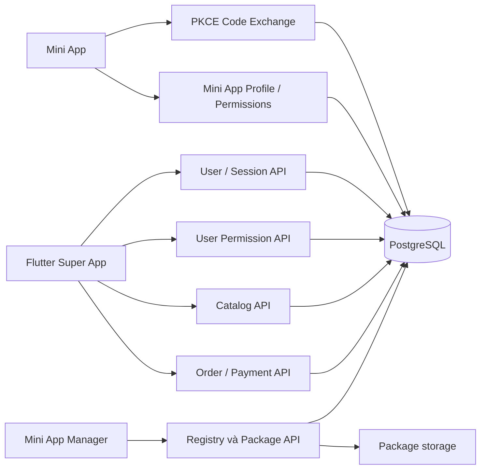

# Backend Super App

NestJS + TypeORM + PostgreSQL, phục vụ bốn phần: quản lý Mini App cho demo, catalog/runtime cho Flutter, user/token/consent cho Super App và Mini App, quản lý đơn hàng & thanh toán (Orders/Payment).

Đặc tả chi tiết:

- [User, đăng nhập, token, quyền theo app và luồng bridge](authentication.md)
- [Chuẩn gói Mini App ZIP v1](miniapp-package.md)
- [Chạy Manager và kịch bản demo](platform-guide.md)

## Cấu trúc

```text
backend/src/
├── entities/
│   ├── mini-app.entity.ts
│   ├── mini-app-version.entity.ts
│   ├── user.entity.ts
│   ├── auth-session.entity.ts
│   ├── miniapp-auth-code.entity.ts
│   ├── user-miniapp-permission.entity.ts
│   └── order.entity.ts
└── modules/
    ├── auth/       # Tài khoản, phiên, PKCE code, consent, hồ sơ miniapp
    ├── registry/   # Metadata, ZIP, phiên bản, ẩn/hiện, file runtime
    ├── catalog/    # Manifest/schema của các app đang hiện
    ├── order/      # Quản lý đơn hàng thanh toán từ Mini App
    └── seed/       # Dữ liệu miniapp mẫu, không tạo user/mật khẩu mẫu
```



## Bảng dữ liệu

| Bảng | Công dụng |
| --- | --- |
| `mini_apps` | App ID, tên/icon/mô tả/liên hệ, runtime, requestedPermissions, capabilities được nền tảng cho phép, status, activePublishedVersion |
| `mini_app_versions` | Snapshot manifest/schema, entry, packageKey, checksum, packageSize, version, ghi chú |
| `users` | Tài khoản với email duy nhất, passwordHash scrypt, tên/ảnh hồ sơ |
| `auth_sessions` | Phiên Super App/Mini App, appId/scopes/phiên cha, SHA256 token, hạn và thu hồi |
| `miniapp_auth_codes` | SHA256 code một lần, user/app/phiên nguồn, PKCE S256, scopes, hạn 60 giây |
| `user_miniapp_permissions` | Quyết định cấp/từ chối từng capability theo user/app, unique `(userId, appId, capability)` |
| `orders` | Đơn hàng thanh toán Mini App: id (UUID), userId, appId, amount, currency, description, status (`pending`, `success`, `failed`, `cancelled`), paymentMethod, createdAt, completedAt |

Bảng `review_audits` và một số cột/trạng thái lịch sử được giữ để tương thích dữ liệu cũ; luồng demo không có gửi duyệt/duyệt/rollback.

`capabilities` tại Registry là quyền nền tảng cho miniapp. Consent của user là dữ liệu riêng, không ghi đè lên capabilities. API Mini App chỉ cho dùng quyền nằm trong manifest, được nền tảng cho phép, user đồng ý và thuộc scope token. Catalog là dữ liệu công khai của app, không phải quyết định consent của user.

## API

Base URL `http://localhost:3000/api/v1`. JSON body được whitelist và từ chối field lạ. API upload gói dùng multipart.

### Tài khoản và token

| Method | Path | Xác thực | Công dụng |
| --- | --- | --- | --- |
| POST | `/auth/register` | Public | Email/password/displayName → tài khoản và token Super App |
| POST | `/auth/login` | Public | Email/password → token Super App |
| POST | `/auth/refresh` | Refresh token trong body | Xoay access/refresh token, giữ audience/appId |
| GET | `/auth/me` | Token Super App | Hồ sơ hiện tại |
| PATCH | `/auth/me` | Token Super App | Sửa displayName/avatarUrl |
| POST | `/auth/logout` | Access token | Thu hồi phiên hiện tại |
| POST | `/auth/logout-all` | Token Super App | Thu hồi mọi phiên của user |

### Consent theo user

| Method | Path | Xác thực | Công dụng |
| --- | --- | --- | --- |
| GET | `/users/me/apps` | Token Super App | App user từng cấp/từ chối quyền và trạng thái hiệu lực |
| GET | `/users/me/apps/:appId/permissions` | Token Super App | Chi tiết các lớp quyền |
| PUT | `/users/me/apps/:appId/permissions` | Token Super App | `{ permissions: [...], granted: true/false }` |
| DELETE | `/users/me/apps/:appId/permissions` | Token Super App | Thu hồi toàn bộ quyền cho app |

### Giao tiếp Super App ↔ Mini App

| Method | Path | Xác thực | Công dụng |
| --- | --- | --- | --- |
| GET | `/miniapp/apps/:appId/launch-context` | Token Super App | Trạng thái app/quyền và openId trước khi mở |
| POST | `/miniapp/auth/code` | Token Super App | Phát authCode một lần, ràng buộc app/scopes/PKCE |
| POST | `/miniapp/auth/token` | Code + PKCE verifier | Đổi code lấy token riêng của Mini App |
| GET | `/miniapp/me` | Token Mini App | Hồ sơ theo scope; email cần `user.getProfile` |
| GET | `/miniapp/permissions` | Token Mini App | Quyền hiệu lực giới hạn bởi scope token |

Token Super App không được chuyển vào WebView. Mini App token không thể đọc hồ sơ tài khoản Super App, sửa consent hay phát code cho app khác. Phiên Super App cha bị logout làm code/token Mini App của phiên đó mất hiệu lực. Xem [request/response và mapping bridge](authentication.md).

### Đơn hàng và Thanh toán (Orders)

| Method | Path | Xác thực | Công dụng |
| --- | --- | --- | --- |
| POST | `/orders` | Token Super App | Tạo đơn hàng mới từ Mini App (`appId`, `amount`, `currency`, `description`) |
| GET | `/orders/:orderId` | Token Super App | Lấy chi tiết thông tin đơn hàng theo ID |
| PATCH | `/orders/:orderId/status` | Token Super App | Cập nhật trạng thái đơn (`status: "success" \| "failed" \| "cancelled"`, `paymentMethod`) |
| GET | `/orders` | Token Super App | Danh sách lịch sử đơn hàng của user (hỗ trợ query filter `?appId=...`) |

Payload `POST /orders`:
```json
{
  "appId": "schema_runtime",
  "amount": 50000,
  "currency": "VND",
  "description": "Thanh toán đơn hàng demo"
}
```

Payload `PATCH /orders/:orderId/status`:
```json
{
  "status": "success",
  "paymentMethod": "MOMO"
}
```

### Quản lý và catalog

| Method | Path | Công dụng |
| --- | --- | --- |
| GET/POST | `/registry/apps` | Danh sách/tạo app |
| GET/PUT | `/registry/apps/:id` | Chi tiết/sửa metadata và capabilities |
| POST | `/registry/apps/:id/packages/inspect` | Kiểm tra ZIP, chưa ghi dữ liệu |
| POST | `/registry/apps/:id/versions` | Upload file ZIP với app.json, tùy chọn notes |
| PATCH | `/registry/apps/:id/visibility` | Bật/tắt qua `{ visible: true/false }` |
| GET | `/catalog/apps` | Các app đang hiện, hỗ trợ category/search/page/limit |
| GET | `/catalog/apps/:id` | Manifest/schema phiên bản đang dùng |
| GET | `/catalog/categories` | Danh mục đang hiện |
| GET | `/miniapps/:id/:version/*` | File chạy của phiên bản đang hiện; icon vẫn tải được cho Manager khi app ẩn |

Registry/Manager vẫn phục vụ demo không có tài khoản admin/phân vai. Ứng dụng Flutter SuperApp đã kết nối trực tiếp vào toàn bộ API Backend: Dynamic Catalog (không fallback asset), Quản lý User/Auth (đăng nhập, đăng ký tài khoản mới, refresh, logout), Consent / Quyền riêng tư theo người dùng, và Quản lý Đơn hàng / Lịch sử thanh toán.

## Chạy cục bộ

Cần Node.js/npm và PostgreSQL. Từ thư mục gốc:

```sh
createdb superapp_registry
cd backend
npm install
npm run build
npm run start:prod
```

Hoặc dùng `npm run start:dev` để chạy ts-node. Script này không tự watch; khởi động lại sau thay đổi mã nguồn. TypeORM `synchronize: true` tự tạo/cập nhật bảng trong môi trường demo. Không có user hoặc mật khẩu mặc định, gọi `/auth/register` để tạo tài khoản.

Biến môi trường:

| Biến | Mặc định |
| --- | --- |
| `PORT` | `3000` |
| `DB_HOST` | `localhost` |
| `DB_PORT` | `5432` |
| `DB_USERNAME` | User hệ điều hành |
| `DB_PASSWORD` | Rỗng |
| `DB_DATABASE` | `superapp_registry` |
| `MINIAPP_STORAGE_DIR` | `storage/miniapps` theo thư mục chạy backend |

Ứng dụng đọc biến môi trường của tiến trình; không tự load `.env`. Ví dụ cấu hình bằng `export DB_USERNAME=...` trước khi chạy. Token opaque được kiểm tra qua DB, không cần JWT secret. Access TTL Super App 1 giờ/Mini App 15 phút, refresh tối đa 30 ngày, auth code 60 giây.

Terminal khác:

```sh
cd builder
npm install
npm run dev
```

Manager chạy ở http://localhost:5174, chỉ có quản lý Mini App. Xem cấu trúc gói và script `package:miniapp` ở [tài liệu gói](miniapp-package.md).

## Kiểm tra

```sh
cd backend
npm test -- --runInBand
npm run build
npm run test:packages:db
npm run test:auth:db
```

Hai smoke test PostgreSQL tự tạo database/thư mục tạm riêng rồi dọn; cần quyền tạo database. `test:auth:db` kiểm tra HTTP, persistence qua restart và race khi dùng code/refresh token đồng thời. Không sử dụng tài khoản/dữ liệu thật.

Khi sao lưu hoặc chuyển máy, giữ cả PostgreSQL và thư mục package storage. Không lưu mật khẩu hoặc token plaintext trong log/tài liệu/gói ZIP.
