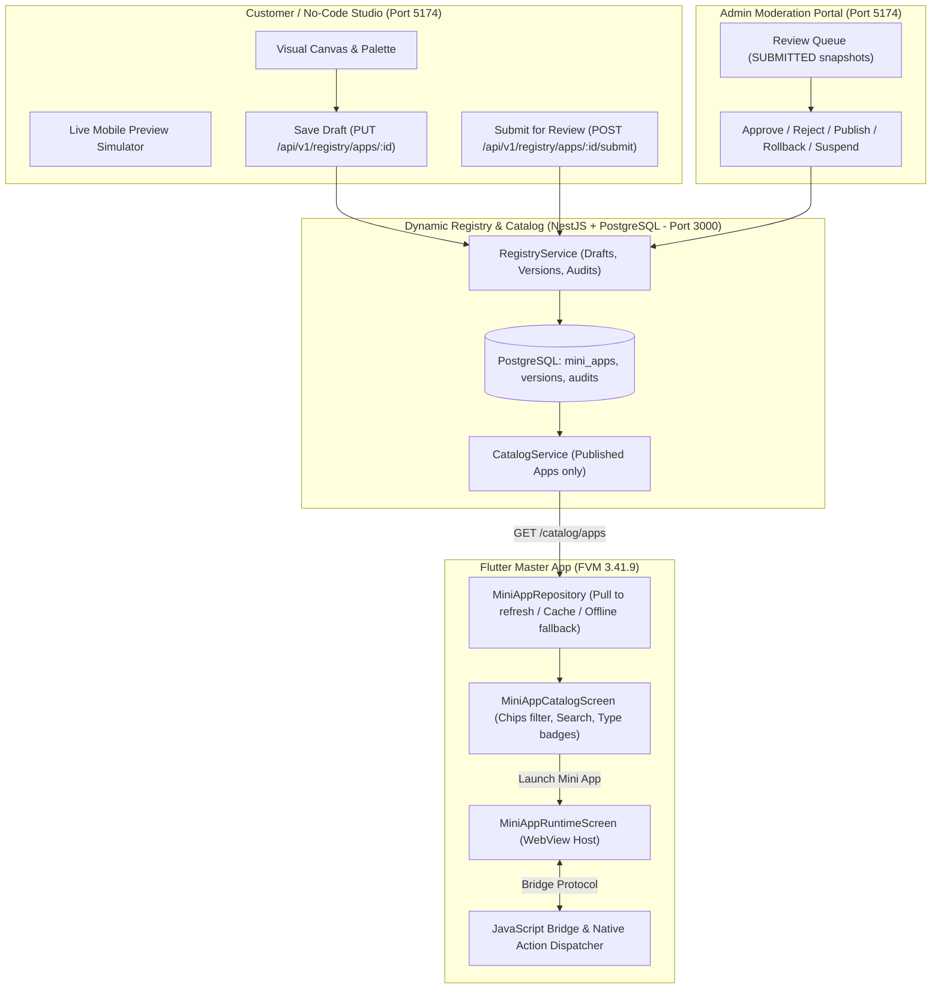
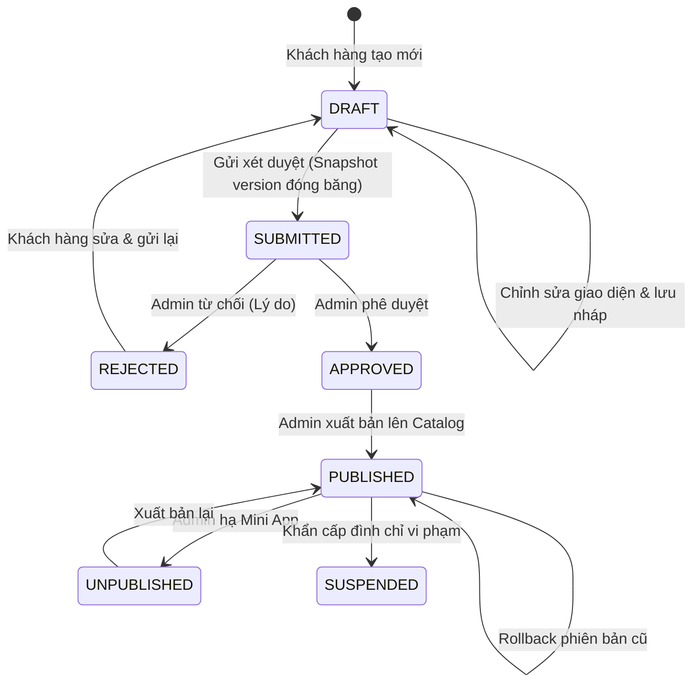

# Super App Mini App Dynamic Publishing Platform — Architecture & Guide

Tài liệu hướng dẫn vận hành kiến trúc Super App Platform mở rộng theo mô hình Zalo Mini App: tích hợp No-Code Studio, Dynamic Registry Backend, Admin Moderation Portal, và Flutter Dynamic Runtime.

---

## 1. Tổng Quan Kiến Trúc (Strangler Architecture)

Hệ thống được thiết kế theo phương pháp **Strangler Pattern** nhằm bảo toàn 100% mã nguồn và các tính năng demo hiện có (`SDK Playground`, `Mock Auth`, `Mock Payment`, `Mock Device`), đồng thời bổ sung khả năng xuất bản động Mini App dạng Schema mà không cần rebuild Flutter Master App.

---

## 2. Phân Loại Mini App (Dual Runtime)

Hệ thống hỗ trợ song song 2 loại Mini App:

| Tiêu chí | Loại A: Existing Web Mini Apps | Loại B: No-Code Schema Mini Apps |
| :--- | :--- | :--- |
| **Đại diện** | `sdk_playground`, `sample_store` | `coffee_shop` (The Coffee House) |
| **Runtime Engine** | React 18 + TypeScript + Vite | Universal Schema Engine (`schema_runtime`) |
| **`runtimeType`** | `'web'` | `'schema'` |
| **Nạp tài nguyên** | `assets/mini_apps/.../index.html` hoặc Remote URL | `assets/mini_apps/schema_runtime/index.html` + dynamic injection |
| **Cơ chế tải schema** | Mã nguồn build tĩnh | `window.__MINIAPP_SCHEMA__` hoặc REST Catalog API |
| **Bridge Protocol** | `window.FlutterBridge` / `SuperAppBridge` | Tương thích 100% giao thức Bridge hiện có |

---

## 3. Quy Trình Vòng Đời Mini App (Lifecycle State Machine)

---

## 4. Danh Sách Dịch Vụ & Cổng Kết Nối

| Thành phần | Đường dẫn thư mục | Cổng | Công nghệ | Lệnh khởi chạy |
| :--- | :--- | :--- | :--- | :--- |
| **Dynamic Backend** | `backend/` | `3000` | NestJS, TypeORM, PostgreSQL | `npm run start:prod` |
| **No-Code Studio & Admin** | `builder/` | `5174` | React 18, TypeScript, Vite, Tailwind | `npm run preview -- --port 5174` |
| **Schema Runtime** | `mini_apps/schema_runtime/` | Bundled | React, Vite, Bridge Channel | `npm run build` |
| **Flutter Master App** | Root `/` | Native | Flutter FVM 3.41.9, Riverpod | `fvm flutter run` |

---

## 5. Kết Quả Kiểm Thử Toàn Diện 9 Kịch Bản

1. **Kịch bản 1 (Tạo Mini App No-Code):** Khách hàng tạo ứng dụng `coffee_shop` (The Coffee House) kèm thực đơn sản phẩm, banner ảnh và các nút gọi Native Bridge. Trạng thái `DRAFT` được lưu vào PostgreSQL.
2. **Kịch bản 2 (Xem trước độc lập):** Bản nháp hiển thị sống động trên mobile viewport simulator của Studio. Gọi `GET /catalog/apps` xác nhận `coffee_shop` **chưa** xuất hiện trên Super App. Gọi trực tiếp `GET /catalog/apps/coffee_shop` bị chặn với HTTP `403 Forbidden`.
3. **Kịch bản 3 (Gửi xét duyệt):** Khách hàng gửi phiên bản `1.0.0`. Hệ thống tạo bản snapshot đóng băng `MiniAppVersionEntity` với `status: SUBMITTED`.
4. **Kịch bản 4 (Admin xét duyệt & xuất bản):** Admin xem snapshot trên Simulator, nhấn **Approve** và **Publish**. Bảng `mini_apps` cập nhật `status: PUBLISHED` và `activePublishedVersion: "1.0.0"`.
5. **Kịch bản 5 (Flutter Dynamic Discovery):** Kéo để làm mới màn hình Home trên Flutter -> Mini App `The Coffee House` xuất hiện ngay lập tức mà không cần sửa Dart code hay rebuild APK/IPA.
6. **Kịch bản 6 (Thực thi Native Action):** Mở `coffee_shop` trên Flutter runtime, nhấn mua combo 75.000đ -> Native Bridge gọi `payment.createOrder` / Native Checkout -> Giao dịch thành công, lưu đơn hàng vào `MockOrderRepository`.
7. **Kịch bản 7 (Cập nhật phiên bản v2):** Khách hàng sửa bản thảo thêm món *Bạc Xỉu Kem Trứng Vàng (55k)*, gửi xét duyệt `2.0.0`. Admin Approve & Publish -> Flutter Master App tự động cập nhật lên giao diện v2.
8. **Kịch bản 8 (Hạ Mini App - Unpublish):** Admin nhấn Unpublish -> Mini App lập tức biến mất khỏi Catalog. Truy cập trực tiếp bị chặn với HTTP `403 Forbidden`.
9. **Kịch bản 9 (Kiểm thử hồi quy):** Toàn bộ các flow cũ (A..H) của `sdk_playground` (Request Auth Code, User Profile, Location, Device QR, Mock Navigation, Close) tiếp tục chạy chính xác 100%.

---

## 6. Chỉ Số Chất Lượng Codebase

- **Flutter Analyze:** `No issues found!` (0 cảnh báo, 0 lỗi).
- **Flutter Unit & Widget Tests:** `32/32 tests passed` (bao gồm `catalog_test.dart`, `nocode_schema_e2e_test.dart`, `dispatcher_test.dart`, `payment_test.dart`, `bridge_protocol_test.dart`, `widget_test.dart`).
- **Backend Jest Tests:** `16/16 tests passed` (coverage cho cả `RegistryService` và `CatalogService`).
- **TypeScript Builds:** Cả `builder`, `schema_runtime` và `sdk_playground` đều biên dịch sạch `0 errors`.
