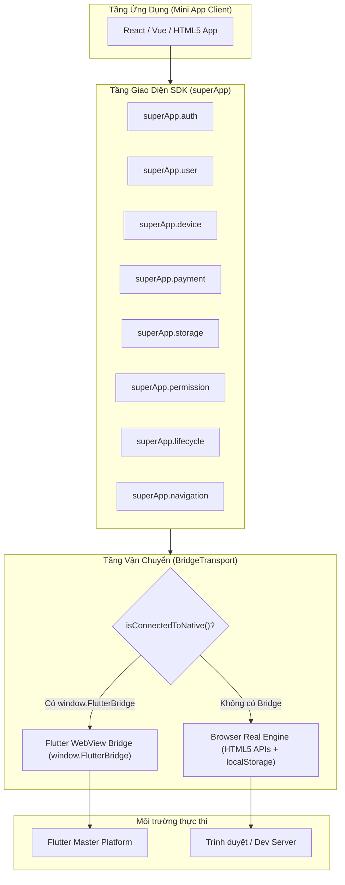

# SuperApp Mini App Developer SDK

Tài liệu hướng dẫn phát triển Mini App dành cho lập trình viên (3rd-Party Developers) sử dụng bộ công cụ **SuperApp JavaScript/TypeScript SDK**.

---

## 📑 Mục lục
1. [Giới thiệu tổng quan](#1-giới-thiệu-tổng-quan)
2. [Kiến trúc bộ SDK (SDK Architecture)](#2-kiến-trúc-bộ-sdk-sdk-architecture)
3. [Danh sách tính năng & APIs hỗ trợ](#3-danh-sách-tính-năng--apis-hỗ-trợ)
4. [Hướng dẫn cài đặt & Khởi tạo](#4-hướng-dẫn-cài-đặt--khởi-tạo)
5. [Ví dụ mã nguồn chi tiết (Code Examples)](#5-ví-dụ-mã-nguồn-chi-tiết-code-examples)
6. [Cơ chế Auto-Fallback khi chạy trên Trình duyệt](#6-cơ-chế-auto-fallback-khi-chạy-trên-trình-duyệt)
7. [Quy trình đóng gói & Xuất bản (Build & Bundle)](#7-quy-trình-đóng-gói--xuất-bản-build--bundle)

---

## 1. Giới thiệu tổng quan

**SuperApp SDK** là thư viện client gọn nhẹ, chuẩn hóa theo tiêu chuẩn Promise-based API, cho phép các ứng dụng Web (viết bằng React, Vue, Svelte, hoặc Vanilla JavaScript) chạy trong môi trường WebView của SuperApp và tương tác an toàn với các tính năng native của thiết bị:
- **Xác thực 1-chạm (Single Sign-On)** thông qua cơ chế Authorization Code 60s.
- **Truy cập phần cứng thiết bị**: Camera QR Scanner, GPS Geolocation, Thư viện ảnh, Thông tin pin, Trạng thái mạng.
- **Thanh toán & Đơn hàng**: Tạo đơn và mở BottomSheet Checkout thanh toán an toàn qua ví SuperApp.
- **Lưu trữ dữ liệu mã hóa**: Keychain / KeyStore theo từng Mini App độc lập.
- **Tự động chuyển đổi chế độ (Auto-Fallback)**: Tự động chạy với Web APIs thực khi kiểm thử trên Chrome / Safari hoặc Simulator.

---

## 2. Kiến trúc bộ SDK (SDK Architecture)

Bộ SDK được phân tầng rõ ràng từ giao diện lập trình tới lớp truyền tải gói tin:



### 2.1. Cấu trúc mô-đun trong SDK:
- **`BridgeTransport`**: Quản lý hàng đợi request, sinh ID tuần tự (`req_timestamp_seq`), quản lý bộ hẹn giờ timeout (mặc định 8000ms), dispatch response tới các Promise `resolve` / `reject`.
- **`window.SuperAppBridge`**: Đối tượng toàn cục làm cầu nối tiếp nhận dữ liệu phản hồi (`dispatchResponse`) và phát sự kiện (`dispatchEvent`) từ Flutter Native.
- **`Types`**: Hệ thống TypeScript type definition hoàn chỉnh cho từng request, response và data model.

---

## 3. Danh sách tính năng & APIs hỗ trợ

| Nhóm API | Hàm gọi (SDK Function) | Mô tả hành động |
| :--- | :--- | :--- |
| **Xác thực** | `superApp.auth.requestCode()` | Lấy mã authCode đăng nhập dùng 1 lần (Single-use, 60s TTL) |
| | `mockAuthBackend.exchangeCode(code)` | Đổi authCode lấy cặp Access Token & Refresh Token |
| | `mockAuthBackend.refreshToken(rt)` | Cấp mới Access Token khi token cũ hết hạn |
| | `superApp.auth.logout()` | Đăng xuất phiên làm việc của Mini App |
| **Người dùng** | `superApp.user.getProfile()` | Lấy đầy đủ hồ sơ (ID, Họ tên, Email, SĐT, Role, Avatar) |
| | `superApp.user.getBasicInfo()` | Lấy thông tin cơ bản công khai (ID, Tên hiển thị, Avatar) |
| **Thiết bị** | `superApp.device.getLocation()` | Lấy toạ độ GPS thực tế (kinh độ, vĩ độ, độ cao, địa chỉ) |
| | `superApp.device.scanQRCode()` | Mở Camera quét mã QR trực tiếp hoặc đọc từ ảnh |
| | `superApp.device.pickImage()` | Mở thư viện ảnh thiết bị và trả về Base64 Data URL |
| **Thanh toán** | `superApp.payment.createOrder(data)` | Khởi tạo đơn hàng mới với số tiền và mô tả |
| | `superApp.payment.openCheckout(orderId)` | Mở giao diện thanh toán native cho người dùng chọn ví / thẻ |
| **Lưu trữ** | `superApp.storage.setItem(key, value)` | Lưu trữ chuỗi mã hóa vào Keychain / Keystore |
| | `superApp.storage.getItem(key)` | Đọc dữ liệu bảo mật đã lưu |
| | `superApp.storage.removeItem(key)` | Xóa khóa lưu trữ |
| | `superApp.storage.clear()` | Xóa toàn bộ dữ liệu thuộc namespace của Mini App |
| **Phân quyền** | `superApp.permission.request(cap)` | Bật hộp thoại Native xin cấp quyền người dùng |
| | `superApp.permission.check(cap)` | Kiểm tra quyền hiện tại đã được cấp hay chưa |
| **Điều hướng** | `superApp.navigation.close()` | Yêu cầu SuperApp đóng Mini App và trở về Catalog |
| | `superApp.navigation.openMiniApp(appId)` | Chuyển đổi trực tiếp sang một Mini App khác |
| | `superApp.navigation.openNativePage(page)` | Mở màn hình Native đặc thù của SuperApp |
| **Vòng đời** | `superApp.lifecycle.onReady(cb)` | Lắng nghe khi Mini App nạp xong và sẵn sàng |
| | `superApp.lifecycle.onShow(cb)` | Lắng nghe khi Mini App xuất hiện trên màn hình |
| | `superApp.lifecycle.onHide(cb)` | Lắng nghe khi Mini App bị ẩn vào nền |

---

## 4. Hướng dẫn cài đặt & Khởi tạo

### 4.1. Cấu trúc thư mục Mini App (Ví dụ với React + Vite)
```text
my_mini_app/
├── src/
│   ├── sdk/                     # Nhúng mã nguồn SDK (hoặc import từ package)
│   │   ├── bridgeTransport.ts
│   │   ├── index.ts
│   │   └── types.ts
│   ├── App.tsx                  # Giao diện chính của Mini App
│   └── main.tsx
├── package.json
└── vite.config.ts
```

### 4.2. Khởi tạo và Import SDK
```typescript
import { superApp, mockAuthBackend } from './sdk';

// Kiểm tra xem Mini App đang chạy trong SuperApp hay trên Trình duyệt web
const isNative = superApp.isConnected();
console.log('Môi trường thực thi:', isNative ? 'SuperApp Native' : 'Web Browser');
```

---

## 5. Ví dụ mã nguồn chi tiết (Code Examples)

### 5.1. Luồng Đăng Nhập & Cấp Token (Authentication Flow)
```typescript
async function handleLogin() {
  try {
    // 1. Yêu cầu cấp mã xác thực từ SuperApp
    const { authCode } = await superApp.auth.requestCode();
    console.log('Nhận được authCode:', authCode);

    // 2. Gửi mã lên Backend máy chủ để đổi lấy Token
    const tokens = await mockAuthBackend.exchangeCode(authCode);
    console.log('Access Token:', tokens.accessToken);
    console.log('Refresh Token:', tokens.refreshToken);

    // Lưu token an toàn vào Storage của SuperApp
    await superApp.storage.setItem('user_token', tokens.accessToken);
  } catch (error) {
    console.error('Đăng nhập thất bại:', error);
  }
}
```

### 5.2. Lấy vị trí GPS thực tế (Location API)
```typescript
async function fetchCurrentLocation() {
  try {
    const loc = await superApp.device.getLocation();
    console.log(`Vị trí: ${loc.latitude}, ${loc.longitude}`);
    console.log(`Địa chỉ: ${loc.address || loc.city}`);
  } catch (err: any) {
    if (err.code === 'PERMISSION_DENIED') {
      alert('Vui lòng cấp quyền truy cập vị trí GPS.');
    }
  }
}
```

### 5.3. Quét mã QR & Chọn ảnh thiết bị (Device APIs)
```typescript
// Quét mã QR
async function scanQR() {
  try {
    const result = await superApp.device.scanQRCode();
    console.log('Nội dung mã QR:', result.content);
  } catch (err) {
    console.log('Người dùng đã huỷ quét');
  }
}

// Chọn ảnh từ thư viện
async function pickPhoto() {
  try {
    const photo = await superApp.device.pickImage();
    console.log('File ảnh:', photo.fileName, photo.sizeBytes, 'bytes');
    // photo.uri là Base64 Data URL, có thể gán trực tiếp vào thẻ 
    document.getElementById('my-avatar')?.setAttribute('src', photo.uri);
  } catch (err) {
    console.log('Chưa chọn ảnh');
  }
}
```

### 5.4. Tạo đơn và mở thanh toán (Payment Flow)
```typescript
async function processPayment() {
  try {
    // 1. Tạo đơn hàng
    const order = await superApp.payment.createOrder({
      amount: 150000,
      description: 'Combo 2 Trà sữa Mini App',
      currency: 'VND',
    });

    // 2. Bật BottomSheet Checkout native của SuperApp
    const result = await superApp.payment.openCheckout(order.orderId);

    if (result.status === 'SUCCESS') {
      alert(`Thanh toán thành công qua ${result.paymentMethod}!`);
    } else {
      alert('Giao dịch đã bị huỷ hoặc thất bại.');
    }
  } catch (err) {
    console.error('Lỗi thanh toán:', err);
  }
}
```

---

## 6. Cơ chế Auto-Fallback khi chạy trên Trình duyệt

Khi chạy Mini App độc lập bằng `npm run dev` trên Chrome/Safari hoặc trong các bài test, SDK tự động kích hoạt **Engine Giả Lập Dữ Liệu Thực**:

1. **Vị trí GPS**: Gọi trực tiếp `navigator.geolocation.getCurrentPosition` và phân giải địa chỉ thực tế qua OpenStreetMap Nominatim.
2. **Chọn ảnh**: Tự động mở hộp thoại file của hệ điều hành (`<input type="file" accept="image/*">`) và trích xuất Base64 kèm kích thước thật.
3. **Quét mã QR**: Bật camera máy tính/điện thoại qua `navigator.mediaDevices.getUserMedia` và giải mã bằng `window.BarcodeDetector` hoặc tải tệp ảnh QR.
4. **Hồ sơ & Đơn hàng**: Tự động lưu và cập nhật trạng thái trong `localStorage` (`superapp_user_profile`, `superapp_orders`).

---

## 7. Quy trình đóng gói & Xuất bản (Build & Bundle)

Để đảm bảo Mini App nạp tức thì trong WebView mà không bị lỗi mạng hoặc thiếu tệp css/js, chúng tôi khuyến nghị cấu hình Vite đóng gói toàn bộ ứng dụng thành **một tệp HTML duy nhất (Single-file inlined bundle)**:

### Cấu hình `vite.config.ts`:
```typescript
import { defineConfig } from 'vite';
import react from '@vitejs/plugin-react';
import { viteSingleFile } from 'vite-plugin-singlefile';

export default defineConfig({
  plugins: [react(), viteSingleFile()],
  build: {
    outDir: '../../assets/mini_apps/my_mini_app',
    emptyOutDir: true,
  },
});
```

### Lệnh đóng gói:
```bash
npm run build
```
Kết quả bản dựng sẽ được xuất trực tiếp vào thư mục `assets/mini_apps/my_mini_app/index.html` của Flutter SuperApp, sẵn sàng để xuất bản hoặc đăng ký lên Registry Backend.
