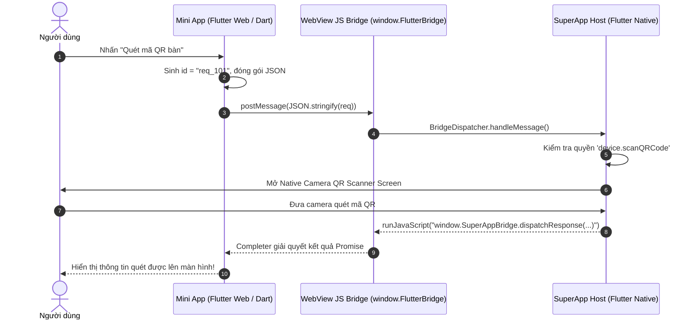

# SuperApp Mini App Developer SDK & Integration Guide

> **Phiên bản tài liệu**: 2.0.0  
> **Áp dụng cho**: Hệ sinh thái SuperApp Platform (Flutter Host, Dynamic Registry Backend, Mini App SDK Monorepo)  
> **Tài liệu liên quan**: [Chuẩn đóng gói gói phát hành Mini App v1](miniapp-package.md) · [Quy trình Xác thực & Consent Backend](authentication.md) · [Hướng dẫn nền tảng SuperApp](platform-guide.md)

---

## 📑 Mục lục
1. [Tổng quan về Hệ sinh thái SDK & Ma trận Công nghệ](#1-tổng-quan-về-hệ-sinh-thái-sdk--ma-trận-công-nghệ)
2. [Kiến trúc Tầng Vận chuyển & Giao thức Bridge (Bridge Protocol)](#2-kiến-trúc-tầng-vận-chuyển--giao-thức-bridge-bridge-protocol)
3. [Tích hợp Mini App với FLUTTER WEB (Chuyên sâu)](#3-tích-hợp-mini-app-với-flutter-web-chuyên-sâu)
   - 3.1. [Nguyên lý hoạt động của Flutter Web trong SuperApp](#31-nguyên-lý-hoạt-động-của-flutter-web-trong-superapp)
   - 3.2. [Cấu hình dự án & Build options (Base Href, CanvasKit vs HTML)](#32-cấu-hình-dự-án--build-options-base-href-canvaskit-vs-html)
   - 3.3. [Giao tiếp Dart ↔ SuperApp Native Bridge (Code Dart sẵn sàng sử dụng)](#33-giao-tiếp-dart--superapp-native-bridge-code-dart-sẵn-sàng-sử-dụng)
   - 3.4. [Ví dụ hoàn chỉnh màn hình Flutter Web Mini App](#34-ví-dụ-hoàn-chỉnh-màn-hình-flutter-web-mini-app)
4. [Tích hợp Mini App với Web SPA (React, Vue, Svelte, Vite)](#4-tích-hợp-mini-app-với-web-spa-react-vue-svelte-vite)
   - 4.1. [Cài đặt & Khởi tạo SDK](#41-cài-đặt--khởi-tạo-sdk)
   - 4.2. [Cấu hình `vite.config.ts` & Đóng gói](#42-cấu-hình-viteconfigts--đóng-gói)
   - 4.3. [Code mẫu TypeScript với React / Vue](#43-code-mẫu-typescript-với-react--vue)
5. [Tích hợp Mini App với Vanilla HTML5 / JavaScript](#5-tích-hợp-mini-app-với-vanilla-html5--javascript)
6. [Tích hợp Mini App No-Code (Schema-Driven)](#6-tích-hợp-mini-app-no-code-schema-driven)
7. [Bảng tra cứu đầy đủ Danh mục API & Phân quyền (Capabilities Matrix)](#7-bảng-tra-cứu-đầy-đủ-danh-mục-api--phân-quyền-capabilities-matrix)
8. [Bộ công cụ phát triển: CLI & Browser Simulator](#8-bộ-công-cụ-phát-triển-cli--browser-simulator)
9. [Chuẩn đóng gói ZIP v1 & Quy trình phát hành](#9-chuẩn-đóng-gói-zip-v1--quy-trình-phát-hành)
10. [Xử lý sự cố thường gặp (Troubleshooting & Best Practices)](#10-xử-lý-sự-cố-thường-gặp-troubleshooting--best-practices)

---

## 1. Tổng quan về Hệ sinh thái SDK & Ma trận Công nghệ

**SuperApp Mini App Platform** được thiết kế theo tư duy **Nền tảng Mở (Open Platform)**. Mini App thực chất là một đơn vị ứng dụng nhỏ gọn, độc lập được chạy trong môi trường **Sandboxed WebView Container** an toàn hoặc **Schema Runtime Engine** của ứng dụng SuperApp Flutter.

### 🌐 Ma trận các công nghệ được hỗ trợ:

| Công nghệ tích hợp | Định dạng gói | Khả năng tương thích | Điểm mạnh nổi bật | Trường hợp sử dụng tiêu biểu |
| :--- | :--- | :--- | :--- | :--- |
| **Flutter Web** | `runtimeType: "web"` (Biên dịch HTML/Wasm/JS) | 100% Native Bridge | Đồng nhất 100% trải nghiệm và Widget với SuperApp chủ; Tái sử dụng code Flutter có sẵn; Hiệu năng đồ họa mượt mà | Các đối tác đã có sẵn ứng dụng Flutter; Ứng dụng nghiệp vụ phức tạp, biểu đồ, game nhẹ |
| **React / Next.js (Static)** | `runtimeType: "web"` (Bundle Vite/Webpack) | 100% qua `@vqh2602/mini-app-sdk` | Hệ sinh thái React cực lớn; Thư viện UI dồi dào (AntD, Tailwind, MUI); Build nhanh với Vite | Ứng dụng Thương mại điện tử, Đặt bàn, Đặt vé, Mạng xã hội nhỏ |
| **Vue 3 / Nuxt (Static)** | `runtimeType: "web"` (Bundle Vite) | 100% qua `@vqh2602/mini-app-sdk` | Nhẹ, dễ học, tốc độ render cao, kích thước bundle tối ưu | Cửa hàng tiện ích, Tra cứu điểm thưởng, Mini game |
| **Vanilla HTML5 / JS** | `runtimeType: "web"` (Thuần HTML/CSS/JS) | 100% qua Bridge hoặc UMD | Không phụ thuộc công cụ build phức tạp; Dung lượng siêu nhẹ (< 50KB); Tải ngay lập tức | Trang tĩnh, Khảo sát ý kiến, Vòng quay may mắn, Tin tức |
| **No-Code / Low-Code Schema** | `runtimeType: "schema"` (`schema.json`) | Native Flutter Widget Engine | Không cần viết JavaScript/Dart; Khai báo thuần JSON; Bảo mật tối đa | Form thu thập dữ liệu, Trang giới thiệu sản phẩm đơn giản |
| **Svelte / Angular / Ionic** | `runtimeType: "web"` | 100% qua `@vqh2602/mini-app-sdk` | Tương thích chuẩn Web Component và SPA | Doanh nghiệp có sẵn codebase chuyên biệt |

---

## 2. Kiến trúc Tầng Vận chuyển & Giao thức Bridge (Bridge Protocol)

Mini App tương tác với thiết bị phần cứng và các dịch vụ của SuperApp (Thanh toán, Xác thực, Camera, GPS) thông qua **Giao thức Cầu nối 2 chiều (Bidirectional JavaScript Bridge)**.

```mermaid
flowchart TD
    subgraph ClientLayer["Lớp Mini App (Bên thứ ba phát triển)"]
        FlutterWebApp["Flutter Web (Dart JS Interop)"]
        ReactVueApp["React / Vue / Vite SPA"]
        VanillaApp["Vanilla HTML5 / JS"]
    end

    subgraph SDKTransport["Tầng Trừu Tượng Hóa (Transport Layer)"]
        Resolver{"TransportResolver\n(Tự nhận diện môi trường)"}
        NativeTransport["NativeBridgeTransport\n(window.FlutterBridge)"]
        IframeTransport["PostMessageTransport\n(window.parent.postMessage)"]
        MockTransport["MockBridgeTransport\n(Standalone / Unit Test)"]
    end

    subgraph RuntimeHost["Môi trường thực thi SuperApp"]
        NativeHost["Flutter Host Container (WebViewAll / InAppWebView)"]
        SimHost["SuperApp Browser Simulator DevTools"]
        LocalMockEngine["In-Memory Mock State Store"]
    end

    FlutterWebApp -->|JSON qua Bridge| NativeTransport
    ReactVueApp -->|@vqh2602/mini-app-sdk| Resolver
    VanillaApp -->|window.FlutterBridge| NativeTransport

    Resolver -->|Trong SuperApp| NativeTransport --> NativeHost
    Resolver -->|Trong Simulator| IframeTransport --> SimHost
    Resolver -->|Chạy độc lập localhost| MockTransport --> LocalMockEngine
```

### 2.1. Cấu trúc Giao thức gói tin (Bridge Envelopes)

Mọi thông điệp trao đổi giữa Mini App và SuperApp đều tuân theo hợp đồng JSON nghiêm ngặt:

#### 1. Yêu cầu gửi từ Mini App (Bridge Request):
```typescript
interface BridgeRequest {
  id: string;          // Khóa duy nhất đại diện cho request (vd: "req_1719500000_1")
  action: string;      // Tên hành động cần thực thi (vd: "device.scanQRCode", "device.getLocation")
  payload: Record<string, any>; // Dữ liệu tham số truyền vào
  appId: string;       // App ID được cấp phép
  origin?: string;     // URL nguồn gọi request
  timestamp: number;   // Unix timestamp (ms)
}
```

#### 2. Phản hồi từ SuperApp Host (Bridge Response):
SuperApp xử lý xong sẽ gửi trả kết quả vào hàm toàn cục `window.SuperAppBridge.dispatchResponse(response)`:
```typescript
interface BridgeResponse {
  id: string;               // Khớp với id của BridgeRequest gửi lên
  success: boolean;         // true: thành công, false: thất bại
  data?: any;               // Kết quả trả về khi success = true
  error?: {                 // Thông tin lỗi khi success = false
    code: string;           // Mã lỗi chuẩn hóa (vd: "PERMISSION_DENIED", "INSUFFICIENT_FUNDS")
    message: string;        // Thông điệp lỗi chi tiết cho lập trình viên
  };
  executionTimeMs: number;  // Thời gian xử lý tại native (ms)
}
```

#### 3. Sự kiện đẩy từ Native xuống Mini App (Bridge Event):
Dành cho các sự kiện bất đồng bộ như thay đổi trạng thái phiên đăng nhập, thay đổi kết nối mạng, vòng đời ứng dụng:
```typescript
interface BridgeEvent {
  event: string;     // Tên sự kiện (vd: "lifecycle.onShow", "auth.sessionChanged")
  payload: any;      // Dữ liệu sự kiện
  timestamp: string; // ISO 8601
}
```

---

## 3. Tích hợp Mini App với FLUTTER WEB (Chuyên sâu)

Phát triển Mini App bằng **Flutter Web** là giải pháp lý tưởng nhất cho các nhóm phát triển muốn tái sử dụng kỹ năng Flutter, chia sẻ mã nguồn giữa ứng dụng độc lập và Mini App, đồng thời đạt được độ mượt mà về mặt hoạt họa và giao diện chuẩn Material 3 / Cupertino.

### 3.1. Nguyên lý hoạt động của Flutter Web trong SuperApp

- Flutter Web biên dịch toàn bộ mã Dart thành **HTML5 Canvas / WebAssembly + JavaScript**.
- Mini App Flutter Web được đóng gói vào thư mục `dist/` kèm file manifest `app.json` (`runtimeType: "web"`).
- Khi người dùng mở Mini App trong SuperApp, WebView Container sẽ tải `dist/index.html`.
- Từ bên trong Flutter Web, code Dart sẽ giao tiếp với SuperApp Host qua đối tượng JavaScript toàn cục `window.FlutterBridge` thông qua thư viện `dart:js_interop` hiện đại của Dart 3.



---

### 3.2. Cấu hình dự án & Build options (Base Href, CanvasKit vs HTML)

Để Flutter Web chạy chính xác trong môi trường URL động của Mini App (ví dụ: `http://localhost:3000/miniapps/my_app/1.0.0/dist/` hoặc `file://`), bạn **bắt buộc** phải sử dụng cấu hình đường dẫn tương đối.

#### Bước 1: Điều chỉnh `web/index.html` của Flutter Web
Đảm bảo thẻ `<base href="...">` được đặt thành relative (`./`):
```html
<!DOCTYPE html>
<html>
<head>
  <!-- QUAN TRỌNG: Phải là href="./" thay vì href="/" -->
  <base href="./">

  <meta charset="UTF-8">
  <meta content="IE=Edge" http-equiv="X-UA-Compatible">
  <meta name="viewport" content="width=device-width, initial-scale=1.0, maximum-scale=1.0, user-scalable=no">
  <title>Flutter Web Mini App</title>
</head>
<body>
  <script src="flutter_bootstrap.js" async></script>
</body>
</html>
```

#### Bước 2: Lựa chọn Renderer khi build:
Khi chạy trong WebView của điện thoại di động, kích thước tệp tải về và tốc độ nạp khung hình đầu tiên là yếu tố sống còn:

1. **Khuyến nghị cho Mini App (Tối ưu tốc độ mở trang)**: Sử dụng **HTML renderer** hoặc **Wasm (Flutter 3.22+)**:
   ```bash
   # Build với HTML renderer: Dung lượng tải cực nhẹ (~1.8MB), nạp trang dưới 1 giây
   flutter build web --release --base-href="./" --web-renderer html
   ```
2. **Build với CanvasKit (Đồ họa chính xác tuyệt đối, nhưng nặng hơn ~4.5MB)**:
   ```bash
   flutter build web --release --base-href="./" --web-renderer canvaskit
   ```

---

### 3.3. Giao tiếp Dart ↔ SuperApp Native Bridge (Code Dart sẵn sàng sử dụng)

Dưới đây là thư viện cầu nối chuẩn **`superapp_bridge_client.dart`** được viết bằng **Dart 3 `dart:js_interop` & `package:web`**. Bạn chỉ cần sao chép tệp này vào dự án Flutter Web của mình:

```dart
// lib/core/superapp_bridge_client.dart
import 'dart:async';
import 'dart:convert';
import 'dart:js_interop';
import 'package:web/web.dart' as web;

/// Client cầu nối giúp Flutter Web tương tác trực tiếp với SuperApp Native Host.
class SuperAppBridgeClient {
  static final SuperAppBridgeClient _instance = SuperAppBridgeClient._internal();
  factory SuperAppBridgeClient() => _instance;
  SuperAppBridgeClient._internal();

  static int _sequence = 0;
  static final Map<String, Completer<dynamic>> _callbacks = {};
  static final Map<String, List<Function(dynamic)>> _eventListeners = {};
  static bool _initialized = false;

  String _appId = 'flutter_miniapp';

  /// Khởi tạo Bridge Client và đăng ký hook hứng response từ Native
  void init({required String appId}) {
    if (_initialized) return;
    _appId = appId;
    _initialized = true;

    // Thiết lập đối tượng window.SuperAppBridge toàn cục bằng JS Interop
    _setupGlobalDispatcher();
  }

  void _setupGlobalDispatcher() {
    final jsBridge = JSObject();

    // Hook nhận phản hồi từ Native: window.SuperAppBridge.dispatchResponse(res)
    jsBridge['dispatchResponse'] = ((JSAny responseRaw) {
      try {
        final dartJson = jsonDecode(jsonEncode(responseRaw.dartify())) as Map<String, dynamic>;
        final String id = dartJson['id'] ?? '';
        final bool success = dartJson['success'] ?? false;
        final dynamic data = dartJson['data'];
        final dynamic error = dartJson['error'];

        final completer = _callbacks.remove(id);
        if (completer != null) {
          if (success) {
            completer.complete(data);
          } else {
            completer.completeError(error ?? {'message': 'Thao tác không thành công'});
          }
        }
      } catch (e) {
        web.console.error('[FlutterWebBridge] Lỗi parse response: $e'.toJS);
      }
    }).toJS;

    // Hook nhận sự kiện từ Native: window.SuperAppBridge.dispatchEvent(evt)
    jsBridge['dispatchEvent'] = ((JSAny eventRaw) {
      try {
        final dartJson = jsonDecode(jsonEncode(eventRaw.dartify())) as Map<String, dynamic>;
        final String eventName = dartJson['event'] ?? '';
        final dynamic payload = dartJson['payload'];

        final listeners = _eventListeners[eventName];
        if (listeners != null) {
          for (final callback in listeners) {
            callback(payload);
          }
        }
      } catch (e) {
        web.console.error('[FlutterWebBridge] Lỗi parse event: $e'.toJS);
      }
    }).toJS;

    // Gán vào window
    (web.window as JSObject)['SuperAppBridge'] = jsBridge;
  }

  /// Kiểm tra xem ứng dụng có đang chạy bên trong SuperApp Native hay không
  bool isConnectedToSuperApp() {
    final win = web.window as JSObject;
    return win.hasProperty('FlutterBridge'.toJS).toDart;
  }

  /// Gửi lệnh tới SuperApp Native và nhận về Future kết quả
  Future<T> invoke<T>(String action, [Map<String, dynamic> payload = const {}, int timeoutSeconds = 10]) {
    final id = 'req_${DateTime.now().millisecondsSinceEpoch}_${++_sequence}';
    final completer = Completer<dynamic>();
    _callbacks[id] = completer;

    final requestMap = {
      'id': id,
      'action': action,
      'payload': payload,
      'appId': _appId,
      'origin': web.window.location.origin,
      'timestamp': DateTime.now().millisecondsSinceEpoch,
    };

    final jsonPayload = jsonEncode(requestMap);

    // 1. Nếu đang chạy trong SuperApp Native Host:
    if (isConnectedToSuperApp()) {
      final win = web.window as JSObject;
      final flutterBridge = win['FlutterBridge'] as JSObject;
      final postMessageFn = flutterBridge['postMessage'] as JSFunction;
      postMessageFn.callAsFunction(flutterBridge, jsonPayload.toJS);
    } 
    // 2. Nếu đang chạy trong Simulator (Iframe):
    else if (web.window.parent != null && web.window.parent != web.window) {
      web.window.parent!.postMessage(jsonPayload.toJS, '*'.toJS);
    } 
    // 3. Fallback khi dev độc lập trên Chrome:
    else {
      _handleLocalMockFallback(id, action, payload);
    }

    // Tự động hủy nếu quá hạn timeout
    return completer.future.timeout(
      Duration(seconds: timeoutSeconds),
      onTimeout: () {
        _callbacks.remove(id);
        throw TimeoutException('Yêu cầu Bridge "$action" bị quá thời gian phản hồi (${timeoutSeconds}s)');
      },
    ).then((value) => value as T);
  }

  /// Lắng nghe sự kiện từ Native (ví dụ: lifecycle.onShow)
  void on(String event, Function(dynamic) callback) {
    _eventListeners.putIfAbsent(event, () => []).add(callback);
  }

  // --- Zalo-style App View & Screen Helpers ---

  Future<dynamic> configAppView({
    String? headerColor,
    String? headerTitle,
    String? textColor,
    String? statusBar,
    bool? actionBarHidden,
    bool? hideAndroidBottomNavigationBar,
    bool? hasPadding,
  }) => invoke('ui.configAppView', {
    if (headerColor != null) 'headerColor': headerColor,
    if (headerTitle != null) 'headerTitle': headerTitle,
    if (textColor != null) 'textColor': textColor,
    if (statusBar != null) 'statusBar': statusBar,
    if (actionBarHidden != null) 'actionBarHidden': actionBarHidden,
    if (hideAndroidBottomNavigationBar != null)
      'hideAndroidBottomNavigationBar': hideAndroidBottomNavigationBar,
    if (hasPadding != null) 'hasPadding': hasPadding,
  });

  Future<dynamic> setNavigationBarTitle(String title) =>
      invoke('ui.setNavigationBarTitle', {'title': title});

  Future<dynamic> setNavigationBarColor(
    String color, {
    String textColor = 'black',
    String? statusBarColor,
  }) => invoke('ui.setNavigationBarColor', {
    'color': color,
    'textColor': textColor,
    if (statusBarColor != null) 'statusBarColor': statusBarColor,
  });

  Future<dynamic> keepScreen({bool keepScreenOn = true}) =>
      invoke('device.keepScreen', {'keepScreenOn': keepScreenOn});

  Future<dynamic> requestSendNotification({String? templateId, String? reason}) =>
      invoke('ui.requestSendNotification', {
        if (templateId != null) 'templateId': templateId,
        if (reason != null) 'reason': reason,
      });

  Future<dynamic> minimizeApp() => invoke('navigation.minimizeApp');

  void _handleLocalMockFallback(String id, String action, Map<String, dynamic> payload) {
    web.console.warn('[FlutterWebBridge] Đang chạy chế độ Giả lập (Mock Fallback) cho: $action'.toJS);
    Timer(const Duration(milliseconds: 200), () {
      final completer = _callbacks.remove(id);
      if (completer == null) return;

      switch (action) {
        case 'device.getBatteryInfo':
          completer.complete({'batteryLevel': 95, 'isCharging': true});
          break;
        case 'user.getProfile':
          completer.complete({'id': 'dev_user', 'name': 'Lập trình viên Flutter', 'role': 'DEVELOPER'});
          break;
        default:
          completer.complete({'status': 'OK', 'mock': true});
      }
    });
  }
}
```

---

### 3.4. Ví dụ hoàn chỉnh màn hình Flutter Web Mini App

Dưới đây là một Widget Flutter hoàn chỉnh minh họa cách gọi Đăng nhập, Quét QR, Thông tin pin và Thanh toán đơn hàng:

```dart
// lib/main.dart
import 'package:flutter/material.dart';
import 'core/superapp_bridge_client.dart';

void main() {
  WidgetsFlutterBinding.ensureInitialized();
  SuperAppBridgeClient().init(appId: 'coffee_delivery');
  runApp(const MiniApp());
}

class MiniApp extends StatelessWidget {
  const MiniApp({super.key});

  @override
  Widget build(BuildContext context) {
    return MaterialApp(
      debugShowCheckedModeBanner: false,
      theme: ThemeData(
        useMaterial3: true,
        colorSchemeSeed: const Color(0xFF6366F1),
      ),
      home: const CoffeeShopScreen(),
    );
  }
}

class CoffeeShopScreen extends StatefulWidget {
  const CoffeeShopScreen({super.key});

  @override
  State<CoffeeShopScreen> createState() => _CoffeeShopScreenState();
}

class _CoffeeShopScreenState extends State<CoffeeShopScreen> {
  final bridge = SuperAppBridgeClient();
  String _userStatus = 'Chưa đăng nhập';
  String _batteryInfo = '--%';

  @override
  void initState() {
    super.initState();
    _loadDeviceInfo();
  }

  Future<void> _loadDeviceInfo() async {
    try {
      final data = await bridge.invoke<Map<String, dynamic>>('device.getBatteryInfo');
      setState(() {
        _batteryInfo = '${data['batteryLevel']}% ${data['isCharging'] == true ? "(Đang sạc)" : ""}';
      });
    } catch (_) {}
  }

  Future<void> _login() async {
    try {
      // 1. Gọi Bridge xin mã authCode từ SuperApp
      final res = await bridge.invoke<Map<String, dynamic>>('auth.requestCode', {'scopes': ['user.profile']});
      final authCode = res['authCode'];

      // 2. Lấy thông tin người dùng
      final profile = await bridge.invoke<Map<String, dynamic>>('user.getProfile');
      setState(() {
        _userStatus = 'Xin chào: ${profile['name']}';
      });

      await bridge.invoke('ui.showToast', {'message': 'Đăng nhập thành công!'});
    } catch (e) {
      _showErrorDialog('Lỗi đăng nhập', e.toString());
    }
  }

  Future<void> _scanTableQR() async {
    try {
      // Mở Camera QR Scanner Native của SuperApp
      final result = await bridge.invoke<Map<String, dynamic>>('device.scanQRCode');
      await bridge.invoke('ui.showToast', {'message': 'Quét thành công: ${result['content']}'});
    } catch (e) {
      // Người dùng huỷ quét hoặc từ chối cấp quyền Camera
    }
  }

  Future<void> _showNotification() async {
    try {
      await bridge.invoke('ui.showToast', {'message': 'Đã gửi phản hồi thành công!'});
    } catch (e) {
      _showErrorDialog('Lỗi', e.toString());
    }
  }

  void _showErrorDialog(String title, String message) {
    if (!mounted) return;
    showDialog(
      context: context,
      builder: (ctx) => AlertDialog(
        title: Text(title),
        content: Text(message),
        actions: [TextButton(onPressed: () => Navigator.pop(ctx), child: const Text('Đóng'))],
      ),
    );
  }

  @override
  Widget build(BuildContext context) {
    return Scaffold(
      appBar: AppBar(
        title: const Text('Coffee Mini App (Flutter Web)'),
        actions: [
          IconButton(
            icon: const Icon(Icons.qr_code_scanner),
            onPressed: _scanTableQR,
            tooltip: 'Quét mã bàn',
          ),
          IconButton(
            icon: const Icon(Icons.close),
            onPressed: () => bridge.invoke('navigation.close'),
            tooltip: 'Đóng Mini App',
          ),
        ],
      ),
      body: Padding(
        padding: const EdgeInsets.all(16.0),
        child: Column(
          crossAxisAlignment: CrossAxisAlignment.stretch,
          children: [
            Card(
              child: ListTile(
                leading: const Icon(Icons.account_circle, size: 40),
                title: Text(_userStatus),
                subtitle: Text('Trạng thái pin máy: $_batteryInfo'),
                trailing: TextButton(
                  onPressed: _login,
                  child: const Text('Đăng nhập'),
                ),
              ),
            ),
            const SizedBox(height: 24),
            ElevatedButton.icon(
              icon: const Icon(Icons.notifications_active),
              label: const Text('Gửi thông báo Toast'),
              style: ElevatedButton.styleFrom(
                padding: const EdgeInsets.symmetric(vertical: 16),
                backgroundColor: const Color(0xFF6366F1),
                foregroundColor: Colors.white,
              ),
              onPressed: _showNotification,
            ),
          ],
        ),
      ),
    );
  }
}
```

---

## 4. Tích hợp Mini App với Web SPA (React, Vue, Svelte, Vite)

Đối với các ứng dụng Web truyền thống viết bằng React, Vue 3, Svelte hoặc TypeScript, nền tảng cung cấp gói thư viện chính thức **`@vqh2602/mini-app-sdk`**.

### 4.1. Cài đặt & Khởi tạo SDK

Cài đặt package từ NPM ([@vqh2602/mini-app-sdk](https://www.npmjs.com/package/@vqh2602/mini-app-sdk)):
```bash
npm install @vqh2602/mini-app-sdk
```

Khởi tạo và sử dụng:
```typescript
import superApp from '@vqh2602/mini-app-sdk';

// Kiểm tra môi trường thực thi
if (superApp.transport.getType() === 'native') {
  console.log('Đang chạy trong SuperApp Native WebView');
} else {
  console.log('Đang chạy trên Dev Simulator hoặc Trình duyệt web');
}
```

---

### 4.2. Cấu hình `vite.config.ts` & Đóng gói

Để đảm bảo các file tĩnh nạp đúng vị trí trong gói phát hành, cấu hình `vite.config.ts` với `base: './'`:

```typescript
import { defineConfig } from 'vite';
import react from '@vitejs/plugin-react';

export default defineConfig({
  plugins: [react()],
  // BẮT BUỘC: Đảm bảo link js/css/ảnh là đường dẫn tương đối
  base: './',
  server: {
    port: 3000,
  },
  build: {
    outDir: 'dist',
    assetsDir: 'assets',
  },
});
```

---

### 4.3. Code mẫu TypeScript với React / Vue

#### 1. Đăng nhập Single Sign-On & Lấy thông tin:
```typescript
async function handleUserAuth() {
  try {
    // 1. Gọi đăng nhập & yêu cầu scopes
    const authResult = await superApp.auth.login({
      scopes: ['user.profile', 'user.phone'],
    });

    console.log('Mã AuthCode (60s TTL):', authResult.authCode);
    console.log('Access Token:', authResult.accessToken);
    console.log('Họ tên người dùng:', authResult.user.name);

    // 2. Lưu trữ token an toàn vào bộ nhớ mã hóa của SuperApp
    await superApp.storage.setItem('user_session', authResult.accessToken);
  } catch (error: any) {
    if (error.code === 'USER_CANCELLED') {
      await superApp.ui.showToast('Người dùng đã từ chối cấp quyền');
    }
  }
}
```

#### 2. Mở Camera Quét mã QR & Chọn ảnh:
```typescript
// Mở camera quét mã
async function handleScanQR() {
  try {
    const qrResult = await superApp.device.scanQRCode();
    console.log('Nội dung mã QR:', qrResult.content);
    await superApp.ui.showToast(`Mã: ${qrResult.content}`);
  } catch (err) {
    console.log('Đã huỷ quét mã QR');
  }
}

// Chọn ảnh từ thư viện máy
async function handlePickImage() {
  const photo = await superApp.device.pickImage();
  // photo.uri là định dạng Base64 Data URL, có thể gán trực tiếp vào thẻ 
  const imgElement = document.getElementById('preview-avatar') as HTMLImageElement;
  if (imgElement) imgElement.src = photo.uri;
}
```

#### 3. Quy trình Lưu trữ & Thông báo UI:
```typescript
async function handleStorageAndToast() {
  try {
    // Lưu cấu hình người dùng vào Keychain / Keystore mã hóa
    await superApp.storage.setItem('user_theme_pref', 'dark');

    // Hiển thị thông báo Toast native
    await superApp.ui.showToast('Đã lưu tùy chọn giao diện!');
  } catch (error: any) {
    console.error('Lỗi lưu trữ:', error);
  }
}
```

#### 4. Điều khiển Giao diện, Header, Màn hình, Thông báo & Thu nhỏ:
```typescript
import { superApp } from '@vqh2602/mini-app-sdk';

// 1. Cấu hình giao diện tổng thể (App View): Ẩn/hiện status bar, header, tràn viền
async function setupFullscreenExperience() {
  await superApp.ui.configAppView({
    headerColor: '#0068FF',
    headerTitle: 'Chi tiết sản phẩm',
    textColor: 'white',
    statusBar: 'transparent',
    actionBarHidden: false,
    hideAndroidBottomNavigationBar: false,
    hasPadding: true,
  });
}

// 2. Đổi tiêu đề thanh điều hướng của trang hiện tại
async function changePageTitle(newTitle: string) {
  await superApp.ui.setNavigationBarTitle(newTitle);
}

// 3. Đổi màu thanh điều hướng & status bar
async function applyBrandColor(hexColor: string) {
  await superApp.ui.setNavigationBarColor({
    color: hexColor,
    textColor: 'white',
  });
}

// 4. Giữ màn hình luôn sáng (cho livestream, quét barcode, đọc sách)
async function toggleScreenAwake(enable: boolean) {
  await superApp.device.keepScreen({ keepScreenOn: enable });
}

// 5. Yêu cầu người dùng cho phép ứng dụng gửi thông báo
async function subscribeNotifications() {
  const result = await superApp.ui.requestSendNotification({
    templateId: 'order_status_v1',
    reason: 'Nhận thông báo cập nhật đơn hàng & khuyến mãi',
  });

  if (result.granted) {
    console.log('Đã đăng ký nhận thông báo, Token:', result.token);
  } else {
    console.warn('Người dùng từ chối cấp quyền thông báo');
  }
}

// 6. Thu nhỏ Mini App vào floating bubble / background dock
async function handleMinimize() {
  await superApp.navigation.minimizeApp();
}
```

---

## 5. Tích hợp Mini App với Vanilla HTML5 / JavaScript

Nếu ứng dụng của bạn không sử dụng bất kỳ framework hay công cụ biên dịch nào (thuần HTML/CSS/JS), bạn vẫn có thể giao tiếp trực tiếp với SuperApp Bridge:

### Cấu trúc thư mục:
```text
my_vanilla_app/
├── app.json
├── icon.png
└── dist/
    ├── index.html
    └── style.css
```

### Mã nguồn `dist/index.html`:
```html
<!DOCTYPE html>
<html lang="vi">
<head>
  <meta charset="UTF-8">
  <meta name="viewport" content="width=device-width, initial-scale=1.0">
  <title>Vanilla Mini App</title>
</head>
<body>
  <h1>Chào mừng đến với Mini App!</h1>
  <button id="btn-login">Đăng nhập</button>
  <button id="btn-close">Đóng App</button>

  <script>
    // Hàm gửi tin nhắn qua Bridge
    function callNative(action, payload) {
      return new Promise((resolve, reject) => {
        const reqId = 'req_' + Date.now();

        // Đăng ký callback hứng kết quả
        window._callbacks = window._callbacks || {};
        window._callbacks[reqId] = { resolve, reject };

        if (!window.SuperAppBridge) {
          window.SuperAppBridge = {
            dispatchResponse: (res) => {
              const cb = window._callbacks[res.id];
              if (cb) {
                delete window._callbacks[res.id];
                if (res.success) cb.resolve(res.data);
                else cb.reject(res.error);
              }
            }
          };
        }

        const msg = JSON.stringify({
          id: reqId,
          action: action,
          payload: payload || {},
          appId: 'my_vanilla_app',
          timestamp: Date.now()
        });

        if (window.FlutterBridge && window.FlutterBridge.postMessage) {
          window.FlutterBridge.postMessage(msg);
        } else {
          console.warn('Không tìm thấy FlutterBridge. Đang chạy ngoài SuperApp.');
        }
      });
    }

    document.getElementById('btn-login').addEventListener('click', async () => {
      try {
        const user = await callNative('user.getProfile');
        alert('Xin chào: ' + user.name);
      } catch (err) {
        alert('Lỗi: ' + JSON.stringify(err));
      }
    });

    document.getElementById('btn-close').addEventListener('click', () => {
      callNative('navigation.close');
    });
  </script>
</body>
</html>
```

---

## 6. Tích hợp Mini App No-Code (Schema-Driven)

Đối với các ứng dụng khảo sát, xem danh mục hoặc biểu mẫu đơn giản mà không cần viết code, bạn có thể khai báo bằng chuẩn **Schema JSON** (`runtimeType: "schema"`). SuperApp sở hữu sẵn engine Flutter Native để tự động sinh giao diện và gắn các hành động native.

### File `schema.json`:
```json
{
  "schemaVersion": 1,
  "pages": [
    {
      "id": "home",
      "title": "Cửa hàng Hoa Tươi",
      "components": [
        {
          "type": "banner",
          "imageUrl": "https://images.unsplash.com/photo-1526047932273-341f2a7631f9",
          "height": 180
        },
        {
          "type": "typography",
          "text": "Bó hoa Tulip Mùa Xuân",
          "variant": "h2"
        },
        {
          "type": "button",
          "label": "Gửi lời chúc mừng",
          "action": {
            "type": "ui.showToast",
            "payload": {
              "message": "Cảm ơn bạn đã quan tâm đến chúng tôi!"
            }
          }
        }
      ]
    }
  ]
}
```

---

## 7. Bảng tra cứu đầy đủ Danh mục API & Phân quyền (Capabilities Matrix)

Mọi API được gọi thông qua Bridge đều được bảo vệ bởi **Hệ thống phân quyền hạt mịn (Fine-grained Permissions)**. Các quyền này **bắt buộc** phải được khai báo trong trường `"permissions"` của tệp `app.json` và được Quản trị viên cấp phép trong Portal quản trị.

| Phân nhóm | Action Bridge | Quyền yêu cầu (`capabilities`) | Tham số đầu vào (Payload) | Kết quả trả về (Response Data) |
| :--- | :--- | :--- | :--- | :--- |
| **Xác thực** | `auth.requestCode` | *Không cần* | `{ scopes?: string[] }` | `{ authCode: string, expiresIn: number }` |
| | `auth.exchangeCode` | *Không cần* | `{ code: string }` | `{ accessToken, refreshToken, expiresIn }` |
| | `auth.refreshToken` | *Không cần* | `{ refreshToken: string }` | `{ accessToken, refreshToken, expiresIn }` |
| | `auth.logout` | *Không cần* | `{}` | `{ success: true }` |
| **Người dùng** | `user.getProfile` | `user.getProfile` | `{}` | `{ id, name, phone, email, avatarUrl, role }` |
| | `user.getBasicInfo` | *Không cần* | `{}` | `{ id, name, avatarUrl }` |
| **Phần cứng** | `device.scanQRCode` | `device.scanQRCode` | `{}` | `{ content: string, format: string }` |
| | `device.getLocation` | `device.getLocation` | `{ highAccuracy?: boolean }` | `{ latitude, longitude, address, city }` |
| | `device.pickImage` | `device.pickImage` | `{}` | `{ uri: "data:image/png;base64,...", fileName, sizeBytes }` |
| | `device.getBatteryInfo` | *Không cần* | `{}` | `{ batteryLevel: number, isCharging: boolean }` |
| | `device.getNetworkInfo` | *Không cần* | `{}` | `{ isConnected: boolean, networkType, isWifi }` |
| | `device.getSystemInfo` | *Không cần* | `{}` | `{ platform, model, systemVersion, screenWidth, screenHeight }` |
| | `device.vibrate` | *Không cần* | `{ style: 'light' \| 'medium' \| 'heavy' }` | `{ success: true }` |
| | `device.copyToClipboard`| *Không cần* | `{ text: string }` | `{ success: true }` |
| **Giao diện & Màn hình** | `ui.configAppView` | *Không cần* | `{ headerColor?, statusBarColor?, textColor?, statusBar?, headerTitle?, actionBarHidden?, hideAndroidBottomNavigationBar?, hasPadding? }` | `{ success: true, ... }` |
| | `ui.setNavigationBarTitle`| *Không cần*| `{ title: string }` | `{ success: true, title: string }` |
| | `ui.setNavigationBarColor` *(gộp vào configAppView)* | *Không cần*| `{ color: string, textColor?: 'white' \| 'black', statusBarColor?: string }` | `{ success: true, ... }` |
| | `ui.setStatusBarColor` *(gộp vào configAppView)* | *Không cần*| `{ color: string }` | `{ success: true, ... }` |
| | `ui.setStatusBarStyle` *(gộp vào configAppView)* | *Không cần*| `{ style: 'light' \| 'dark' }` | `{ success: true, ... }` |
| | `ui.showToast` | *Không cần* | `{ message: string, duration?: number }` | `{ success: true }` |
| | `ui.showAlert` | *Không cần* | `{ title: string, message: string }` | `{ success: true }` |
| | `ui.showConfirm` | *Không cần* | `{ title: string, message: string }` | `{ confirmed: boolean }` |
| | `ui.requestSendNotification`| `notification`| `{ templateId?: string, reason?: string }` | `{ success: boolean, granted: boolean, token?: string, subscriptionId?: string }` |
| | `device.keepScreen` | *Không cần* | `{ keepScreenOn?: boolean }` | `{ success: true, keepScreenOn: boolean }` |
| **Lưu trữ** | `storage.setSecureItem` | *Không cần* | `{ key: string, value: string }` | `{ success: true }` |
| | `storage.getSecureItem` | *Không cần* | `{ key: string }` | `{ key: string, value: string }` |
| | `storage.removeSecureItem`| *Không cần*| `{ key: string }` | `{ success: true }` |
| | `storage.getAll` | *Không cần* | `{}` | `Record<string, string>` |
| | `storage.clear` | *Không cần* | `{}` | `{ success: true }` |
| **Điều hướng** | `navigation.close` / `navigation.closeApp` | `navigation.close` | `{}` | `{ success: true }` |
| | `navigation.minimizeApp` | *Không cần* | `{}` | `{ success: true, status: 'minimized', appId: string }` |
| | `navigation.openMiniApp` | `navigation.openMiniApp`| `{ appId: string, params?: object }` | `{ success: true }` |
| | `navigation.openExternalBrowser` | *Không cần* | `{ url: string }` | `{ success: true }` |

---

### 7.1. Hướng dẫn chi tiết các API Điều khiển Màn hình & Giao diện (Zalo Mini App Compatible)

SuperApp Platform tích hợp đầy đủ bộ API điều khiển giao diện theo chuẩn của **Zalo Mini App Platform**, đồng thời liên kết mật thiết với **Thanh điều hướng Native AppBar của SuperApp Host**:

> [!IMPORTANT]
> **Hợp nhất 3 hàm cũ vào một hàm duy nhất `configAppView`:**
> Ba API rời rạc trước đây gồm `setStatusBarStyle` (đổi icon sáng/tối), `setStatusBarColor` (đổi màu nền status bar) và `setNavigationBarColor` (đổi màu thanh header) đã được **gộp chung hoàn toàn vào `configAppView`**. Nhà phát triển chỉ cần gọi một hàm duy nhất để thay đổi màu sắc, thanh trạng thái, độ tương phản và hiệu ứng mờ kính (frosted blur) trong một lệnh gọi nguyên tử (atomic call), tránh hiện tượng giật/nhấp nháy giao diện.

#### 1. `configAppView` (Hợp nhất toàn diện AppBar & Status Bar)
Cấu hình giao diện tổng thể và điều khiển trực tiếp AppBar Native của SuperApp WebView:
- **`headerColor`** *(thay thế `setNavigationBarColor`)*: Màu nền thanh điều hướng AppBar. Hỗ trợ mã màu HEX (`#0068FF`, `#FFFFFF`, `#0F172A`), màu RGBA (`rgba(0, 104, 255, 0.8)`), hoặc `'transparent'` (trong suốt).
- **`statusBarColor`** *(thay thế `setStatusBarColor`)*: Màu nền của thanh trạng thái (Status Bar). Mặc định nếu không truyền, sẽ hòa cùng màu với `headerColor` để tạo thành một khối liền mạch.
- **`textColor`** *(thay thế `setStatusBarStyle`)*: Màu chữ tiêu đề và màu icon trên thanh điều hướng & status bar (`'white'` | `'black'`). Nếu không truyền, hệ thống sẽ tự động tính toán theo độ sáng (luminance) của `headerColor`.
- **`statusBar`**: Kiểu hiển thị thanh trạng thái thiết bị (`'transparent'` | `'hidden'` | `'light'` | `'dark'`).
- **`headerTitle`**: Tiêu đề hiển thị ở chính giữa thanh AppBar (tự động căn giữa, giới hạn 1 dòng và cắt `ellipsis` nếu quá dài).
- **`actionBarHidden`**: `true` để ẩn hoàn toàn thanh AppBar Native (chế độ Fullscreen tuyệt đối), `false` để hiện lại thanh AppBar.
- **`hideAndroidBottomNavigationBar`**: Ẩn/hiện thanh điều hướng ảo ở đáy màn hình của hệ điều hành Android.
- **`hasPadding`**: `true` (nội dung nằm trong Safe Area), `false` (nội dung tràn viền Edge-to-Edge cả trên lẫn dưới).
- **`hasPaddingTop`** / **`safeAreaTop`**: `false` để tắt Safe Area đỉnh màn hình (nội dung web tràn lên sát mép trên cùng, phía sau notch / Dynamic Island).
- **`hasPaddingBottom`** / **`safeAreaBottom`**: `false` để tắt Safe Area đáy màn hình (nội dung web tràn xuống sát mép dưới, phía sau thanh Home Indicator).

> [!NOTE]
> **Bảo toàn Safe Area cho Nút Action Capsule `[ ••• | ⊙ ]`:**
> Dù Mini App có tắt hoàn toàn Safe Area trên đỉnh (`hasPaddingTop: false` hoặc `actionBarHidden: true`), **riêng nút Action Capsule `[ ••• | ⊙ ]` ở góc phải luôn luôn được giữ trong Safe Area** (bên dưới Dynamic Island / Tai thỏ / Thanh trạng thái). Điều này đảm bảo người dùng không bao giờ bị che mất nút điều khiển và luôn có thể mở menu quản trị hoặc thoát ứng dụng an toàn.

> [!NOTE]
> **So sánh Trước và Sau khi Gộp hàm:**
> ```javascript
> // ❌ CÁCH CŨ (Gọi 3 hàm riêng lẻ, dễ nhấp nháy UI):
> await bridge.setNavigationBarColor('#0068FF');
> await bridge.setStatusBarColor('#0052CC');
> await bridge.setStatusBarStyle('light');
>
> // ✅ CÁCH MỚI (Gộp chung trong 1 lệnh duy nhất với configAppView):
> await bridge.configAppView({
>   headerColor: '#0068FF',
>   statusBarColor: '#0052CC',
>   textColor: 'white',
>   statusBar: 'transparent',
>   headerTitle: 'Sản phẩm nổi bật',
>   actionBarHidden: false,
>   hasPaddingTop: false,   // Tắt safe area top
>   hasPaddingBottom: false // Tắt safe area bot
> });
> ```

> [!IMPORTANT]
> **Hiệu ứng Kính Mờ Trong Suốt (Frosted Glass Blur Backdrop):**
> Khi bạn thiết lập `statusBar: 'transparent'` hoặc `headerColor: 'transparent'` (hoặc màu có độ trong suốt alpha), AppBar sẽ tự động kích hoạt bộ lọc làm mờ kính mờ `BackdropFilter(filter: ImageFilter.blur(sigmaX: 16, sigmaY: 16))`. Đồng thời, trang web Mini App bên dưới sẽ cuộn mượt mà phía sau thanh AppBar, tạo nên trải nghiệm thị giác cao cấp chuẩn Native iOS & Android.

> [!NOTE]
> **Quy tắc Bất biến về Nút Hành động AppBar Capsule `[ ••• | ⊙ ]`:**
> - Nút capsule góc phải trên AppBar là thành phần kiểm soát bảo mật và an toàn của SuperApp Shell (giúp người dùng luôn có thể mở BottomSheet quản lý quyền riêng tư `•••` hoặc đóng ứng dụng `⊙`).
> - Mini App **không thể chỉnh sửa, tùy biến hành vi hoặc ẩn** nút capsule này.
> - **Cơ chế Tự động Thích ứng Màu sắc (Auto-Contrast):** Nút capsule được trang bị thuật toán tính toán độ tương phản động. Khi nền AppBar chuyển sang màu tối hoặc xanh đậm (`#0068FF`), nút capsule tự động đổi sang viên thuốc kính mờ viền trắng và icon trắng tinh; khi nền sáng (`#FFFFFF`), capsule tự chuyển sang màu trắng thanh lịch với icon đen đá (`#0F172A`); khi nền trong suốt, viên capsule phủ lớp frosted glass riêng biệt giúp người dùng luôn quan sát rõ ràng dù nội dung web bên dưới là video, hình ảnh hay chữ.

##### Ví dụ Code JavaScript / TypeScript:
```typescript
// 1. Cấu hình màu xanh thương hiệu với chữ trắng, status bar trong suốt
await bridge.configAppView({
  headerColor: '#0068FF',
  statusBarColor: '#0052CC',
  headerTitle: 'Sản phẩm nổi bật',
  textColor: 'white',
  statusBar: 'transparent',
  actionBarHidden: false,
});

// 2. Chế độ Kính mờ trong suốt (Frosted Glass Blur) với nội dung cuộn bên dưới
await bridge.configAppView({
  headerColor: 'transparent',
  headerTitle: 'Khám phá Bộ sưu tập',
  textColor: 'black',
  statusBar: 'transparent',
  actionBarHidden: false,
  hasPadding: false, // Để banner cuộn tràn viền dưới AppBar
});

// 3. Toàn màn hình ẩn hoàn toàn AppBar (cho Games / Video Player)
await bridge.configAppView({
  actionBarHidden: true,
  statusBar: 'hidden',
  hasPadding: false,
  hideAndroidBottomNavigationBar: true,
});
```

#### 2. `setNavigationBarTitle`
Đặt lại tiêu đề trên thanh điều hướng của trang hiện tại một cách tức thì:
```typescript
// Qua bridge global
await bridge.setNavigationBarTitle({ title: 'Chi tiết Đơn hàng #9981' });
// hoặc truyền chuỗi trực tiếp:
await bridge.setNavigationBarTitle('Chi tiết Đơn hàng #9981');

// Qua SuperApp SDK
await superApp.ui.setNavigationBarTitle('Chi tiết Đơn hàng #9981');
```

#### 3. Các hàm tương thích ngược (Legacy Aliases)
Ba hàm `setNavigationBarColor`, `setStatusBarColor`, và `setStatusBarStyle` vẫn được giữ dưới dạng alias tương thích ngược, bên dưới tự động chuyển tiếp về `configAppView`:
```typescript
// Vẫn hoạt động bình thường nhờ tự động chuyển tiếp về configAppView:
await bridge.setNavigationBarColor({ color: '#0068FF', textColor: 'white' });
await bridge.setStatusBarColor('#0052CC');
await bridge.setStatusBarStyle('light');
```

#### 4. `keepScreen`
Giữ màn hình thiết bị luôn bật, không tự động tắt sau thời gian chờ (idle timeout) bằng Native Wakelock:
```typescript
// Bật giữ sáng khi đang livestream, quét barcode hoặc đọc tài liệu
await bridge.keepScreen({ keepScreenOn: true });
// hoặc rút gọn:
await bridge.keepScreen(true);

// Tắt giữ sáng khi rời khỏi trang
await bridge.keepScreen({ keepScreenOn: false });
```

#### 5. `requestSendNotification`
Yêu cầu người dùng cấp quyền gửi thông báo qua Official Account (OA) / Mini App Notification Channel (tự động bật hộp thoại phân quyền Native):
```typescript
const res = await bridge.requestSendNotification({
  templateId: 'order_status_update',
  reason: 'Nhận thông báo cập nhật lộ trình giao hàng trực tiếp',
});

if (res.granted) {
  console.log('Đã được cấp quyền! Subscription ID:', res.subscriptionId);
  console.log('Notification Token:', res.token);
  // Gửi token này lên Backend của Mini App để gửi tin nhắn CSKH sau này
} else {
  console.warn('Người dùng từ chối cấp quyền thông báo');
}
```

#### 6. `minimizeApp`
Thu nhỏ Mini App vào dạng Floating Bubble / Background Dock trong SuperApp:
```typescript
// Thu nhỏ Mini App và quay lại màn hình chính của SuperApp
await bridge.minimizeApp();

// Hoặc qua SDK
await superApp.navigation.minimizeApp();
```

---

## 8. Bộ công cụ phát triển: All-in-One SDK, CLI & Browser Simulator

Toàn bộ hệ thống SDK, công cụ dòng lệnh (CLI) và môi trường giả lập (Browser Simulator) được đóng gói hợp nhất trong **1 thư viện npm duy nhất**: **`@vqh2602/mini-app-sdk`**.

### 8.1. Cài đặt và sử dụng Mini App CLI (`miniapp`)

Lập trình viên có thể dùng trực tiếp qua `npx` mà không cần cài đặt trước:

```bash
# 1. Khởi tạo Mini App mới từ template chuẩn (React / Vanilla TS)
npx @vqh2602/mini-app-sdk create my_awesome_app
# Hoặc nếu đã cài đặt toàn cục (npm install -g @vqh2602/mini-app-sdk):
miniapp create my_awesome_app

# 2. Khởi chạy dev server kèm Browser Simulator tích hợp sẵn
cd my_awesome_app
npx miniapp dev
# -> Lệnh này đồng thời khởi chạy Vite server (:3000) và mở Phone Simulator (:5175)

# 3. Khởi chạy riêng Browser Simulator & DevTools độc lập
npx miniapp simulator --port 5175 --app-url http://localhost:3000

# 4. Kiểm tra tính hợp lệ của manifest và môi trường
npx miniapp doctor

# 5. Đóng gói biên dịch và sinh SHA-256 checksum
npx miniapp build

# 6. Tải lên và gửi xét duyệt tới Registry Backend
npx miniapp upload --submit --notes "Phát hành phiên bản 1.0.0"
```

### 8.2. Môi trường giả lập Browser Simulator & DevTools tích hợp sẵn

Browser Simulator được đóng gói sẵn tĩnh ngay bên trong `@vqh2602/mini-app-sdk` (`simulator-dist/`), cho phép bạn kiểm thử Mini App ngay trên trình duyệt máy tính mà không cần cài đặt ứng dụng Flutter lên điện thoại thật:
- **Chassis mô phỏng điện thoại thật**: Lựa chọn giữa khung iPhone 15 Pro hoặc Android Google Pixel.
- **Capsule Menu**: Thanh công cụ góc phải tiêu chuẩn (Nút Reload, Nút Đóng, Menu cài đặt).
- **Bridge Inspector thời gian thực**: Theo dõi từng gói tin request/response gửi qua lại giữa Web và Native.
- **DevTools Panel**:
  - Chuyển đổi giữa 4 người dùng mẫu (Khách vãng lai, Khách thường, Khách VIP Diamond, Tài khoản hết số dư).
  - Tùy chỉnh mức pin giả lập, chuyển đổi trạng thái mạng WiFi / 4G / Offline.
  - Bộ giả lập thanh toán SuperApp Pay BottomSheet.
  - Bộ tiêm độ trễ mạng (Latency Injector: 0ms, 200ms, 1500ms).
- **Khởi chạy độc lập**: Gõ lệnh `npx miniapp simulator` hoặc `npx @vqh2602/mini-app-sdk simulator` tại bất kỳ đâu.

---

## 9. Chuẩn đóng gói ZIP v1 & Quy trình phát hành

### 9.1. Cấu trúc gói phát hành bắt buộc

Gói phát hành phải là tệp **ZIP chuẩn v1**, không chứa thư mục bọc ngoài cùng:

#### Đối với Web Mini App (React, Vue, Flutter Web, Vanilla):
```text
my_miniapp-1.0.0.zip
├── app.json            # Manifest mô tả ứng dụng và quyền hạn
├── icon.png            # Icon ứng dụng (tối đa 2MB)
└── dist/               # Thư mục chứa toàn bộ sản phẩm sau khi build
    ├── index.html      # Tệp entry point chính
    ├── assets/         # CSS, JS, hình ảnh, font chữ
    └── ...
```

#### Chi tiết tệp `app.json`:
```json
{
  "manifestVersion": 1,
  "appId": "coffee_delivery",
  "name": "Coffee Delivery",
  "description": "Ứng dụng đặt cà phê và giao tận nơi trong 30 phút",
  "category": "Food & Beverage",
  "version": "1.0.0",
  "runtimeType": "web",
  "entry": "dist/index.html",
  "icon": "icon.png",
  "permissions": [
    "navigation.close",
    "user.getProfile",
    "device.getLocation"
  ],
  "developerName": "Highland Team",
  "supportEmail": "dev@highland.vn",
  "website": "https://highland.vn",
  "themeColor": "#6366F1"
}
```

### 9.2. Lệnh đóng gói từ Backend Tool
Bạn có thể sử dụng công cụ đóng gói và kiểm tra tự động của hệ sinh thái:
```bash
cd backend
npm run package:miniapp -- ../examples/miniapps/web-demo ../dist/web_demo-1.0.0.zip
```

---

## 10. Xử lý sự cố thường gặp (Troubleshooting & Best Practices)

### 1. Lỗi: "Script error." hoặc trang trắng trên iOS WebView
- **Nguyên nhân**: Do chính sách CORS nghiêm ngặt của WebKit khi nạp các tệp script có nguồn gốc khác biệt hoặc lỗi cú pháp không được bắt bằng `try...catch`.
- **Giải pháp**:
  - Đảm bảo toàn bộ tài nguyên trong thẻ `<script>` và `<link>` đều sử dụng đường dẫn tương đối (ví dụ `./assets/app.js` thay vì `/assets/app.js`).
  - Trong `vite.config.ts`, luôn đặt `base: './'`.
  - Trong Flutter Web, luôn thêm `--base-href="./"`.

### 2. Lỗi: "Bridge call timed out after 10000ms"
- **Nguyên nhân**: Action gọi lên Native không nhận được phản hồi, hoặc người dùng mở hộp thoại thanh toán/quét QR nhưng không thao tác khiến quá hạn thời gian chờ.
- **Giải pháp**: Kiểm tra xem tên action có chính xác theo bảng [Capabilities Matrix](#7-bảng-tra-cứu-đầy-đủ-danh-mục-api--phân-quyền-capabilities-matrix) hay không. Bạn có thể mở **Device Debug Center** trong SuperApp Flutter để xem log thời gian thực của Bridge.

### 3. Lỗi: "PERMISSION_DENIED: Capability [xyz] not granted"
- **Nguyên nhân**: Mini App gọi một hàm Native nhưng quên chưa khai báo quyền trong mảng `"permissions"` của `app.json`, hoặc quyền này chưa được Quản trị viên kích hoạt trên trang **SuperApp Manager Portal**.
- **Giải pháp**: Mở `app.json`, thêm quyền vào `"permissions"`, đóng gói lại bản mới và truy cập SuperApp Manager để tích chọn cấp quyền.

### 4. Tối ưu hiệu năng nạp trang (Performance Best Practices)
- **Tối ưu hình ảnh**: Sử dụng định dạng WebP hoặc SVG cho icon và hình minh họa.
- **Bộ nhớ đệm (Cache)**: Tận dụng `superApp.storage` để lưu cache thông tin danh mục hoặc cấu hình thay vì gọi API liên tục mỗi lần mở app.
- **Kích thước bundle**: Với Flutter Web, hãy ưu tiên cờ `--web-renderer html` để kích thước tải ban đầu dưới 2MB.
