# SuperApp Mobile Platform (Flutter Master Shell)

Tài liệu kỹ thuật chi tiết về kiến trúc mã nguồn, bảng tính năng hỗ trợ đa nền tảng (Platform Matrix) và các thành phần cốt lõi của ứng dụng trung tâm **SuperApp Master Platform** xây dựng trên **Flutter**.

---

## 📑 Mục lục
1. [Bảng hỗ trợ nền tảng (Platform Support Matrix)](#1-bảng-hỗ-trợ-nền-tảng-platform-support-matrix)
2. [Kiến trúc mã nguồn (Code Architecture)](#2-kiến-trúc-mã-nguồn-code-architecture)
3. [Chi tiết các tính năng chính (Key Features)](#3-chi-tiết-các-tính-năng-chính-key-features)
4. [Cơ chế Bridge Protocol & Dispatcher](#4-cơ-chế-bridge-protocol--dispatcher)
5. [Hệ thống Kiểm soát Quyền (Capabilities Gatekeeper)](#5-hệ-thống-kiểm-soát-quyền-capabilities-gatekeeper)
6. [Màn hình Runtime & Thanh điều hướng Capsule](#6-màn-hình-runtime--thanh-điều-hướng-capsule)
7. [Hướng dẫn cài đặt & Chạy ứng dụng](#7-hướng-dẫn-cài-đặt--chạy-ứng-dụng)

---

## 1. Bảng hỗ trợ nền tảng (Platform Support Matrix)

Ứng dụng SuperApp được thiết kế theo tiêu chuẩn đa nền tảng của Flutter, sử dụng engine `webview_all` kết hợp cùng các plugin phần cứng native:

| Nhóm tính năng / API | Android | iOS | macOS | Windows | Linux | Web | Ghi chú kỹ thuật |
| :--- | :---: | :---: | :---: | :---: | :---: | :---: | :--- |
| **Mini App WebView Runtime** | ✅ | ✅ | ✅ | ✅ | ✅ | ✅ | WebKit / WebView2 / Iframe wrapper |
| **No-Code Schema Engine** | ✅ | ✅ | ✅ | ✅ | ✅ | ✅ | Render động giao diện từ JSON Schema |
| **Hai chiều Bridge Protocol** | ✅ | ✅ | ✅ | ✅ | ✅ | ✅ | JavaScriptChannel & window.postMessage |
| **Định vị GPS (`device.getLocation`)** | ✅ | ✅ | ✅ | ✅ | ✅ | ✅ | GPS native / HTML5 Geolocation API |
| **Quét mã QR (`device.scanQRCode`)** | ✅ | ✅ | ⚠️ | ⚠️ | ⚠️ | ✅ | Camera scan / Image file QR / Web BarcodeDetector |
| **Chọn ảnh thiết bị (`device.pickImage`)** | ✅ | ✅ | ✅ | ✅ | ✅ | ✅ | Photo Gallery / OS File Picker |
| **Bảo mật (`flutter_secure_storage`)** | ✅ | ✅ | ✅ | ✅ | ✅ | ✅ | KeyStore / Keychain / DPAPI / libsecret / Web Storage |
| **Thông tin mạng (`connectivity_plus`)** | ✅ | ✅ | ✅ | ✅ | ✅ | ✅ | WiFi, Cellular, Ethernet, Offline detection |
| **Thông tin pin (`battery_plus`)** | ✅ | ✅ | ✅ | ✅ | ✅ | ✅ | Mức pin, trạng thái sạc |
| **Thông tin thiết bị (`device_info_plus`)** | ✅ | ✅ | ✅ | ✅ | ✅ | ✅ | Model, OS version, Device ID |
| **Độ sáng màn hình (`screen_brightness`)**| ✅ | ✅ | ⚠️ | ⚠️ | ⚠️ | ⚠️ | Điều khiển độ sáng phần cứng |
| **Chuyển giọng nói (`speech_to_text`)** | ✅ | ✅ | ⚠️ | ⚠️ | ⚠️ | ✅ | Nhận diện giọng nói tiếng Việt / tiếng Anh |
| **WeChat Capsule Navigation Bar** | ✅ | ✅ | ✅ | ✅ | ✅ | ✅ | Nút tròn điều hướng `[ ••• | ⊙ ]` |
| **Debug Logs Inspector Native** | ✅ | ✅ | ✅ | ✅ | ✅ | ✅ | Giám sát RPC logs & bắt lỗi runtime |

> **Chú thích**:
> - ✅ **Hỗ trợ đầy đủ (Full Native Support)**: Hoạt động trơn tru với API phần cứng hoặc API chuẩn của hệ điều hành.
> - ⚠️ **Hỗ trợ có điều kiện (Fallback / Partial)**: Thiết bị desktop/laptop có thể không có camera mặt sau hoặc cảm biến đặc thù, hệ thống tự động kích hoạt fallback phù hợp (chọn ảnh chứa QR, điều hướng file).

---

## 2. Kiến trúc mã nguồn (Code Architecture)

Hệ thống được tổ chức theo tiêu chuẩn **Feature-First / Clean Architecture**, quản lý trạng thái bằng **Riverpod 2.x** và định tuyến bằng **GoRouter 14.x**:

```mermaid
graph TD
    subgraph PresentationLayer["1. Presentation Layer"]
        CatalogScreen["Mini App Catalog Screen"]
        RuntimeScreen["Mini App Runtime Screen (WebView Container)"]
        DebugScreen["Native Debug Screen (Logs Inspector)"]
        ProfileScreen["Native Profile Screen"]
        CapsuleBar["WeChat-Style Capsule Bar [ ••• | ⊙ ]"]
    end

    subgraph BridgeLayer["2. Mini App Bridge Layer"]
        BridgeChannel["BridgeChannel (JavaScript Channels)"]
        BridgeDispatcher["BridgeDispatcher (Sanitize & Measure Timing)"]
        EventEmitter["BridgeEventEmitter (Push Events to Mini App)"]
    end

    subgraph CoreApplicationLayer["3. Core & Native Handlers"]
        Gatekeeper["Permissions Gatekeeper (Capability Check)"]
        ActionDispatcher["NativeActionDispatcher"]
        AuthHandler["AuthActionHandler"]
        DeviceHandler["DeviceActionHandler"]
        PaymentHandler["PaymentActionHandler"]
        StorageHandler["StorageActionHandler"]
        NavHandler["NavigationActionHandler"]
    end

    subgraph DataDomainLayer["4. Domain & Data Repositories"]
        MiniAppRepo["MiniAppRepository (Remote API + Local Cache)"]
        AuthRepo["MockAuthRepository & TokenService"]
        OrderRepo["MockOrderRepository"]
        SecureStorage["SecureStorageRepository"]
        DebugLogRepo["DebugLogRepository"]
    end

    PresentationLayer --> BridgeLayer
    BridgeLayer --> CoreApplicationLayer
    CoreApplicationLayer --> DataDomainLayer
```



### Chi tiết cấu trúc thư mục `lib/`:

```text
lib/
├── app/
│   ├── bootstrap/               # Khởi tạo App, cấu hình Theme toàn cục
│   └── router/                  # Cấu hình GoRouter, danh sách routes (/catalog, /runtime/:appId, /debug...)
├── core/
│   ├── bridge_protocol/         # Định nghĩa cấu trúc BridgeRequest, BridgeResponse, BridgeEvent
│   ├── config/                  # AppConfig (URL API, TTL token, Allowed Origins), AppTheme tokens
│   └── errors/                  # Hệ thống lỗi chuẩn hóa: BridgeError (Mã lỗi, message, details)
└── features/
    ├── authentication/          # Quản lý phiên đăng nhập Master App, cấp mã authCode và refresh token
    ├── debug_center/            # Màn hình Native Debug Center, quản lý logs lịch sử gọi Bridge RPC
    ├── device/                  # DeviceAdapter thực hiện các tác vụ phần cứng (GPS, Camera, Image Picker)
    ├── mini_app_bridge/         # Kênh giao tiếp 2 chiều: BridgeChannel, BridgeDispatcher, BridgeEventEmitter
    ├── mini_app_catalog/        # Hiển thị Catalog Mini App, tải Manifest từ backend, cơ chế offline cache
    ├── mini_app_runtime/        # Khởi chạy WebView, thanh điều hướng WeChat Capsule, watchdog màn hình trắng
    ├── native_actions/          # Bộ phân phối NativeActionDispatcher và toàn bộ các Action Handlers
    ├── payment/                 # Xử lý đơn hàng, BottomSheet Checkout giả lập nhiều phương thức thanh toán
    ├── permissions/             # Kiểm tra quyền Manifest, hiển thị Dialog xin cấp quyền thiết bị
    ├── storage/                 # Kho lưu trữ an toàn cách ly theo từng Mini App (KeyStore / Keychain)
    └── user_profile/            # Thông tin người dùng, màn hình Native Profile đồng bộ với Mini App
```

---

## 3. Chi tiết các tính năng chính (Key Features)

### 3.1. Mini App Catalog & Khám phá ứng dụng
- **Đồng bộ Dynamic Registry**: Kết nối trực tiếp tới Backend NestJS (`/api/v1/catalog/apps`) để tải danh sách Mini App mới nhất mà không cần cập nhật ứng dụng từ App Store/Google Play.
- **Offline First**: Tự động lưu cache manifest cục bộ. Nếu mất mạng, người dùng vẫn có thể duyệt và mở các Mini App đã được đóng gói sẵn trong `assets/`.
- **Hỗ trợ 2 kiểu Mini App**:
  1. *Web-based Mini App*: Ứng dụng HTML5/React/Vue đóng gói dạng Single-file hoặc host qua remote URL.
  2. *No-Code Schema Mini App*: Ứng dụng dựng hoàn toàn bằng tệp JSON Schema mô tả giao diện và hành vi.

### 3.2. WeChat-Style Top Capsule Navigation Bar
- Tích hợp thanh điều khiển chuẩn hiện đại ở góc trên bên phải gồm 2 nút:
  - **Nút ba chấm (`•••`)**: Mở hộp thoại thông tin chi tiết của Mini App (ID, phiên bản, quyền truy cập, nút tải lại và nút mở Debug Logs).
  - **Nút tròn thoát (`⊙`)**: Gửi sự kiện `miniapp.close` tới Mini App và đóng runtime an toàn.
- Giao diện tràn viền (Edge-to-Edge) tối ưu không gian hiển thị cho webview.

### 3.3. Watchdog phát hiện màn hình trắng (Blank Screen Watchdog)
- Tự động kiểm tra DOM sau 2.5 giây từ khi tải xong trang (`document.getElementById("root")`).
- Nếu phát hiện webview bị trắng (chưa mount được React hoặc lỗi script), hệ thống sẽ hiển thị một Diagnostic Alert Banner cảnh báo người dùng và gợi ý mở trình kiểm tra lỗi.

### 3.4. Kho lưu trữ an toàn độc lập (Isolated Secure Storage)
- Cung cấp cơ chế lưu trữ bảo mật dựa trên phần cứng (Hardware Keystore trên Android, Keychain trên iOS/macOS).
- Tự động tiền tố namespace theo từng `appId` và `domain` (`sec_{appId}_{domain}_{key}`), ngăn chặn tuyệt đối tình trạng rò rỉ dữ liệu chéo giữa các Mini App.

---

## 4. Cơ chế Bridge Protocol & Dispatcher

Kênh giao tiếp giữa Web Mini App và Flutter Master Shell sử dụng cơ chế truyền tin bất đồng bộ chuẩn hóa JSON Envelope:

### 4.1. Cấu trúc Gói tin Request (Web → Flutter)
```json
{
  "id": "req_1730000000_1",
  "action": "device.getLocation",
  "payload": {
    "highAccuracy": true
  },
  "appId": "sdk_playground",
  "origin": "miniapp://sdk_playground",
  "timestamp": 1730000000000
}
```

### 4.2. Cấu trúc Gói tin Response (Flutter → Web)
```json
{
  "id": "req_1730000000_1",
  "success": true,
  "data": {
    "latitude": 10.776889,
    "longitude": 106.700806,
    "city": "Hồ Chí Minh",
    "country": "Việt Nam",
    "accuracy": 5.0,
    "isMock": false
  },
  "executionTimeMs": 42
}
```

### 4.3. Khi xảy ra lỗi
```json
{
  "id": "req_1730000000_1",
  "success": false,
  "error": {
    "code": "PERMISSION_DENIED",
    "message": "Người dùng đã từ chối cấp quyền truy cập vị trí GPS",
    "details": { "capability": "device.getLocation" }
  },
  "executionTimeMs": 15
}
```

---

## 5. Hệ thống Kiểm soát Quyền (Capabilities Gatekeeper)

Để đảm bảo an toàn cho người dùng, **SuperApp Platform** triển khai mô hình cấp phép nghiêm ngặt (Zero Trust):

1. **Manifest Declaration**: Mini App phải khai báo trước các capability cần dùng trong tệp `manifest.json` (ví dụ: `device.scanQRCode`, `payment.createOrder`).
2. **Pre-flight Capability Check**: Trước khi gọi bất kỳ Action Handler nào, `NativeActionDispatcher` sẽ kiểm tra capability có nằm trong danh sách được cấp phép không. Nếu không, trả ngay mã lỗi `PERMISSION_DENIED`.
3. **Interactive User Consent**: Đối với các quyền nhạy cảm (Camera, GPS, Đọc hồ sơ cá nhân), hệ thống sẽ bật hộp thoại Native Dialog hỏi ý kiến người dùng tại thời điểm gọi đầu tiên.

---

## 6. Màn hình Runtime & Thanh điều hướng Capsule

Khi người dùng mở một Mini App từ Catalog, luồng điều hướng hoạt động như sau:

1. **Khởi tạo WebViewController**: Cấu hình chế độ JavaScript không giới hạn, màu nền trắng.
2. **Đăng ký Bridge Channel**: Inject polyfill `window.FlutterBridge` và `window.SuperAppBridge`.
3. **Nạp Bundle**: Tải URL từ thư mục asset local (ví dụ: `assets/mini_apps/sdk_playground/index.html`) hoặc remote URL.
4. **Bắn sự kiện khởi động**: Khi trang hoàn tất nạp (`onPageFinished`), emit sự kiện `miniapp.ready` và `miniapp.show`.
5. **Đóng gói điều hướng**: Người dùng có thể nhấn nút `⊙` trên thanh Capsule Bar để trở về Catalog bất kỳ lúc nào.

---

## 7. Hướng dẫn cài đặt & Chạy ứng dụng

### 7.1. Yêu cầu hệ thống
- **Flutter SDK**: Phiên bản 3.22.x trở lên (Dart SDK 3.x).
- **Xcode**: Phiên bản 15.0+ (nếu chạy iOS/macOS).
- **Android Studio**: Android SDK API 34+ (nếu chạy Android).

### 7.2. Lệnh khởi chạy

```bash
# 1. Tải dependencies
flutter pub get

# 2. Kiểm tra chất lượng mã nguồn
flutter analyze

# 3. Chạy ứng dụng trên thiết bị mục tiêu
flutter run -d macos      # Chạy trên macOS Desktop
flutter run -d chrome     # Chạy trên Web Browser
flutter run -d android    # Chạy trên thiết bị / Giả lập Android
flutter run -d ios        # Chạy trên thiết bị / Simulator iOS
```
