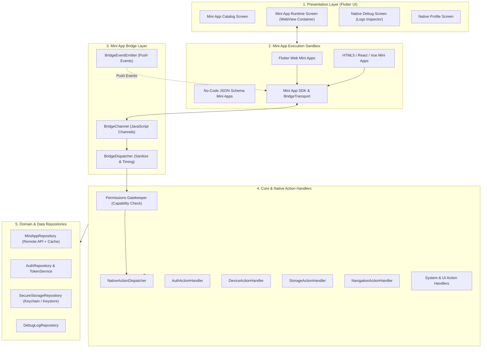

# SuperApp Mobile Platform (Flutter Master Shell)

> **Tích hợp Backend hoàn chỉnh**: Toàn bộ các chức năng cốt lõi của SuperApp đã kết nối trực tiếp với Backend NestJS + PostgreSQL thật:
> - **Đăng nhập & Đăng ký**: Màn hình đăng nhập yêu cầu nhập email, mật khẩu và ô cấu hình endpoint Backend URL động. Màn hình đăng ký tài khoản mới gọi `POST /api/v1/auth/register`.
> - **Mini App Catalog**: Tải 100% danh sách Mini App từ Backend Catalog API (`/api/v1/catalog/apps`), không còn phụ thuộc dữ liệu mock hay fallback từ assets.
> - **Bảo mật & Quyền riêng tư (Consent)**: Đồng bộ quyết định cấp/từ chối quyền người dùng với Backend (`/api/v1/users/me/apps/:appId/permissions`).
> - **Mini App PKCE Bridge**: Tích hợp luồng xin auth code và đổi token PKCE S256 cho Mini App qua Native Bridge.


Tài liệu kỹ thuật chi tiết về kiến trúc mã nguồn, bảng tính năng hỗ trợ đa nền tảng (Platform Matrix) và các thành phần cốt lõi của ứng dụng trung tâm **SuperApp Master Platform** xây dựng trên **Flutter**.

---

## 📑 Mục lục
1. [Bảng hỗ trợ nền tảng (Platform Support Matrix)](#1-bảng-hỗ-trợ-nền-tảng-platform-support-matrix)
2. [Kiến trúc mã nguồn (Code Architecture)](#2-kiến-trúc-mã-nguồn-code-architecture)
3. [Chi tiết các tính năng chính (Key Features)](#3-chi-tiết-các-tính-năng-chính-key-features)
4. [Cơ chế Bridge Protocol & Danh mục Hàm (API & Type Specs)](#4-cơ-chế-bridge-protocol--danh-mục-hàm-api--type-specs)
5. [Hệ thống Kiểm soát Quyền (Capabilities Gatekeeper)](#5-hệ-thống-kiểm-soát-quyền-capabilities-gatekeeper)
6. [Màn hình Runtime & Thanh điều hướng Capsule](#6-màn-hình-runtime--thanh-điều-hướng-capsule)
7. [Hướng dẫn cài đặt & Chạy ứng dụng](#7-hướng-dẫn-cài-đặt--chạy-ứng-dụng)

---

## 1. Bảng hỗ trợ nền tảng (Platform Support Matrix)

Ứng dụng SuperApp được thiết kế theo tiêu chuẩn đa nền tảng của Flutter, sử dụng engine `webview_all` kết hợp cùng các plugin phần cứng native:

| Nhóm tính năng / API | Android | iOS | macOS | Windows | Linux | Web | Ghi chú kỹ thuật |
| :--- | :---: | :---: | :---: | :---: | :---: | :---: | :--- |
| **Mini App WebView Runtime** | ✅ | ✅ | ✅ | ✅ | ✅ | ✅ | WebKit / WebView2 / Iframe wrapper |
| **No-Code Schema Engine** | ✅ | ✅ | ✅ | ✅ | ✅ | ✅ | Render động giao diện từ JSON Schema |
| **Hai chiều Bridge Protocol** | ✅ | ✅ | ✅ | ✅ | ✅ | ✅ | JavaScriptChannel & window.postMessage |
| **Định vị GPS (`device.getLocation`)** | ✅ | ✅ | ✅ | ✅ | ✅ | ✅ | GPS native / HTML5 Geolocation API |
| **Quét songmã QR (`device.scanQRCode`)** | ✅ | ✅ | ⚠️ | ⚠️ | ⚠️ | ✅ | Camera scan / Image file QR / Web BarcodeDetector |
| **Chọn ảnh thiết bị (`device.pickImage`)** | ✅ | ✅ | ✅ | ✅ | ✅ | ✅ | Photo Gallery / OS File Picker |
| **Bảo mật (`flutter_secure_storage`)** | ✅ | ✅ | ✅ | ✅ | ✅ | ✅ | KeyStore / Keychain / DPAPI / libsecret / Web Storage |
| **Sinh trắc học (`local_auth`)** | ✅ | ✅ | ✅ | ❌ | ❌ | ❌ | Cần phần cứng hỗ trợ và sinh trắc học đã thiết lập/được phép dùng |
| **Thông tin mạng (`connectivity_plus`)** | ✅ | ✅ | ✅ | ✅ | ✅ | ✅ | WiFi, Cellular, Ethernet, Offline detection |
| **Thông tin pin (`battery_plus`)** | ✅ | ✅ | ✅ | ✅ | ✅ | ✅ | Mức pin, trạng thái sạc |
| **Thông tin thiết bị (`device_info_plus`)** | ✅ | ✅ | ✅ | ✅ | ✅ | ✅ | Model, OS version, Device ID |
| **Độ sáng màn hình (`screen_brightness`)**| ✅ | ✅ | ⚠️ | ⚠️ | ⚠️ | ⚠️ | Điều khiển độ sáng phần cứng |
| **Chuyển giọng nói (`speech_to_text`)** | ✅ | ✅ | ⚠️ | ⚠️ | ⚠️ | ✅ | Nhận diện giọng nói tiếng Việt / tiếng Anh |
| **WeChat Capsule Navigation Bar** | ✅ | ✅ | ✅ | ✅ | ✅ | ✅ | Nút tròn điều hướng `[ ••• | ⊙ ]` |
| **Debug Logs Inspector Native** | ✅ | ✅ | ✅ | ✅ | ✅ | ✅ | Giám sát RPC logs & bắt lỗi runtime |

> **Chú thích**:
> - ✅ **Hỗ trợ đầy đủ (Full Native Support)**: Hoạt động trơn tru với API phần cứng hoặc API chuẩn của hệ điều hành.
> - ⚠️ **Hỗ trợ có điều kiện (Fallback / Partial)**: Thiết bị desktop/laptop có thể không có camera mặt sau hoặc cảm biến đặc thù, hệ thống tự động kích hoạt fallback phù hợp (chọn ảnh chứa QR, điều hướng file).

---

## 2. Kiến trúc mã nguồn (Code Architecture)

Hệ thống được tổ chức theo tiêu chuẩn **Feature-First / Clean Architecture**, quản lý trạng thái bằng **Riverpod 2.x** và định tuyến bằng **GoRouter 14.x**:



### Chi tiết cấu trúc thư mục `lib/`:

```text
lib/
├── app/
│   ├── bootstrap/               # Khởi tạo App, cấu hình Theme toàn cục
│   └── router/                  # Cấu hình GoRouter, danh sách routes (/catalog, /runtime/:appId, /debug...)
├── core/
│   ├── bridge_protocol/         # Định nghĩa cấu trúc BridgeRequest, BridgeResponse, BridgeEvent
│   ├── config/                  # AppConfig (URL API, TTL token, Allowed Origins), AppTheme tokens
│   └── errors/                  # Hệ thống lỗi chuẩn hóa: BridgeError (Mã lỗi, message, details)
└── features/
    ├── authentication/          # Quản lý phiên đăng nhập Master App, cấp mã authCode và refresh token
    ├── debug_center/            # Màn hình Native Debug Center, quản lý logs lịch sử gọi Bridge RPC
    ├── device/                  # DeviceAdapter thực hiện các tác vụ phần cứng (GPS, Camera, Image Picker)
    ├── mini_app_bridge/         # Kênh giao tiếp 2 chiều: BridgeChannel, BridgeDispatcher, BridgeEventEmitter
    ├── mini_app_catalog/        # Hiển thị Catalog Mini App, tải Manifest từ backend, cơ chế offline cache
    ├── mini_app_runtime/        # Khởi chạy WebView, thanh điều hướng WeChat Capsule, watchdog màn hình trắng
    ├── native_actions/          # Bộ phân phối NativeActionDispatcher và toàn bộ các Action Handlers
    ├── permissions/             # Kiểm tra quyền Manifest, hiển thị Dialog xin cấp quyền thiết bị
    ├── storage/                 # Kho lưu trữ an toàn cách ly theo từng Mini App (KeyStore / Keychain)
    └── user_profile/            # Thông tin người dùng, màn hình Native Profile đồng bộ với Mini App
```

---

## 3. Chi tiết các tính năng chính (Key Features)

### 3.1. Mini App Catalog & Khám phá ứng dụng
- **Dữ liệu thật từ Backend Registry**: Kết nối trực tiếp tới Backend NestJS (`/api/v1/catalog/apps`, `/api/v1/catalog/categories`, `/api/v1/catalog/apps/:id`) để tải danh sách Mini App đang hoạt động. Ứng dụng **không sử dụng mock data hay fallback từ assets**; khi Backend offline hoặc không có mạng, ứng dụng hiển thị thông báo lỗi kết nối rõ ràng kèm nút thử lại.
- **Hỗ trợ 2 kiểu Mini App**:
  1. *Web-based Mini App*: Ứng dụng HTML5/React/Vue đóng gói dạng Single-file hoặc host qua remote URL.
  2. *No-Code Schema Mini App*: Ứng dụng dựng hoàn toàn bằng tệp JSON Schema mô tả giao diện và hành vi.

### 3.2. Đăng nhập linh hoạt & Đăng ký tài khoản (Dynamic Endpoint & Auth)
- **Cấu hình Endpoint Backend**: Màn hình đăng nhập cung cấp ô nhập URL Backend động (mặc định `http://localhost:3000`), cho phép kết nối linh hoạt tới localhost, máy chủ mạng LAN hoặc cloud. URL được chuẩn hóa và lưu trữ an toàn trong SharedPreferences.
- **Đăng nhập chuẩn xác thực**: Yêu cầu nhập email và mật khẩu (gọi `POST /api/v1/auth/login`). Token nhận được là Bearer opaque token kèm refresh token, quản lý phiên an toàn.
- **Đăng ký tài khoản mới**: Cung cấp màn hình Đăng ký (`/register`), người dùng nhập họ tên, email và mật khẩu để tạo tài khoản thật trên PostgreSQL qua `POST /api/v1/auth/register`.

#### 3.2.1. Xác thực sinh trắc học

Mini App có thể kiểm tra khả dụng rồi yêu cầu xác nhận bằng vân tay / Face ID qua Native Bridge:

1. Gọi `superApp.auth.checkBiometrics()` để kiểm tra thiết bị hỗ trợ và đã thiết lập sinh trắc học.
2. Nếu `canAuthenticate === true`, gọi `superApp.auth.authenticateBiometric()`; host kiểm tra lại trước khi mở hộp thoại hệ thống.
3. Chỉ tiếp tục thao tác cần xác nhận khi `authenticated === true`. Nếu chưa thiết lập/cho phép, hướng dẫn người dùng kiểm tra Cài đặt thiết bị.

Action xác thực yêu cầu phiên SuperApp đang đăng nhập. Đây là xác nhận cục bộ trên thiết bị, không tạo hoặc làm mới token backend và không thay thế đăng nhập email/password.

### 3.3. Quản lý Quyền riêng tư & Thu hồi Consent (Backend Permissions)
- **Kiểm soát quyền 3 lớp**: Quyền hiệu lực của Mini App được xác thực qua Manifest ∩ Quyền nền tảng Registry ∩ Đồng ý của người dùng (User Consent).
- **Đồng bộ nguyên tử & Chống Race Condition**: Khi người dùng cấp hoặc thu hồi quyền, quyết định được lưu trên Backend qua `PUT /api/v1/users/me/apps/:appId/permissions`. Quá trình cập nhật được tuần tự hóa (serialize) theo `userId + appId + capability` và theo dõi phiên bản revision; nếu backend thất bại, hệ thống tự động rollback trạng thái bộ nhớ nhưng bỏ qua các rollback lỗi thời nếu có thao tác mới hơn can thiệp.
- **Trung tâm Quyền riêng tư**: Trong Profile Tab và Action Bottom Sheet, người dùng có thể xem danh sách các Mini App đã từng cấp quyền và dễ dàng bật/tắt hoặc thu hồi quyền (DELETE / PUT) trực tiếp về Backend thông qua `PermissionService`.

### 3.4. WeChat/Zalo-Style Capsule Bar & Action Bottom Sheet
- Tích hợp thanh điều khiển chuẩn hiện đại ở góc trên bên phải gồm 2 nút:
  - **Nút ba chấm (`•••`)**: Mở Action Bottom Sheet thông tin và điều khiển ứng dụng chuẩn Zalo/WeChat:
    - *Header ứng dụng*: Icon, tên Mini App, nhãn xác thực đơn vị chủ quản, và nút `(i)` xem chi tiết metadata kỹ thuật.
    - *Gửi tới (Chia sẻ nhanh)*: Danh sách liên hệ gần đây (Sầu Riêng, XU É 12, Nhóm, Xem thêm) để chia sẻ tức thì.
    - *Thanh liên kết Mini App*: Hiển thị URL chia sẻ (`https://superapp.vn/s/:id`) kèm nút sao chép vào bộ nhớ tạm.
    - *Lưới 6 tính năng điều khiển (Action Grid)*:
      1. **Mã QR**: Mở hộp thoại quét mã QR để mở Mini App trên thiết bị khác.
      2. **Tạo phím tắt**: Tạo lối tắt truy cập nhanh trên màn hình chính.
      3. **Yêu thích**: Đánh dấu / bỏ đánh dấu Mini App yêu thích (icon sao vàng).
      4. **Thu nhỏ**: Thu nhỏ Mini App và trở về màn hình chủ SuperApp mà không mất phiên.
      5. **Quản lý quyền**: Xem và bật/tắt quyền (Camera, QR, v.v.), thu hồi quyền trực tiếp với Backend.
      6. **Tải lại**: Khởi động lại và làm mới trang WebView.
  - **Nút tròn thoát (`⊙`)**: Gửi sự kiện `miniapp.close` tới Mini App và đóng runtime an toàn.
- Giao diện tràn viền (Edge-to-Edge) tự động đồng bộ màu nền theo theme của Mini App.

### 3.5. Watchdog phát hiện màn hình trắng (Blank Screen Watchdog)
- Tự động kiểm tra DOM sau 2.5 giây từ khi tải xong trang (`document.getElementById("root")`).
- Nếu phát hiện webview bị trắng (chưa mount được React hoặc lỗi script), hệ thống sẽ hiển thị một Diagnostic Alert Banner cảnh báo người dùng và gợi ý mở trình kiểm tra lỗi.

### 3.6. Kho lưu trữ an toàn độc lập (Isolated Secure Storage)
- Cung cấp cơ chế lưu trữ bảo mật dựa trên phần cứng (Hardware Keystore trên Android, Keychain trên iOS/macOS).
- Tự động tiền tố namespace theo từng `appId` và `domain` (`sec_{appId}_{domain}_{key}`), ngăn chặn tuyệt đối tình trạng rò rỉ dữ liệu chéo giữa các Mini App.

---

## 4. Cơ chế Bridge Protocol & Danh mục Hàm (API & Type Specs)

Kênh giao tiếp giữa Web Mini App và Flutter Master Shell sử dụng cơ chế truyền tin bất đồng bộ chuẩn hóa JSON Envelope:

### 4.1. Cấu trúc Gói tin Request (Web → Flutter)
```json
{
  "id": "req_1730000000_1",
  "action": "device.getLocation",
  "payload": {
    "highAccuracy": true
  },
  "appId": "sdk_playground",
  "origin": "miniapp://sdk_playground",
  "timestamp": 1730000000000
}
```

### 4.2. Cấu trúc Gói tin Response (Flutter → Web)
```json
{
  "id": "req_1730000000_1",
  "success": true,
  "data": {
    "latitude": 10.776889,
    "longitude": 106.700806,
    "city": "Hồ Chí Minh",
    "country": "Việt Nam",
    "accuracy": 5.0
  },
  "executionTimeMs": 42
}
```

### 4.3. Khi xảy ra lỗi
```json
{
  "id": "req_1730000000_1",
  "success": false,
  "error": {
    "code": "PERMISSION_DENIED",
    "message": "Người dùng đã từ chối cấp quyền truy cập vị trí GPS",
    "details": { "capability": "device.getLocation" }
  },
  "executionTimeMs": 15
}
```

### 4.4. Kiểm soát Tải & Xác thực Danh tính RPC (Concurrency, Duplicate ID & Auth Check)

Để bảo vệ tài nguyên ứng dụng và ngăn chặn rò rỉ dữ liệu hoặc vượt giới hạn:
- **Giới hạn RPC đồng thời (Concurrency Limit)**: `BridgeDispatcher` theo dõi số lượng RPC đang chạy bằng bộ đếm active calls độc lập `_activeCallCount` (tối đa theo cấu hình `maxConcurrentRequests`, mặc định 5 RPC/phiên). Nếu vượt quá ngưỡng, RPC bị từ chối ngay lập tức với mã lỗi `RATE_LIMIT_EXCEEDED`.
- **Chặn trùng lặp Request ID (Duplicate In-Flight IDs)**: Khi nhận được RPC có `id` trùng với một RPC đang thực thi trong phiên (`_inFlightRequestIds`), hệ thống từ chối ngay với mã lỗi `INVALID_PARAMS`. Request ban đầu vẫn tiếp tục thực thi bình thường mà không bị ảnh hưởng hay xóa nhầm định danh.
- **Xác thực danh tính tài khoản theo từng RPC (Auth Identity Check)**: Mỗi RPC được đối chiếu danh tính người dùng hiện hành (`currentUserIdGetter`) với `userId` được cấp phát lúc khởi tạo phiên làm việc. Nếu phát hiện thay đổi tài khoản hoặc đăng xuất, RPC bị chặn ngay lập tức với mã lỗi `AUTH_REQUIRED` và toàn bộ phiên Bridge Dispatcher bị hủy (`dispose()`).

### 4.5. Danh mục Hàm & Đặc tả Kiểu Dữ Liệu Chi Tiết (API Specifications & Type Definitions)

Mọi yêu cầu gọi từ Mini App thông qua SDK hoặc qua `window.FlutterBridge.postMessage` đều tuân theo hợp đồng dữ liệu rõ ràng. Dưới đây là định nghĩa kiểu (TypeScript Types) và định dạng dữ liệu (JSON Format) chuẩn mực cho từng hàm được SuperApp hỗ trợ:

#### 1. Nhóm Máy ảnh & Quét mã (Camera & QR Scanner)

##### `device.scanQRCode` / `media.scanQRCode` / `scanQr`
Mở màn hình Native Scanner quét mã QR hoặc mã vạch bằng camera, hỗ trợ nhận diện từ Thư viện ảnh hoặc nhập thủ công khi camera không khả dụng trên môi trường ảo.

- **Capability yêu cầu**: `device.scanQRCode`
- **SDK Method**: `superApp.scanQr(options)` hoặc `superApp.media.scanQRCode(prompt)`
- **Định dạng Tham số đầu vào (Request Payload)**:
  ```typescript
  interface ScanQrOptions {
    prompt?: string;       // Gợi ý hiển thị trên khung ngắm (mặc định: 'Quét mã QR & Mã vạch')
    formats?: string[];    // Bộ lọc định dạng: ['QR_CODE', 'EAN_13', 'CODE_128']
  }
  ```
- **Định dạng Kết quả trả về (Response Data - `response.data`)**:
  ```typescript
  interface QRCodeResult {
    content: string;       // Nội dung chuỗi giải mã từ mã QR hoặc Barcode
    format: string;        // Loại mã được nhận diện: 'QR_CODE' | 'EAN_13' | 'CODE_128'
    timestamp: number;     // Unix timestamp thời điểm quét (ms)
  }
  ```
- **Ví dụ JSON Phản hồi Thành công**:
  ```json
  {
    "id": "req_1730000001",
    "success": true,
    "data": {
      "content": "SUPERAPP-ORDER-882910",
      "format": "QR_CODE",
      "timestamp": 1730536800000
    },
    "executionTimeMs": 312
  }
  ```

---

##### `media.getPhoto` / `device.pickImage`
Chụp ảnh trực tiếp từ camera hoặc chọn 1 ảnh từ thư viện thiết bị.

- **Capability yêu cầu**: `device.pickImage`
- **SDK Method**: `superApp.getPhoto({ source })`
- **Request Payload**:
  ```typescript
  interface GetPhotoOptions {
    source?: 'camera' | 'gallery'; // Nguồn lấy ảnh (mặc định: 'camera')
  }
  ```
- **Response Data (`response.data`)**:
  ```typescript
  interface PhotoResult {
    uri: string;           // Đường dẫn tệp tin ảnh cục bộ trên máy
    mimeType: string;      // Định dạng MIME (vd: "image/jpeg", "image/png")
    width: number;         // Chiều rộng ảnh (pixels)
    height: number;        // Chiều cao ảnh (pixels)
    sizeBytes: number;     // Dung lượng tệp tin (bytes)
    fileName: string;      // Tên tệp tin
    source: string;        // 'camera' | 'gallery'
    timestamp: number;     // Unix timestamp (ms)
  }
  ```

---

##### `media.pickImages` / `media.chooseImage`
Chọn nhiều hình ảnh cùng lúc từ thư viện thiết bị.

- **Capability yêu cầu**: `device.pickImage`
- **SDK Method**: `superApp.pickImages({ maxCount })`
- **Request Payload**:
  ```typescript
  interface PickImagesOptions {
    maxCount?: number;     // Số lượng ảnh tối đa cho phép chọn (mặc định: 3, tối đa: 100)
  }
  ```
- **Response Data (`response.data`)**:
  ```typescript
  interface PickImagesResult {
    images: Array<{
      uri: string;
      mimeType: string;
      width: number;
      height: number;
      sizeBytes: number;
      fileName: string;
    }>;
    count: number;         // Tổng số lượng ảnh đã chọn thành công
  }
  ```

---

##### `media.saveImageToGallery` & `media.saveVideoToGallery`
Lưu hình ảnh hoặc video từ tệp cục bộ vào Bộ sưu tập (Gallery / Photos) của thiết bị.

- **Request Payload**:
  ```typescript
  interface SaveMediaOptions {
    uri: string;           // Đường dẫn tệp tin cục bộ cần lưu
  }
  ```
- **Response Data**:
  ```typescript
  interface SaveMediaResult {
    success: boolean;
    timestamp: number;
  }
  ```

---

#### 2. Nhóm Vị trí & Phần cứng Thiết bị (Device & Hardware)

##### `device.getLocation`
Lấy tọa độ vị trí địa lý GPS hiện tại của thiết bị.

- **Capability yêu cầu**: `device.getLocation`
- **SDK Method**: `superApp.device.getLocation({ highAccuracy })`
- **Request Payload**:
  ```typescript
  interface GetLocationOptions {
    highAccuracy?: boolean;// Chế độ GPS độ chính xác cao (mặc định: true)
  }
  ```
- **Response Data (`response.data`)**:
  ```typescript
  interface LocationResult {
    latitude: number;      // Vĩ độ (vd: 10.776889)
    longitude: number;     // Kinh độ (vd: 106.700806)
    accuracy: number;      // Sai số tính bằng mét (vd: 4.5)
    altitude: number;      // Độ cao so với mực nước biển (mét)
    heading: number;       // Hướng di chuyển (độ, từ 0 đến 359.9)
    speed: number;         // Vận tốc di chuyển tức thời (m/s)
    timestamp: number;     // Unix timestamp (ms)
  }
  ```

---

##### `device.getBatteryInfo`
Kiểm tra mức năng lượng pin còn lại và trạng thái sạc.

- **Capability yêu cầu**: Không cần
- **SDK Method**: `superApp.device.getBatteryInfo()`
- **Request Payload**: `{}`
- **Response Data (`response.data`)**:
  ```typescript
  interface BatteryInfo {
    level: number;         // Mức pin từ 0 đến 100 (%)
    status: string;        // 'charging' | 'discharging' | 'full' | 'unknown'
    temperature: number | null; // Nhiệt độ pin (°C) nếu thiết bị hỗ trợ
    isCharging: boolean;   // true nếu thiết bị đang cắm sạc
    timestamp: number;     // Unix timestamp (ms)
  }
  ```

---

##### `device.getNetworkInfo`
Kiểm tra trạng thái kết nối mạng Internet (WiFi, di động hoặc offline).

- **Capability yêu cầu**: Không cần
- **SDK Method**: `superApp.device.getNetworkInfo()`
- **Request Payload**: `{}`
- **Response Data (`response.data`)**:
  ```typescript
  interface NetworkInfo {
    isConnected: boolean;  // Thiết bị có đang kết nối mạng hay không
    networkType: string;   // 'wifi' | 'cellular' | 'ethernet' | 'none'
    isWifi: boolean;       // Đang kết nối WiFi
    isMobile: boolean;     // Đang kết nối mạng di động (3G/4G/5G)
    ssid: string | null;   // Tên mạng WiFi kết nối (nếu hệ điều hành cho phép)
    bssid: string | null;  // Địa chỉ MAC của Access Point WiFi
    ipAddress: string | null; // Địa chỉ IP nội bộ của máy (vd: "192.168.1.100")
    signalStrength: string | null;
    timestamp: number;     // Unix timestamp (ms)
  }
  ```

---

##### `device.getDeviceInfo` / `device.getSystemInfo`
Lấy thông số kỹ thuật phần cứng, kích thước màn hình hiển thị và Safe Area.

- **Capability yêu cầu**: Không cần
- **SDK Method**: `superApp.device.getDeviceInfo()`
- **Request Payload**: `{}`
- **Response Data (`response.data`)**:
  ```typescript
  interface DeviceInfo {
    platform: 'android' | 'ios' | 'macos' | 'windows' | 'linux' | 'web';
    osVersion: string | null;     // Phiên bản hệ điều hành (vd: "iOS 17.5", "Android 14")
    deviceModel: string | null;   // Tên model máy (vd: "iPhone 15 Pro", "SM-S918B")
    brand: string | null;         // Thương hiệu sản xuất (vd: "Apple", "Samsung")
    screenWidth: number | null;   // Chiều rộng màn hình theo điểm ảnh logic (dp/pt)
    screenHeight: number | null;  // Chiều cao màn hình theo điểm ảnh logic (dp/pt)
    pixelRatio: number | null;    // Mật độ điểm ảnh thiết bị (scale factor)
    statusBarHeight: number | null; // Chiều cao Status Bar đỉnh máy (px)
    safeAreaBottom: number | null;  // Chiều cao Safe Area thanh điều hướng đáy (px)
    timestamp: number;            // Unix timestamp (ms)
  }
  ```

---

##### `device.getContacts`
Đọc danh bạ liên hệ người dùng từ thiết bị.

- **Capability yêu cầu**: `device.getContacts`
- **SDK Method**: `superApp.device.getContacts({ query })`
- **Request Payload**:
  ```typescript
  interface GetContactsOptions {
    query?: string;        // Từ khóa tìm kiếm theo tên hoặc số điện thoại (tùy chọn)
  }
  ```
- **Response Data (`response.data`)**:
  ```typescript
  interface ContactInfo {
    id: string;            // ID định danh liên hệ trong danh bạ hệ thống
    displayName: string;   // Tên hiển thị đầy đủ
    phoneNumber: string | null; // Số điện thoại chính
    email: string | null;  // Địa chỉ email chính
    phoneNumbers: string[];// Mảng tất cả các số điện thoại
    emails: string[];      // Mảng tất cả các email
    department: string | null;
  }
  interface ContactsResult {
    contacts: ContactInfo[];
    total: number;         // Tổng số liên hệ khớp
  }
  ```

---

##### `device.vibrate`
Kích hoạt mô-tơ rung phản hồi xúc giác (Haptic Feedback) trên thiết bị.

- **SDK Method**: `superApp.device.vibrate(style)`
- **Request Payload**:
  ```typescript
  interface VibrateOptions {
    style?: 'light' | 'medium' | 'heavy'; // Mức độ rung (mặc định: 'light')
  }
  ```
- **Response Data**: `{ success: true, style: string }`

---

#### 3. Nhóm Lưu trữ Bảo mật Cách ly (Secure Isolated Storage)

Dữ liệu được lưu trữ mã hóa phần cứng (Android Keystore / iOS Keychain), tự động gắn namespace độc lập theo `appId` đảm bảo không bị rò rỉ chéo giữa các Mini App.

##### `storage.setItem` & `storage.getItem`
Ghi và đọc dữ liệu khóa-giá trị bảo mật.

- **SDK Method**: `superApp.storage.setItem(key, value, domain?)` & `superApp.storage.getItem(key, domain?)`
- **Request Payload `storage.setItem`**:
  ```typescript
  interface StorageSetOptions {
    key: string;           // Tên khóa lưu trữ (vd: "theme_preference")
    value: any;            // Giá trị (chuỗi hoặc JSON object)
    domain?: string;       // Phân vùng lưu trữ tùy chọn (mặc định: "default")
  }
  ```
- **Response Data `storage.setItem`**:
  ```typescript
  interface StorageSetResult {
    key: string;
    domain: string;
    appId: string;
    success: boolean;
    securityLevel: string; // 'hardware_keystore'
    updatedAt: string;     // Chuỗi thời gian chuẩn ISO 8601
  }
  ```
- **Response Data `storage.getItem`**:
  ```typescript
  interface StorageGetResult {
    key: string;
    value: string | null;  // Dữ liệu đã lưu hoặc null nếu không tồn tại
    domain: string;
    exists: boolean;       // true nếu khóa tồn tại
    securityLevel: string;
  }
  ```

---

##### `storage.removeItem` & `storage.clear`
Xóa 1 khóa hoặc dọn sạch toàn bộ dữ liệu lưu trữ của Mini App.

- **Request Payload**:
  - `storage.removeItem`: `{ key: string, domain?: string }`
  - `storage.clear`: `{ domain?: string }`
- **Response Data**:
  - `storage.removeItem`: `{ key: string, domain: string, removed: boolean }`
  - `storage.clear`: `{ cleared: boolean, count: number }`

---

##### `credentials.setCredentials` & `credentials.getCredentials`
Lưu trữ và truy xuất tài khoản & mật khẩu được bảo vệ bởi Keychain/Keystore hệ thống.

- **Request Payload `credentials.setCredentials`**:
  ```typescript
  interface SetCredentialsOptions {
    username: string;      // Tên đăng nhập
    password: string;      // Mật khẩu bảo mật
    domain?: string;       // Tên miền phân vùng (mặc định: "default")
  }
  ```
- **Response Data `credentials.getCredentials`**:
  ```typescript
  interface CredentialGetResult {
    domain: string;
    username: string | null;
    password?: string | null;
    exists: boolean;
    securityLevel: string;
  }
  ```

---

#### 4. Nhóm Giao diện & Trải nghiệm Người dùng (UI & Controls)

##### `ui.configAppView`
Tùy biến toàn diện diện mạo Mini App trên thiết bị: màu thanh tiêu đề, ẩn/hiện AppBar, đổi màu Status Bar và đệm Safe Area.

- **SDK Method**: `superApp.ui.configAppView(options)`
- **Request Payload**:
  ```typescript
  interface ConfigAppViewOptions {
    headerColor?: string;       // Mã màu nền AppBar (vd: '#0068FF' hoặc 'transparent')
    headerTitle?: string;       // Đổi tên tiêu đề hiển thị trên AppBar
    textColor?: 'white' | 'black'; // Màu chữ và nút trên AppBar
    statusBar?: 'transparent' | 'hidden' | 'light' | 'dark'; // Chế độ thanh Status Bar
    statusBarColor?: string;    // Màu nền thanh Status Bar hệ thống
    actionBarHidden?: boolean;  // true để ẩn toàn bộ thanh AppBar (chỉ giữ capsule bar)
    hasPaddingTop?: boolean;    // true để đệm tránh tai thỏ (Notch)
    hasPaddingBottom?: boolean; // true để đệm tránh thanh Home bar đáy màn hình
    bottomNavColor?: string;    // Màu sắc vùng Safe Area đáy
  }
  ```
- **Response Data**: `{ success: true }`

---

##### `ui.showToast`
Hiển thị thông báo Toast nhanh cạnh dưới màn hình.

- **Request Payload**:
  ```typescript
  interface ToastOptions {
    message: string;       // Nội dung thông báo
    duration?: number;     // Thời gian hiển thị (ms, mặc định: 2000)
  }
  ```
- **Response Data**: `{ success: true }`

---

##### `ui.showAlert` & `ui.showConfirm`
Hiển thị hộp thoại cảnh báo hoặc xác nhận thao tác dạng Native Dialog.

- **Request Payload `ui.showAlert`**:
  ```typescript
  interface AlertOptions {
    title: string;         // Tiêu đề hộp thoại
    message: string;       // Nội dung thông điệp
    buttonText?: string;   // Nhãn nút đóng (mặc định: 'Đóng')
  }
  ```
- **Request Payload `ui.showConfirm`**:
  ```typescript
  interface ConfirmOptions {
    title: string;
    message: string;
    confirmText?: string;  // Nhãn nút xác nhận (mặc định: 'Đồng ý')
    cancelText?: string;   // Nhãn nút hủy (mặc định: 'Huỷ')
  }
  ```
- **Response Data `ui.showConfirm`**:
  ```typescript
  interface ConfirmResult {
    confirmed: boolean;    // true nếu bấm Đồng ý, false nếu bấm Huỷ
  }
  ```

---

##### `ui.keepScreen`
Yêu cầu hệ thống giữ màn hình luôn sáng (Wakelock), ngăn tự động khóa máy.

- **Request Payload**: `{ keepScreenOn: boolean }`
- **Response Data**: `{ success: true, keepScreenOn: boolean }`

---

##### `ui.copyToClipboard`
Sao chép văn bản vào bộ nhớ đệm (Clipboard) hệ điều hành.

- **Request Payload**: `{ text: string }`
- **Response Data**: `{ success: true, text: string }`

---

##### `ui.minimizeApp` & `ui.closeApp`
Thu nhỏ Mini App xuống chạy ngầm hoặc thoát khỏi Mini App trở về SuperApp.

- **Response Data `ui.minimizeApp`**:
  ```typescript
  interface MinimizeResult {
    success: boolean;
    status: 'minimized';
    appId: string;
    timestamp: number;
  }
  ```

---

#### 5. Nhóm Người dùng & Xác thực (User & Authentication)

##### `user.getBasicInfo`
Lấy thông tin công khai không nhạy cảm của tài khoản đang đăng nhập SuperApp.

- **Capability yêu cầu**: `user.getBasicInfo`
- **SDK Method**: `superApp.user.getBasicInfo()`
- **Request Payload**: `{}`
- **Response Data (`response.data`)**:
  ```typescript
  interface UserBasicInfo {
    id: string;            // UUID duy nhất của tài khoản người dùng
    name: string;          // Tên hiển thị người dùng (vd: "Nguyễn Văn A")
    avatarUrl?: string;    // URL ảnh đại diện (nếu có)
  }
  ```

---

##### `user.getProfile`
Lấy thông tin tài khoản người dùng chi tiết (yêu cầu người dùng đồng ý cấp quyền bảo mật).

- **Capability yêu cầu**: `user.getProfile`
- **SDK Method**: `superApp.user.getProfile()`
- **Request Payload**: `{}`
- **Response Data (`response.data`)**:
  ```typescript
  interface UserProfile {
    id: string;            // UUID của người dùng
    name: string;          // Họ và tên đầy đủ
    email?: string;        // Địa chỉ email (đã xác thực)
    phone?: string;        // Số điện thoại đăng ký
    avatarUrl?: string;    // URL ảnh đại diện
    role?: string;         // Phân quyền ('USER' | 'ADMIN' | 'MERCHANT')
    isVerified?: boolean;  // Trạng thái tài khoản đã KYC
  }
  ```

---

##### `auth.checkBiometrics`

Kiểm tra khả dụng mà không mở hộp thoại xác thực.

- **SDK Method**: `superApp.auth.checkBiometrics()`
- **Capability yêu cầu**: Không cần
- **Yêu cầu đăng nhập**: Không
- **Request Payload**: `{}`
- **Response Data (`response.data`)**:
  ```typescript
  interface BiometricStatus {
    supported: boolean;           // Thiết bị hỗ trợ sinh trắc học
    enrolled: boolean;            // Có sinh trắc học đã thiết lập và được phép dùng
    canAuthenticate: boolean;     // supported && enrolled
    availableBiometrics: string[]; // Ví dụ: face, fingerprint, strong, weak
  }
  ```

Android, iOS và macOS được hỗ trợ khi thiết bị đáp ứng điều kiện. Web, Linux và Windows trả `supported: false`. Không phụ thuộc vào một tên loại sinh trắc học cụ thể; trạng thái khả dụng vẫn có thể thay đổi trước khi xác thực.

---

##### `auth.authenticateBiometric`

Kiểm tra lại khả dụng rồi mở hộp thoại sinh trắc học của hệ điều hành qua hàng đợi tương tác của host.

- **SDK Method**: `superApp.auth.authenticateBiometric({ reason? })`
- **Capability yêu cầu**: Không cần
- **Yêu cầu đăng nhập**: Có; thiếu phiên trả `AUTH_REQUIRED`
- **Request Payload**: `{ reason?: string }`; chuỗi không rỗng, tối đa 200 ký tự, mặc định “Xác thực sinh trắc học để tiếp tục”.
- **Response Data**: `{ authenticated: boolean }`; chỉ `true` mới là xác thực thành công.
- **Chế độ xác thực**: Chỉ sinh trắc học (`biometricOnly: true`), không chuyển sang PIN/passcode.
- **Timeout Bridge mặc định**: 5 phút.

```typescript
try {
  const status = await superApp.auth.checkBiometrics();
  if (!status.supported) {
    console.info('Thiết bị không hỗ trợ sinh trắc học.');
  } else if (!status.canAuthenticate) {
    console.info('Hãy thiết lập hoặc cho phép vân tay / Face ID trong Cài đặt thiết bị.');
  } else {
    const result = await superApp.auth.authenticateBiometric({
      reason: 'Xác thực để xem thông tin cá nhân',
    });
    if (result.authenticated === true) {
      // Tiếp tục thao tác cần xác nhận cục bộ.
    }
  }
} catch (error) {
  console.error('Xác thực chưa hoàn tất:', error);
  // Dừng thao tác cần xác nhận khi lỗi hoặc người dùng hủy.
}
```

Các mã lỗi cần xử lý: `UNSUPPORTED` (không hỗ trợ/chưa thiết lập/chưa sẵn sàng), `CANCELLED` (người dùng hoặc hệ thống hủy), `RATE_LIMIT_EXCEEDED` (đang xác thực hoặc bị khóa), `TIMEOUT`, `INVALID_PARAMS` và `INTERNAL_ERROR`.

API không trả dữ liệu vân tay/khuôn mặt; kết quả JavaScript không phải bằng chứng xác thực cho backend. Backend vẫn phải kiểm tra token và quyền truy cập. Xem [hợp đồng và xử lý lỗi chi tiết](authentication.md#xác-thực-sinh-trắc-học-trong-mini-app).

**Cấu hình native**: Android dùng `FlutterFragmentActivity`, quyền `USE_BIOMETRIC` và theme AppCompat; iOS khai báo `NSFaceIDUsageDescription`. Cần build lại ứng dụng native sau khi thêm plugin; hot reload không đủ.

**Ví dụ tương tác**: SDK Playground → **A. Authentication Flow** → **Kiểm tra sinh trắc học** và **Xác thực sinh trắc học**. Thử trên thiết bị thật các trường hợp không hỗ trợ, chưa thiết lập, thành công, hủy và bị khóa.

---

##### `auth.requestCode`
Yêu cầu sinh mã ủy quyền dùng 1 lần (Single-use Auth Code) theo chuẩn bảo mật PKCE S256 cho Mini App.

- **Capability yêu cầu**: Không cần
- **Request Payload**:
  ```typescript
  interface RequestCodeOptions {
    codeChallenge: string;       // SHA256 code challenge (base64url)
    codeChallengeMethod: 'S256';
    scopes?: string[];           // Danh sách các quyền cần ủy quyền
  }
  ```
- **Response Data (`response.data`)**:
  ```typescript
  interface AuthCodeResult {
    authCode: string;            // Mã ủy quyền dùng 1 lần (hạn 60 giây)
    expiresIn: number;           // 60 (giây)
  }
  ```

---

#### 6. Nhóm Tệp tin & Tiện ích Mở rộng (File & Utilities)

##### `file.saveFile`
Lưu tệp tin dữ liệu nhị phân hoặc Base64 vào bộ nhớ máy qua hộp thoại lưu tệp.

- **Request Payload**:
  ```typescript
  interface SaveFileOptions {
    fileName: string;      // Tên tệp tin kèm đuôi (vd: "don_hang_123.pdf")
    base64?: string;       // Chuỗi dữ liệu tệp mã hóa Base64
    path?: string;         // Hoặc đường dẫn tệp tin nguồn cục bộ
  }
  ```
- **Response Data**:
  ```typescript
  interface SaveFileResult {
    success: boolean;
    fileName: string;
    uri: string;           // Đường dẫn tệp tin sau khi lưu
  }
  ```

---

##### `file.pickFile`
Mở trình quản lý tệp tin của hệ điều hành để người dùng chọn tệp.

- **Request Payload**:
  ```typescript
  interface PickFileOptions {
    allowMultiple?: boolean; // Cho phép chọn nhiều tệp cùng lúc (mặc định: false)
  }
  ```
- **Response Data**:
  ```typescript
  interface PickFileResult {
    files: Array<{
      fileName: string;
      mimeType: string;
      sizeBytes: number;
      path: string;
    }>;
    count: number;
  }
  ```

---

##### `utility.openPhone` & `utility.openSMS`
Khởi chạy ứng dụng Gọi điện thoại hoặc Soạn tin nhắn SMS mặc định của thiết bị.

- **Request Payload `utility.openPhone`**: `{ phoneNumber: string }`
- **Request Payload `utility.openSMS`**: `{ phoneNumber: string, body?: string }`
- **Response Data**: `{ success: true }`

---

##### `utility.openExternalBrowser`
Mở đường dẫn URL bên ngoài trình duyệt mặc định hệ thống (Safari, Chrome).

- **Request Payload**: `{ url: string }`
- **Response Data**: `{ success: true, url: string }`

---

##### `utility.speechToText`
Kích hoạt microphone nhận diện giọng nói và chuyển đổi thành văn bản.

- **Capability yêu cầu**: `device.recordAudio`
- **Request Payload**: `{ language?: string }`
- **Response Data**:
  ```typescript
  interface SpeechResult {
    success: boolean;
    text: string;          // Nội dung văn bản nhận diện được từ giọng nói
  }
  ```

---

##### `utility.share`

Flutter Host dùng `share_plus` để mở bảng chia sẻ hệ thống. Mini App gọi action này khi người dùng bấm nút chia sẻ. Action cần giao diện Mini App đang hoạt động và có thể gọi mà không cần đăng nhập hoặc khai báo capability trong manifest.

```typescript
const { status } = await superApp.utility.share({
  text: 'Xin chào',
  url: 'https://flutter.dev',
});
```

Payload cần ít nhất một trong hai trường `text` và `url`. `url` phải là liên kết HTTP(S) tuyệt đối. Có thể truyền thêm `title` và `subject`. Payload sai trả `INVALID_PARAMS`. Bridge chờ tối đa 5 phút theo mặc định.

- `success` nghĩa là hệ điều hành đã ghi nhận đích chia sẻ được chọn. Việc gửi nội dung tiếp theo phụ thuộc vào ứng dụng đích.
- `dismissed` nghĩa là người dùng đóng bảng chia sẻ.
- `unavailable` nghĩa là nền tảng không trả được kết quả chia sẻ.

Chạy thử mục **Nhập liệu & Tiện ích → share** trong SDK Playground bằng SuperApp Host đã tích hợp action này. [Hướng dẫn tích hợp SDK](sdk.md#chia-sẻ-văn-bản-và-liên-kết)

---

#### 7. Nhóm Kiểm tra & Cấp Quyền Động (Runtime Permissions)

##### `permission.request` & `permission.check`
Kiểm tra hoặc chủ động yêu cầu người dùng cấp quyền truy cập tính năng (Camera, GPS, Danh bạ...).

- **SDK Method**: `superApp.permission.request(capability)` & `superApp.permission.check(capability)`
- **Request Payload**: `{ capability: string }`
- **Response Data (`response.data`)**:
  ```typescript
  interface PermissionResult {
    capability: string;    // Tên capability được kiểm tra (vd: 'device.scanQRCode')
    granted: boolean;      // true nếu người dùng cấp quyền, false nếu từ chối
  }
  ```

---

## 5. Hệ thống Kiểm soát Quyền (Capabilities Gatekeeper)

SDK `2.0.0` dùng định danh Mini App do host xác thực khi không cấu hình `appId`.
Các yêu cầu có App ID khai báo sai bị chặn trước bước hỏi quyền. Với capability
đã khai báo nhưng chưa có đồng ý của người dùng, host mở bảng cấp quyền trước
khi thực thi action; `permission.check()` chỉ kiểm tra và không mở bảng này.


Để đảm bảo an toàn cho người dùng, **SuperApp Platform** triển khai mô hình cấp phép nghiêm ngặt (Zero Trust):

1. **Manifest Declaration**: Mini App phải khai báo trước các capability cần dùng trong tệp `manifest.json` (ví dụ: `device.scanQRCode`, `device.getLocation`).
2. **Pre-flight Capability Check**: Trước khi gọi bất kỳ Action Handler nào, `NativeActionDispatcher` sẽ kiểm tra capability có nằm trong danh sách được cấp phép không. Nếu không, trả ngay mã lỗi `PERMISSION_DENIED`.
3. **Interactive User Consent**: Đối với các quyền nhạy cảm (Camera, GPS, Đọc hồ sơ cá nhân), hệ thống sẽ bật hộp thoại Native Dialog hỏi ý kiến người dùng tại thời điểm gọi đầu tiên.

---

## 6. Màn hình Runtime & Thanh điều hướng Capsule

Khi người dùng mở một Mini App từ Catalog, luồng điều hướng hoạt động như sau:

1. **Khởi tạo WebViewController**: Cấu hình chế độ JavaScript không giới hạn, màu nền trắng.
2. **Đăng ký Bridge Channel**: Inject polyfill `window.FlutterBridge` và `window.SuperAppBridge`.
3. **Nạp Bundle**: Tải URL trực tiếp từ Backend Registry server (ví dụ: `http://localhost:3000/api/v1/miniapps/:appId/:version/dist/index.html`). Toàn bộ Mini App được tự build, đóng gói và phục vụ qua Backend, không còn phụ thuộc vào local Flutter assets.
4. **Bắn sự kiện khởi động**: Khi trang hoàn tất nạp (`onPageFinished`), emit sự kiện `miniapp.ready` và `miniapp.show`.
5. **Đóng gói điều hướng**: Người dùng có thể nhấn nút `⊙` trên thanh Capsule Bar để trở về Catalog bất kỳ lúc nào.

### 6.1. Quản lý Vòng đời Phiên Runtime & Cô lập Danh tính (`MiniAppRuntimeSession`)

Mỗi lần khởi chạy Mini App, một phiên thực thi `MiniAppRuntimeSession` riêng biệt được tạo với `sessionId` (UUID v4) độc lập:
1. **Cô lập tài nguyên**: WebViewController, BridgeDispatcher, BridgeEventEmitter và toàn bộ timers tiến trình thuộc về phiên riêng. Khi chuyển app hoặc hủy phiên, phiên cũ được gọi `dispose()` (nạp `about:blank`, hủy toàn bộ timer và ngắt tiếp nhận RPC).
2. **Xử lý thay đổi trạng thái đăng nhập (`authStateProvider`)**:
   - **Đăng xuất (`logged_out`)**: Khi người dùng đăng xuất, Runtime phát sự kiện `logged_out` vào WebView, chủ động hủy phiên (`session.dispose()`), giải phóng WebViewController và đóng màn hình Mini App (`Navigator.maybePop()`), ngăn chặn triệt để nguy cơ truy cập dữ liệu (Secure Storage) của tài khoản cũ.
   - **Đổi tài khoản (`account_switched`)**: Khi phát hiện tài khoản đăng nhập khác (`prevUserId != nextUserId`), Runtime phát sự kiện `account_switched`, hủy phiên cũ và tự động khởi tạo lại phiên mới (`_startNewSession`) cô lập hoàn toàn cho tài khoản mới.

---

## 7. Hướng dẫn cài đặt & Chạy ứng dụng

### 7.1. Yêu cầu hệ thống
- **Flutter SDK**: Phiên bản 3.22.x trở lên (Dart SDK 3.x).
- **Xcode**: Phiên bản 15.0+ (nếu chạy iOS/macOS).
- **Android Studio**: Android SDK API 34+ (nếu chạy Android).

### 7.2. Lệnh khởi chạy

```bash
# 1. Tải dependencies
flutter pub get

# 2. Kiểm tra chất lượng mã nguồn
flutter analyze

# 3. Chạy ứng dụng trên thiết bị mục tiêu
flutter run -d macos      # Chạy trên macOS Desktop
flutter run -d chrome     # Chạy trên Web Browser
flutter run -d android    # Chạy trên thiết bị / Giả lập Android
flutter run -d ios        # Chạy trên thiết bị / Simulator iOS
```

SDK `2.0.0` đã gỡ API `payment`, sự kiện thanh toán và giao diện checkout của SuperApp. Các ví dụ không còn gọi API thanh toán.
