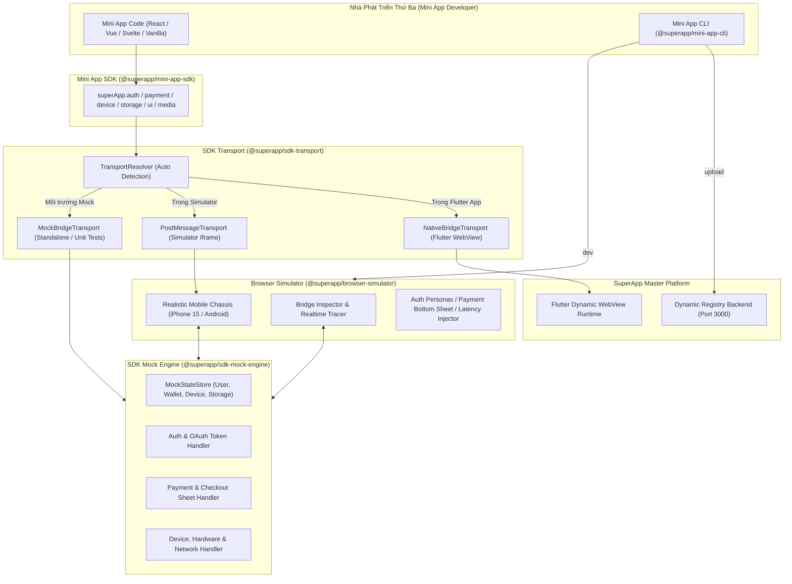

# SuperApp Mini App Developer SDK Ecosystem

Hệ sinh thái bộ công cụ SDK, Bridge Transport, Mock Engine, CLI và Browser Simulator dành riêng cho các nhà phát triển thứ ba (3rd-party developers) xây dựng, kiểm thử và xuất bản Mini App trên nền tảng SuperApp.

---

## 🏗️ 1. Kiến Trúc 5 Thành Phần (Monorepo Workspace)

Thư mục `mini_app_sdk/` được cấu trúc theo mô hình npm workspaces phân tách độc lập và chuyên trách:



| STT | Thành phần | Thư mục | Công nghệ | Vai trò & Trách nhiệm |
| :--- | :--- | :--- | :--- | :--- |
| **1** | **Mini App SDK** | `packages/sdk-core` | TypeScript | Bộ API chính thức xuất bản cho bên thứ ba (`npm install @superapp/mini-app-sdk`): `auth`, `payment`, `device`, `storage`, `ui`, `media`, `lifecycle`. |
| **2** | **SDK Transport** | `packages/sdk-transport` | TypeScript | Lớp trừu tượng hoá Bridge: chuyển đổi linh hoạt giữa Flutter WebView Native (`FlutterBridge`), PostMessage trong iframe Simulator, hoặc Mock cục bộ. |
| **3** | **SDK Mock Engine** | `packages/sdk-mock-engine` | TypeScript | Động cơ giả lập Native: sinh mã `authCode`, cấp `accessToken`, hồ sơ người dùng, quản lý số dư ví, trừ tiền thanh toán, giả lập pin, mạng, độ trễ và lưu trữ cách ly. |
| **4** | **Mini App CLI** | `packages/mini-app-cli` | Node.js + TypeScript | Công cụ dòng lệnh: `create` (tạo dự án mẫu), `dev` (khởi chạy dev server), `build` (biên dịch + checksum), `upload` (gửi lên Registry xét duyệt), `doctor`. |
| **5** | **Browser Simulator** | `packages/browser-simulator` | React 18 + Vite | Môi trường giả lập trực quan trên trình duyệt: khung iPhone 15/Android, capsule menu, thanh trạng thái, Bridge Inspector thời gian thực, modal xác nhận thanh toán. |

---

## ⚡ 2. Hướng Dẫn Vận Hành Cho Nhà Phát Triển (Quickstart)

### Bước 1: Cài đặt các gói phụ thuộc Monorepo
Từ thư mục `mini_app_sdk`:
```bash
npm install
npm run build
```

### Bước 2: Sử dụng CLI để tạo Mini App mới
```bash
# Sử dụng CLI
node ./packages/mini-app-cli/bin/miniapp.js create my_awesome_app
```
Lệnh này sẽ tự động sinh:
- `app.json`: Manifest khai báo `appId`, `name`, `version`, `permissions`, `themeColor`.
- `package.json`: Cài đặt sẵn `@superapp/mini-app-sdk`.
- `src/main.ts`: Code mẫu gọi các hàm đăng nhập, thanh toán, pin, toast.
- `index.html` & `vite.config.ts`.

### Bước 3: Chạy và kiểm thử trên Browser Simulator
```bash
# Khởi chạy Simulator (Port 5175)
npm run simulator
```
Truy cập trình duyệt tại `http://localhost:5175/?url=http://localhost:3000`.

### Bước 4: Đóng gói và xuất bản Mini App
```bash
cd my_awesome_app

# Đóng gói và kiểm tra checksum
npx miniapp build

# Tải lên SuperApp Dynamic Registry và gửi xét duyệt
npx miniapp upload --submit --notes "Phát hành phiên bản 1.0.0"
```

---

## 📖 3. Bảng Tra Cứu API Mini App SDK (`@superapp/mini-app-sdk`)

### 🔐 3.1. Xác thực & Người dùng (`superApp.auth`)
```typescript
import superApp from '@superapp/mini-app-sdk';

// Đăng nhập và xin cấp quyền profile + phone
const loginRes = await superApp.auth.login({
  scopes: ['user.profile', 'user.phone'],
});
console.log('User Name:', loginRes.user.name);
console.log('Access Token:', loginRes.accessToken);

// Lấy thông tin người dùng hiện tại
const profile = await superApp.auth.getUserProfile();

// Lấy Access Token
const token = await superApp.auth.getAccessToken();

// Đăng xuất
await superApp.auth.logout();
```

### 💳 3.2. Thanh toán SuperApp Pay (`superApp.payment`)
```typescript
try {
  const result = await superApp.payment.requestPayment({
    orderId: 'ORDER_2026_001',
    amount: 150000,
    description: 'Thanh toán Combo Cơm Trưa',
  });
  
  if (result.status === 'SUCCESS') {
    await superApp.ui.showToast('Thanh toán thành công qua Ví SuperApp!');
  }
} catch (error: any) {
  if (error.code === 'INSUFFICIENT_FUNDS') {
    await superApp.ui.showAlert({ title: 'Lỗi', message: 'Số dư ví không đủ' });
  } else if (error.code === 'USER_CANCELLED') {
    await superApp.ui.showToast('Bạn đã huỷ thanh toán');
  }
}
```

### 📱 3.3. Thiết bị & Phần cứng (`superApp.device`)
```typescript
// Mức pin và trạng thái sạc
const battery = await superApp.device.getBatteryInfo();
console.log(`Pin: ${battery.batteryLevel}%, Đang sạc: ${battery.isCharging}`);

// Trạng thái mạng
const network = await superApp.device.getNetworkInfo();
console.log(`Kết nối: ${network.networkType}, WiFi: ${network.isWifi}`);

// Rung xúc giác haptic feedback
await superApp.device.vibrate('light'); // 'light' | 'medium' | 'heavy'
```

### 💾 3.4. Lưu trữ cách ly (`superApp.storage`)
```typescript
// Ghi dữ liệu
await superApp.storage.setItem('user_cart', { items: [{ id: 1, name: 'Trà Sữa' }] });

// Đọc dữ liệu (Tự động deserialize JSON)
const cart = await superApp.storage.getItem('user_cart');

// Xoá key
await superApp.storage.removeItem('user_cart');
```

### 🔔 3.5. Giao diện & Điều hướng (`superApp.ui` / `superApp.navigation`)
```typescript
// Toast
await superApp.ui.showToast('Cập nhật thành công!');

// Alert Dialog
await superApp.ui.showAlert({ title: 'Chúc mừng', message: 'Nhận được voucher 50%' });

// Confirm Dialog
const agreed = await superApp.ui.showConfirm({
  title: 'Xoá giỏ hàng',
  message: 'Bạn có chắc chắn muốn làm trống giỏ hàng?',
});

// Đặt tiêu đề thanh điều hướng
await superApp.ui.setNavigationBarTitle('Menu Quán Cà Phê');

// Đóng Mini App về màn hình chính SuperApp
await superApp.closeApp();
```

### 🔄 3.6. Vòng đời ứng dụng (`superApp.lifecycle`)
```typescript
// Bắt sự kiện khi app ra màn hình (Foreground)
superApp.lifecycle.onAppShow(() => {
  console.log('Mini App hiển thị trở lại');
});

// Bắt sự kiện khi app bị ẩn xuống nền (Background)
superApp.lifecycle.onAppHide(() => {
  console.log('Mini App tạm dừng');
});
```
